# 吴恩达《机器学习工程师的生产实践（MLOps）Machine Learning Engineering for Production》中英字幕 - P151：22_持续交付.zh_en - GPT中英字幕课程资源 - BV1pi4y167g5

In moremon mature M Lops processes and where more than a few models need to be managed。

 it's important to implement a robust deployment process。

 This is especially true when model predictions are served online as part of a user facing application。

Let's discuss robust deployment using continuous delivery now。

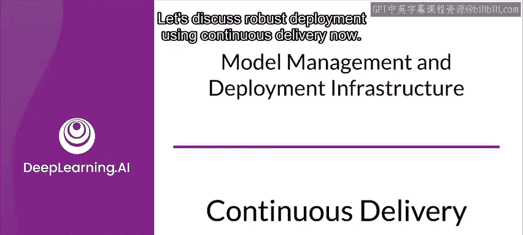

First， before deploying， you need to make sure that your code works。

 should determine which you should determine through comprehensive unit testing。

This is automated with continuous integration or CI。

C I triggers whenever new code is committed or pushed to your source code repository。

 It mainly performs building， packaging and testing for the components。

 The quality of the testing will be determined by the coverage and quality of your unit test suite。

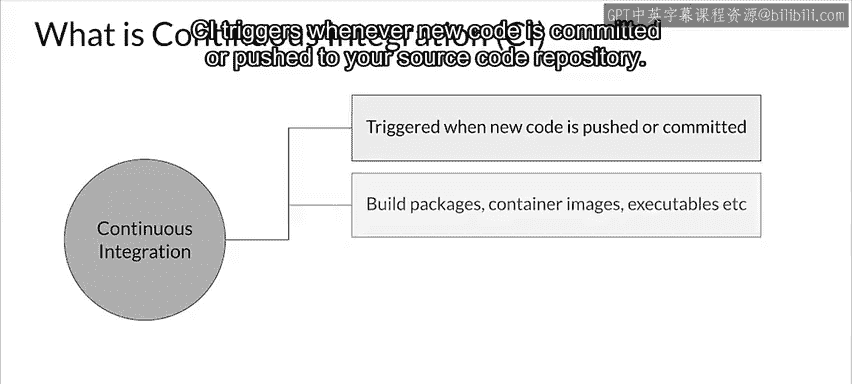

If all tests pass， it delivers the tested code and packages to a continuous delivery pipeline。

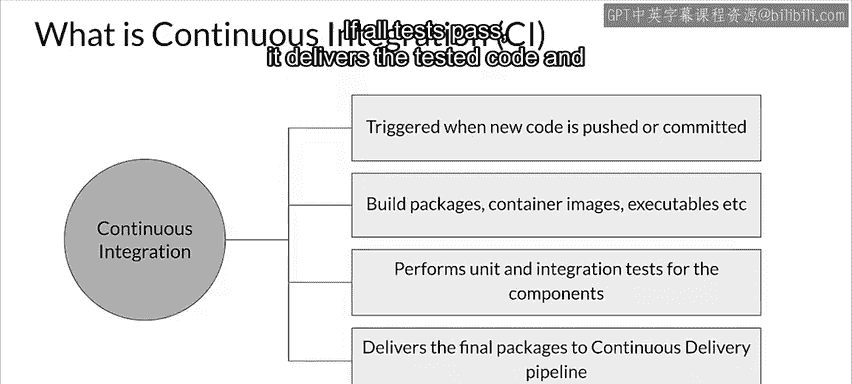

Next， continuous delivery or C deploys new code and trained models to the target environment。

 It also ensures compatibility of code and models with the target environment and for an MLL deployment。

 it should check the prediction service performance of the model to make sure that the new model can be served successfully。

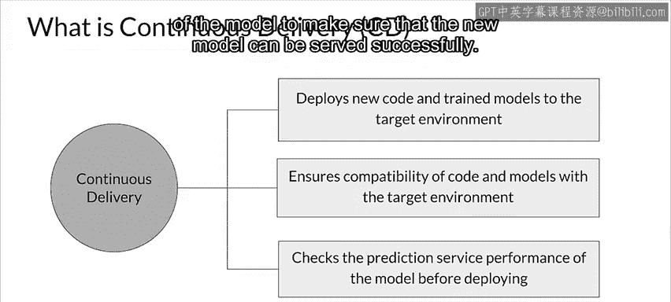

The full continuous integration， continuous delivery process and infrastructure is referred to as CICD。

 it includes two different forms of data analysis and model analysis During experimentation data analysis and model analysis are usually manual processes which are performed by data scientists。

Once a model and code have been promoted to a production training pipeline。

 data and model analysis should be performed automatically。

As part of the promotion of the code to production。

 source code is committed to a source code control and CI is initiated。

CD then deploys a production code to a production training pipeline and models are trained。

Train models are then deployed to an online serving environment or batchch Pre service。

During serving， the performance monitoring collects the performance metrics of the model from live data。

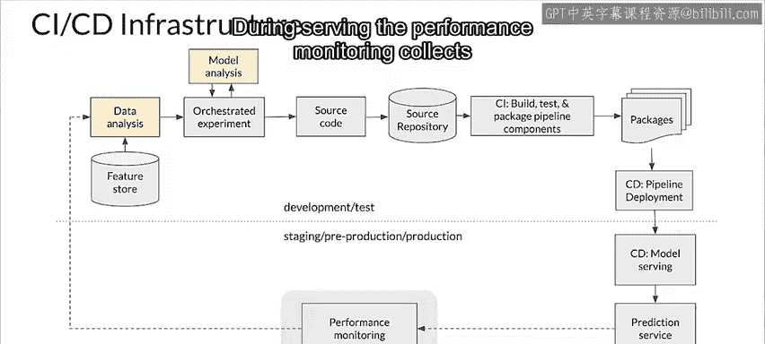

Let's look at the two main tests that are performed during continuous integration。

 unit testing and integration testing。In unit testing。

 you test each component to make sure that they're producing correct outputs in addition to unit testing or code。

 which follows the standard practice for software development。

 there are two additional types of unit tests when doing CI for machine learning。

The unit tests for our data and the unit test for our model。

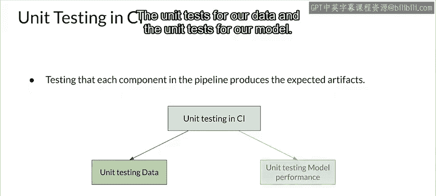

Unit testing for data is not the same as performing data validation on your raw features。

 It's primarily concerned with the results of your feature engineering。

 You can write unit tests to check if engineered features are calculated correctly。

It includes tests to check whether they are scaled or normalized correctly。

One hot vector values are correct and beddings are generated and used correctly， etc。

And you will also do tests to confirm if columns and data are the correct types in the right range。

 not empty and so forth。

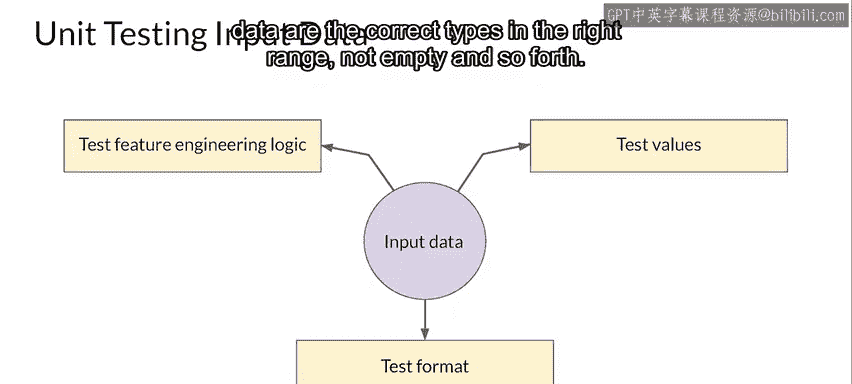

Your modeling code should also be written in a modular way which allows it to be testable。

You need to write unit tests for the functions you use inside your modeling code to check if the functions return their output in the correct shape and type。

 which for numerical features includes testing for naan or not a number。

 and for string features includes testing for empty strings and so forth。

You also need to add tests to make sure that the accuracy， error rates， AUC， ROC， et ceter。

 are above a performance baseline that you specify。

Even if the trained model as has acceptable accuracy。

 you need to test it against data slices to make sure that the model is accurate for key subsets of the data in order to avoid bias。

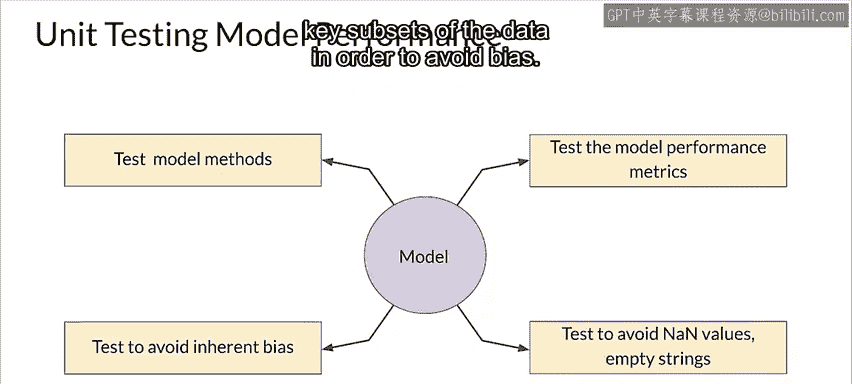

While you should perform standard unit testing of your code。

 there are some additional considerations for ML。These include the design of your mos。

 which is especially important for ML unit testing。

They should be designed to cover your edge and corner cases。

 which requires you to think about each of your features and your domain and identify where those edge and corner cases are。

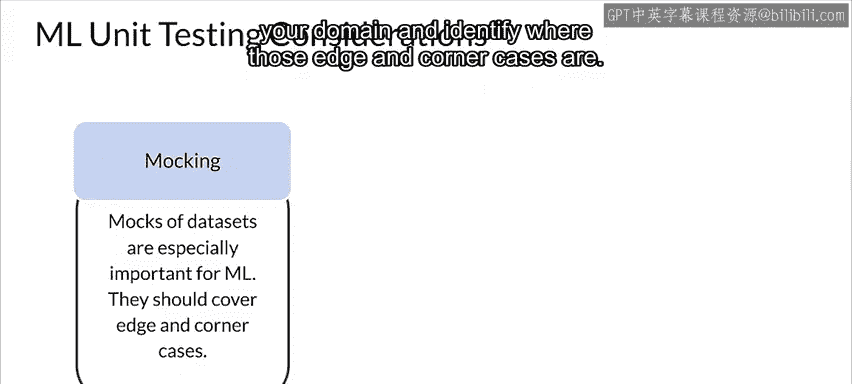

Ideally， your mo should occupy roughly the same region of your feature space as your actual data of wood。

But much more sparsely， of course， since your mock dataset set should be much smaller than your actual dataset set in most cases。

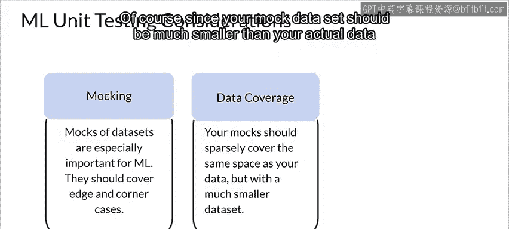

If you've created good mocks and good tests， you should have good code coverage， but just to be sure。

 take advantage of one of the available libraries to test and track your code coverage。

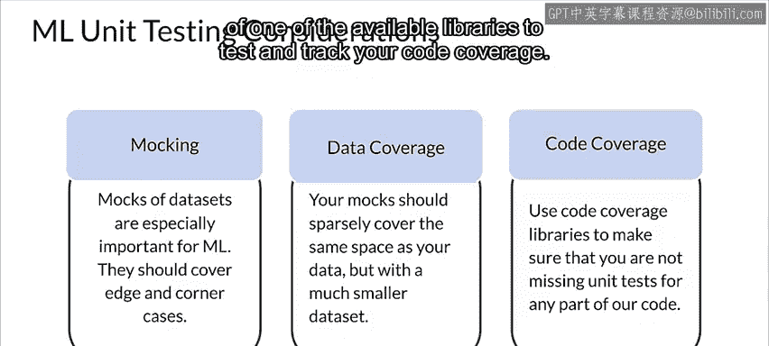

Infrastructure validation acts as an early warning layer before pushing a model into production to avoid issues with models that might not run or might perform badly when actually serving requests in production。

 It focuses on the compatibility between the model server binary and the model which is about to be deployed。

It's a good idea to include infrastructure validation in your training pipeline so that as you train models you can avoid problems early。

 you can also run it as part of your CICD workflow。

 which is especially important if you didn't run it during model training。

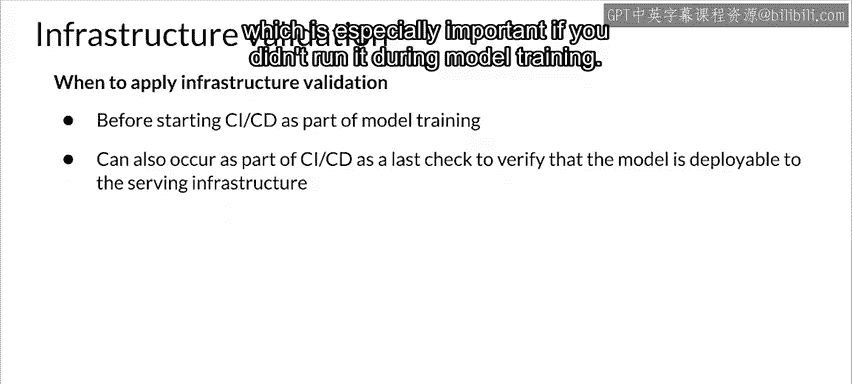

Let's take a look at an example of running infrastructure validation as part of a training pipeline。

In a TFX pipeline， the infrra validator component takes the model。

 launches a sandbox model server with the model， and sees if it can successfully be loaded and optionallyqueried。

If the model behaves as expected， then it is referred to as blessedles and considered ready to be deployed。

Infrra valididator focuses on the compatibility between the model server binary， for example。

 Tensorflow serving and the model to deploy， despite the name Infrra validator。

 it is the user's responsibility to configure the environment correctly。

 An infrra validator only interacts with the model server in the user configured environment to see if it works as expected。

Configuring this environment correctly will ensure that your infr validation passing or failing will be indicative of whether the model would beservable in the production serving environment。

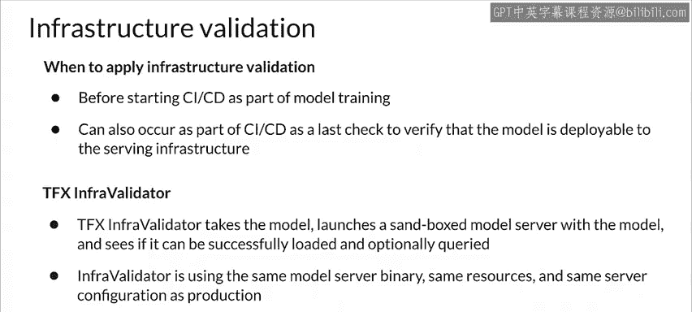