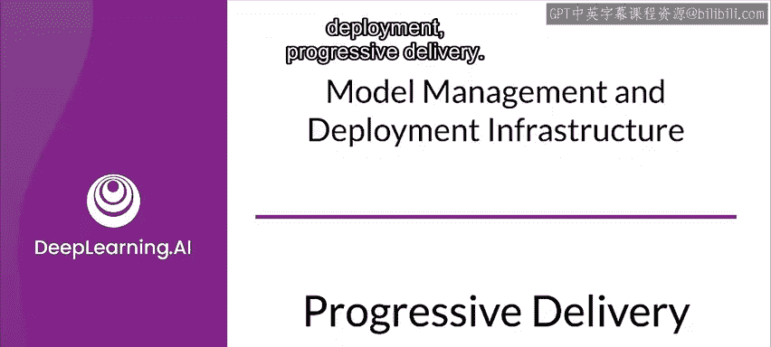
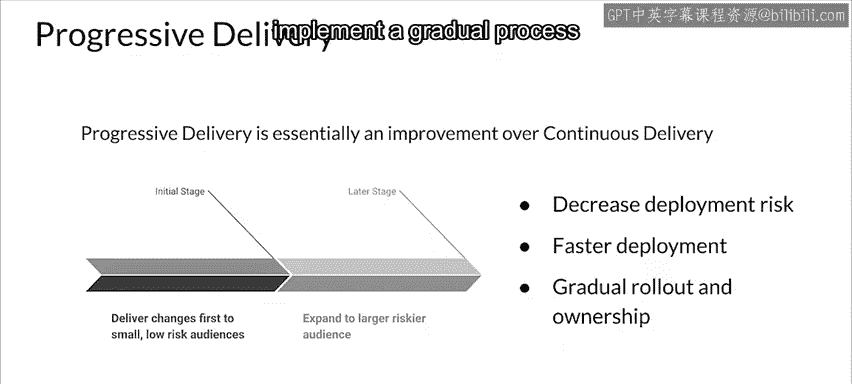
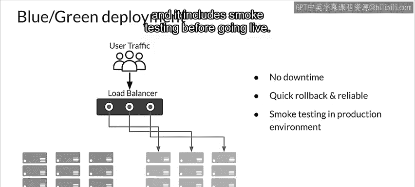
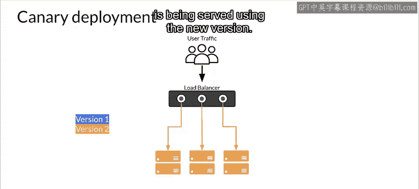
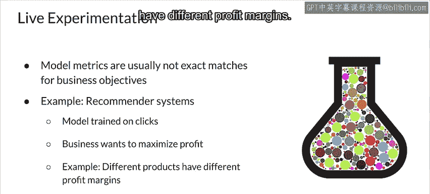
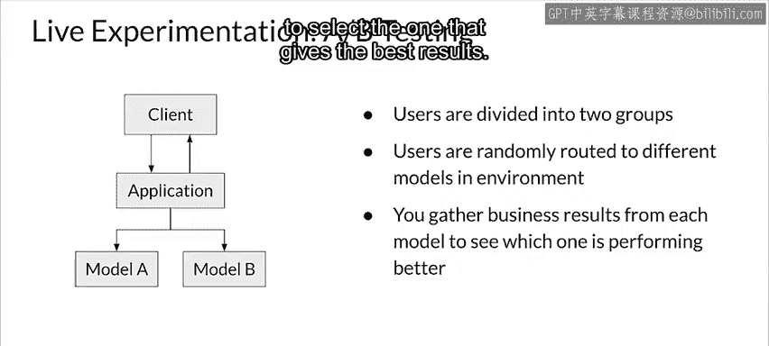
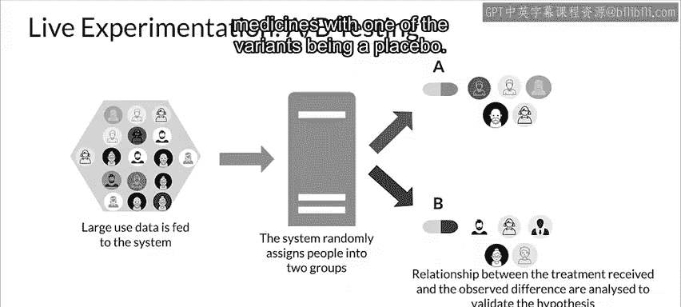
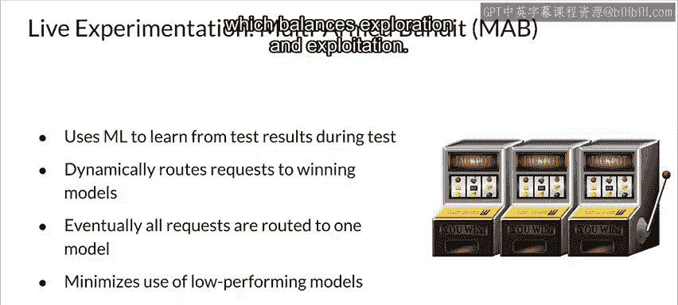
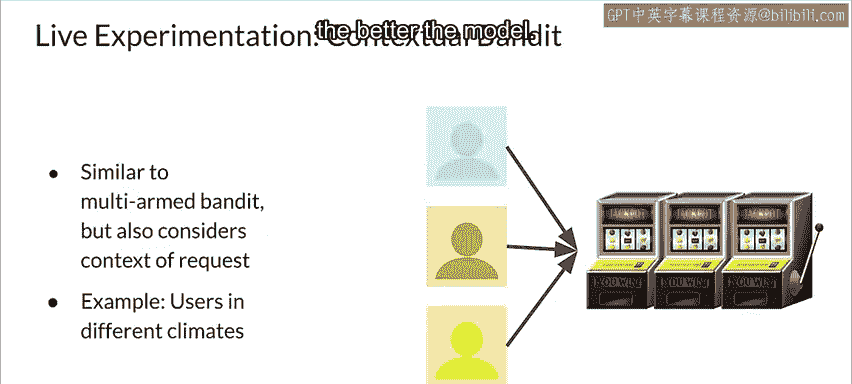

# 吴恩达《机器学习工程师的生产实践（MLOps）Machine Learning Engineering for Production》中英字幕 - P152：23_渐进式交付.zh_en - GPT中英字幕课程资源 - BV1pi4y167g5

Now let's take the next step and look at an even more advanced style of deployment。

 progressive delivery。

Progressive delivery is a software development process that is built upon the core tenets of continuous integration and continuous delivery。

 but is essentially an improvement over CICD。It includes many modern software development processes。

 including Canary deployments， AB testing， bandits， and observability。

It focuses on gradually rolling out new features in order to limit potential negative impact and gauge user response to new product features。

The process involves delivering changes first to small。

 low risk audiences and then expanding to larger and risker riskier audiences。

 thereby validating the results。 The benefits of progressive delivery include while it offers controls and safeguards like feature flags to increase speed and decrease deployment risk。

 This can often lead to faster deployments and implement a gradual process for both roll out and ownership。

Progressive delivery usually involves having multiple versions deployed at the same time so that comparisons in performance can be made。

 This practice comes from software engineering， especially for online services。

 Each of the models performs the same tasks so that they can be compared。

That includes deploying competing models as in AB testing。Which I'll discuss shortly。

And deploying to shadow environments to limit the deployment risk， as in canary testing。

 which I'll also be discussing soon。A simple form of progressive delivery is blue green deployment。

 where there are two production serving environments requests flow through a load balancer which directs traffic to the currently live environment。

 which is called blue。Meanwhile， a new version is deployed to the green environment。

 which acts as a staging setup where a series of tests are conducted to ensure performance and functionality。

After passing the tests， traffic is directed to the green deployment。 If there are any problems。

 traffic can be moved back to blue。 This means that there is no down time during deployment。

 Roback is easy， and there is a high degree of reliability。

 and it includes smoke testing before going live。

A canary deployment is similar to a blue green deployment。

 but instead of switching the entire incoming traffic from blue to green all at once。

Traffic is switched gradually。As traffic begins to use the new version。

 the performance of the new version is monitored。 If necessary。

 the deployment can be stopped and reversed with no downtime and minimal exposure of users to the new version。

😊，Eventually， all of the traffic is being served using the new version。

Progressive deployment is closely related to live experimentation。

Live experimentation is used to test models to measure the actual business results delivered or data as closely associated with business results as you can actually measure。

This is necessary because model metrics， which you use to optimize your models during training。

 are usually not exact matches for business objectives。 For example， consider recommender systems。

You train your model to maximize the click through rate， which is how your data is labeled。

But what the business actually wants to do is maximize profit。

This is closely related to click through， but it's not an exact match since some clicks will result in more profit than others。

 For example， different products have different profit margins。

One simple form of live experimentation is A B testing。In A B testing。

 you have at least two different models or perhaps1 different models。

 and you compare the business results between them to select the model that gives the best business performance。

 You do that by dividing users into two or N groups and you route users to a randomly selected model。

 Notice that it's important here that the user continues to use the same model for their entire session if they make multiple requests。

You then gather the results from each model to select the one that gives the best results。

This is actually a widely used tool in many areas of science， not just machine learning。

AB testing is the process of comparing two variations of the same system。

 usually by testing the response to variant A versus variant B。

 and concluding which of the two variants is more effective。

Often AB testing is used for testing medicines， with one of the variants being a placebo。

An even more advanced approach is multi armed bandits。

 The multi armed bandit approach is similar to A B testing， but uses M。

 L to test or to learn rather from test results， which are gathered during the test。

As it learns which models are performing better， it dynamically routes more and more requests to the winning models。

What this means is that eventually all of the requests will be routed to a single model。

Or a smaller group of similarly performing models。One of the major benefits of that is that it minimizes the use of low performing models by not waiting for the end of the test to select the winner。

The multiar bandit approach is a reinforcement learning architecture。

Which balances exploration and exploitation。

An even more advanced approach is contextual bandit。

The contextual bandit algorithm is an extension of the multiar bandit approach where you also factor in the customer's environment or other context of the request when choosing a bandit。

The context affects how a reward is associated with each bandit。 So as contexts change。

 the model should learn to adapt its bandit choice。For example。

 consider recommending clothing choices to people in different climates。

A customer in a hot climate will have a very different context than a customer in a cold climate。

 Not only do you want to find the maximum reward， you also want to reduce the reward loss when you're exploring different bandits。

When judging the performance of a model， the metric that measures the reward loss is called regret。

Which is the difference between the cumulative reward from the optimal policy and the model's cumulative sum of rewards over time。

The lower the regret， the better the model and contextual bandits helps with minimizing regret。

Well， it's been quite a week， hasn't it， I especially like the discussion of progressive delivery。

 which I find fascinating。😊，And of course， having a good understanding of developing pipeline components is really important。

I hope you enjoyed it too， and until next time， keep learning。

