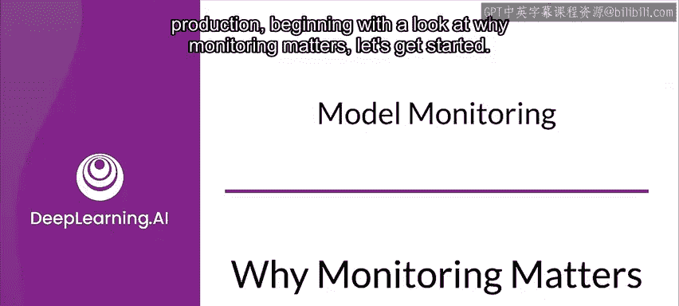
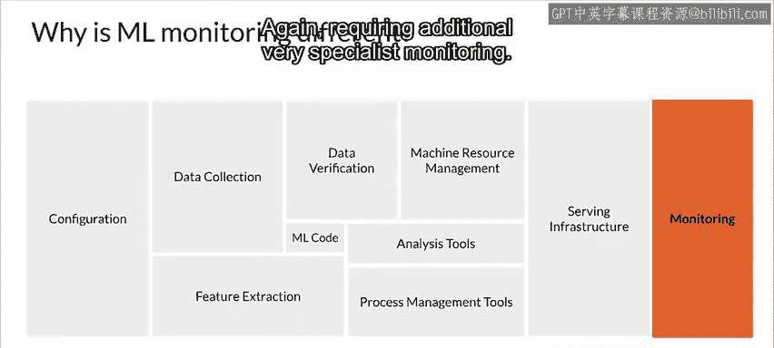

# 吴恩达《机器学习工程师的生产实践（MLOps）Machine Learning Engineering for Production》中英字幕 - P153：24_为何监控很重要.zh_en - GPT中英字幕课程资源 - BV1pi4y167g5

Welcome back。This week we have a lot of great stuff to explore。

 really focusing this week on some topics that are at the intersection of machine learning and DevOs。

After all， MLOs is a big part of what we're covering in this course。

 and things like this become very important to actual implementation of ML ops for production ML。

 especially in a business environment。We'll start with a discussion of model monitoring。

 including observability， logging and tracing， detecting model decay and mitigating model decay。

Then we'll dive into responsible AI and discuss some advanced topics， including legal requirements。

 anonymization and pseudodonmization， GDPR， and the right to be forgotten。There's a lot to cover。

 so let's get started。Welcome back， this week starts with a discussion of monitoring your models in production。

Beginning with a look at why monitoring matters， let's get started。

By now， you're familiar with this process， which starts with building your models。

 but doesn't end with deployment。The last task， monitoring your model in production is an ongoing task for as long as your model is in production。

The data that you gather by monitoring will guide the building of the next version of your model and make you aware of changes in your model performance。

So as you can see here， this is a cyclical iterative process。

 which requires the last step monitoring in order to be complete。

 You should note here that this diagram is only looking at monitoring which is directly related to your model performance。

 but you will also need to include monitoring of the systems and infrastructure。

 which are included in your entire product or service such as databases and web servers。

That kind of monitoring is only concerned with the basic operation of your product or service and not the model itself。

 but is critical to your users's experience。 Basically， if the system is down。

 it really doesn't matter how good your model is。Benjamin Franklin once wrote an ounce of prevention is worth a pound of cure。

 or in metric terms， maybe a gram of prevention is worth a kilo of cure。In 1733。

 he visited Boston and was impressed with the fire prevention measures that the city had established。

 So when he returned home to Philadelphia， he tried to get his city to adopt similar measures。

Franklin was talking about preventing actual fires， but in our case。

 you might apply the same idea to preventing fire drills。

 the kind of fire drills where your system is performing badly。

 and it's suddenly an emergency to fix it。It's these kinds of fire drills that can happen if you don't monitor your model performance。

If your training data is too old， even when you first deploy a new model。

 it can have immediate data skekus。Without monitoring right from the start。

 you may easily be unaware of the problem and your model will not be accurate even when it's new。

Of course， as previously discussed， models will also become stale or inaccurate because the world constantly changes and the training data you originally collected might no longer reflect the current state。

 Again， without monitoring， you are unlikely to be aware of the problem。

You can also have negative feedback loops This turns out to be a more complex issue that arises when you automatically train your models on data collected in production。

If this data is biased or corrupted in any way， then the models trained on that data will perform poorly。

Modtoring is important even for automated processes， because they， too， can have problems。

ML monitoring or functional monitoring deals with keeping an eye on model predictive performance and changes in serving data。

These include the metrics， the model optimized during training。

 and the distributions and characteristics of each feature in the serving data。

System monitoring or non functional monitoring refers to monitoring the performance of the entire production system。

 the system status and the reliability of the serving system。This includes queries per second。

Failures， latencies， resource utilization， etcter。You may ask yourself。

 why is ML monitoring different than software monitoring？Unlike a pure software system。

 there are two additional components to consider in an ML system， the data and the model。

Unlike in traditional software systems， the accuracy of an M L system depends on how well the model reflects the world it is meant to model。

 which in turn depends on the data used for training and on the data they receives while serving requests。

It's not simply a matter of monitoring for system failures like seg faults and out of memory or network issues。

The model and the data require additional， very specialized monitoring as well。

Code and config also take on additional complexity and sensitivity in an ML system due to two aspects。

 entanglement and configuration。Entanglement。And no， I'm not referring here to quantum entanglement。

Refers to the issue where changing anything changes everything。

Here you need to be careful with feature engineering and feature selection and understand your model sensitivity。

Configuration can also be an issue because model hyperparameter。

 versions and features are often controlled in a system config。

 and the slightest error here can cause radically different model behavior that won't be picked up with traditional software tests again。

 requiring additional， very specialized monitoring。

