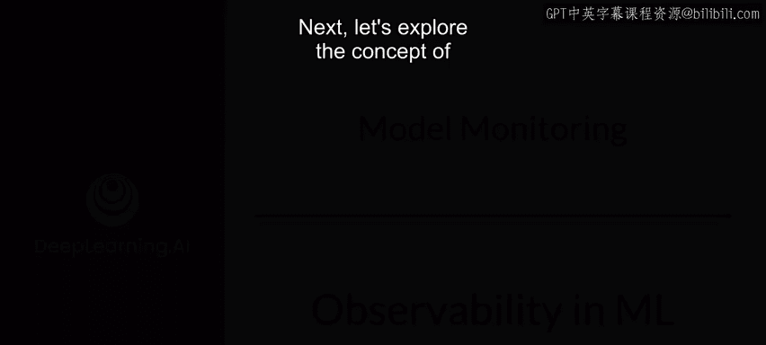
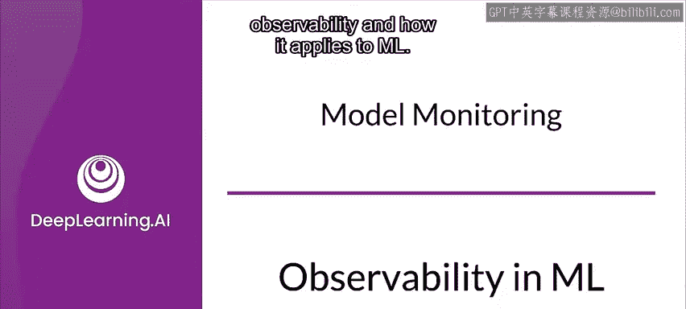
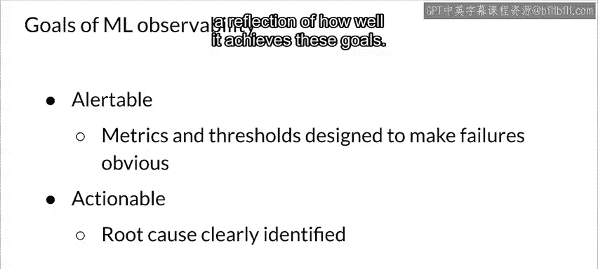

# 吴恩达《机器学习工程师的生产实践（MLOps）Machine Learning Engineering for Production》中英字幕 - P154：25_机器学习中的可观测性.zh_en - GPT中英字幕课程资源 - BV1pi4y167g5

Next， let's explore the concept of observability and how it applies to MO。

First， what is observability？Observability measures how well you can infer the internal states of a system by just knowing the inputs and outputs for M。

 this means monitoring and analyzing the prediction requests and the generated predictions from your models。

Observability isn't a new concept。It actually comes from control system theory。

 where it has been well established for decades。In control system theory。

 observability and controllability are closely linked。

You can only control a system to the extent that you can observe it。

Looking at an M L based product or service， this maps to the idea that controlling the accuracy of the results overall。

 usually across different versions of the model requires observability。

 This also adds to the importance of model interpretability。In M L systems。

 observability becomes a more complex problem， since you need to consider multiple interacting systems and services。

 such as cloud deployments， containerized infrastructure， distributed systems and microservices。

 This generally means that there are a substantial number of systems。

 which you need to monitor and aggregate。 This often means relying on vendor monitoring systems to collect and sometimes aggregate data。

 because the observability of each instance can be limited。For example。

 monitoring CPU utilization across an auto scaling containerized application is much different than simply monitoring CPU usage on a single server。

Observability is about making measurements。 And just like when you are analyzing your model performance during training。

 measuring top level metrics is not enough and will provide an incomplete picture。

You need to slice your data to understand how your model performs for various data subsets。

For example， in an autonomous vehicle， you need to understand performance in both rainy and sunny conditions and measure them separately。

More generally speaking， data slices provide a useful way to analyze different groups of people or different types of conditions。

This means that domain knowledge is important in observing and monitoring your systems in production。

 just like it is when you're trading your models in general。

 it's your domain knowledge that will guide how you slice your data。

The TFX framework and TensorFlow model analysis are very powerful tools and include functionality for doing observability analysis on multiple slices of data for your deployed models。

This is true for both supervised and unsupervised monitoring of your models。 In a supervised setting。

 the true labels are available to measure the accuracy of your predictions。In contrast。

 in an unsupervised setting， you'll monitor for things like the means， medians。

 ranges and standard deviations of each feature。In both supervised and unsupervised settings。

 you need to slice your data to understand how your system behaves for different subsets。

Going back to the autonomous vehicle example， slicing by weather condition is important to avoid things like making poor driving decisions in the rain。

 The main goal of observability in the context of monitoring is to prevent or act upon system failures for this。

 the observations need to provide alerts when a failure happens and ideally provide recommended actions to bring the system back to normal behavior。

More specifically， alertability refers to designing metrics and thresholds that make it very clear when a failure happens。

 This may include defining rules to link more than one measurement to identify a failure。

Knowing that your system is failing is a good start。

But an actionable recommendation based on the nature of the failure is way more helpful to correct this behavior。

Actionable alerts clearly define the root cause of the system's failure。At a bare minimum。

 your system should gather sufficient information to enable root cause analysis。

Both alertability and actionability are goals， and the effectiveness of your system is a reflection of how well it achieves these goals。

