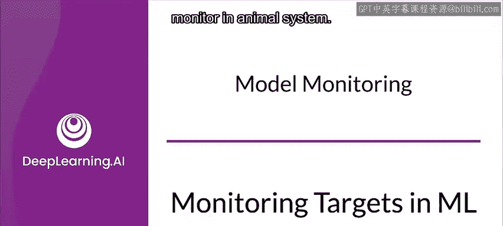
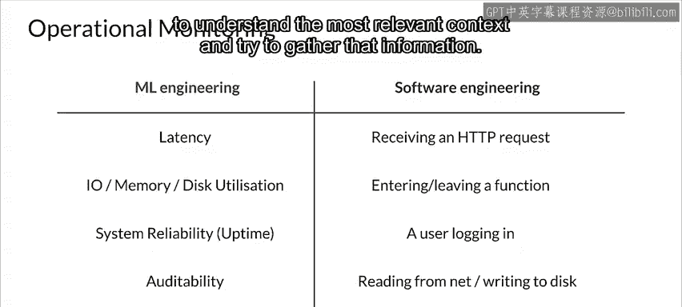

# 吴恩达《机器学习工程师的生产实践（MLOps）Machine Learning Engineering for Production》中英字幕 - P155：26_机器学习中的监控目标.zh_en - GPT中英字幕课程资源 - BV1pi4y167g5

Let's look now at the kind of things that you can actually observe and monitor in an MLl system。

Starting with the basics， you can monitor the inputs and outputs of your system。

The inputs in a deployed system are the prediction requests， each of which is a feature vector。

 you can use statistical measures of each feature， including their distributions。

 and look for changes that may be associated with failures。 Again。

 this should not be just top level measurements， but measurements of slices that are relevant to your domain。

The outputs are the model's predictions， which you can also monitor and measure。

This should include an understanding of the deployment of different model versions to help you understand how different versions perform。

You should also consider performing a correlation analysis to understand how changes in your inputs affect your model outputs。

 and again， this should be done on slices of your data。For example。

 correlation analysis can help you detect how seemingly harmless changes in your inputs cause prediction failures。

The prediction requests， whether you're doing real time or batch predictions。

 form a large part of the observable data that you have for a deployment。

For each feature you should monitor for errors such as values falling outside in a allowed range or a set of categories。

 where these error conditions are often defined based on domain knowledge。

You should also monitor how each feature distribution changes over time and compare those to the training data。

Monitoring for errors and changes is better done with slice data so that you can better understand and identify potential system failures。

Statistical testing and comparisons are the basic tools that you can use to analyze your data。

 Typical descriptive statistics include median means， standard deviation and range values。

For monitoring model predictions， you can also use statistical testing and sometimes in scenarios such as predicting click through where labels are available。

You can also do comparisons between known labels and model predictions。In this figure。

 you can see that if the variables are normally distributed。

 then you would expect the mean values to be within the standard error of the mean interval。

It's also important to consider that if you have altered the distributions of the training data to correct for things like class imbalance or fairness issues。

 then you need to take that into account when comparing to the distributions of the input data that gathered through that is gathered through the monitoring prediction request。

Monitoring in the realm of software engineering is far more well established。

So the operational concerns around our ML system may include monitoring system performance in terms of measures like latency or IO in memory or diskutilization or system reliability in terms of uptime。

 and monitoring can even happen while taking auditability into account。In software engineering。

 talking about monitoring is strictly speaking， talking about events。

 Even can be almost anything ranging from receiving an ACTP request。

 entering or leaving a function which may or may not contain M L code or not。A user logging in。

Reading from network or writing to the disk and so on。

All of these events listed here have some context。 having all of the context for all of the events would be great for debugging and understanding how your systems perform in both technical and business terms。

But collecting all the context information is often not practical。

 as the amount of data to process and store could be very large。

 So it's important to understand the most relevant context and try to gather that information。

