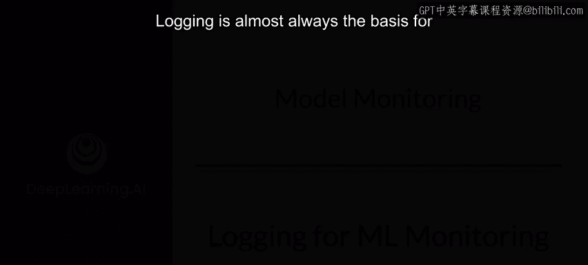
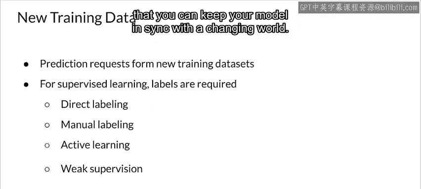

# 吴恩达《机器学习工程师的生产实践（MLOps）Machine Learning Engineering for Production》中英字幕 - P156：27_机器学习监控的日志记录.zh_en - GPT中英字幕课程资源 - BV1pi4y167g5

Logging is almost always the basis for collecting the data that you will use to monitor your models and systems。

 A log is an immutable times stampamped record of discrete events that happened over time for your M。

 L system。 along with additional information。 Let's take a deeper look at logging。

To avoid making the same mistake twice， it's important to learn from history。For M L systems。

 the same logic applies。 This is where locking becomes really handy and more so when building observability。

 Let's explore how to do that。You could start with the out of the box logs and metrics。

 These will usually give you some basic overall monitoring capabilities， which you can then add to。

For example， in Google's compute engine platform， if you need additional application logs。

 you can install agents to collect those logs。 Cloud monitoring collects metrics from all of the cloud services by default。

 which you can then use to build dashboards。When you need additional application or business level metrics。

 you can use those custom metrics to monitor over time。

Then using aggregate sinks and workspaces allows you to centralize your logs from many different sources or services in order to create a unified view of your application。

To clarify exactly what I mean， a log is an immutable timested record of discrete events that happened over time。

This also includes debugging or profiling messages that are printed to the log from your application。

 as well as automatically generated warning errors and debug messages。

 depending on the vervasity settings for your logging。

Cloud providers also offer managed services for logging of cloud based distributed services。

These include Google Cloud monitoring， Amazon CloudWch， and Azure Monitor。

 as well as several managed offerings from third parties。

Log messages are very easy to generate since it is just a string， a blob of J。

 or typed key value pairs。Event logs provide valuable insight， along with context。

 providing detail that averages and percentiles don't surface。 However。

 it's not always easy to provide the right level of context without obscuring the really valuable information in too much extraneous detail。

While metrics show the trends of a service or an application， logs focus on specific events。

This includes both log messages printed from your application as well as warnings， errors。

 or debug messages， which are generated automatically。

The information in logs can be used to investigate incidents and to help with root cause analysis。

But logging isn't perfect。For example， excessive logging can negatively impact system performance。

As a result of these performance concerns， aggregation operations on logs can be expensive。

 and for this reason， alerts based on logs should be treated with caution。On the processing side。

 raw logs are almost always normalized， filtered， and processed by a tool like log staash or fluent D orscribe or Hka before they are persisted in a data store like Elasticse or BigQury。

Setting up and maintaining this tooling carries with it a significant operational cost。

 One of the key advantages of managed services is that they remove this cost。

Much of the discussion so far has centered around how you could use metrics to monitor your input data and predictions in an MLL system。

 This is usually the basic way to collect data to monitor an application。

Some of the red flags to watch out for may include basic things like a feature becoming unavailable。

 especially when you're including historical data in your prediction requests。

 which needs to be retrieved from a data store。In other cases。

 notable shifts in the distribution of key input values are important。 For example。

 a categorical value that was relatively rare in the training data becomes more common。

Patterns specific to your model， for example， in an NLP scenario。

 a sudden rise in the number of words not seen in the training data that can also be another sign of a potential change which can lead to problems。

How you store your log data can have a significant impact on how easily it can be queried for analysis。

At this point， you should consider parsing out and storing your input and prediction data。

 along with any labels that you're able to gather in a queryable data store。

 such as a database or a search engine based tool like Elasticse。

 This enables analysis for things like generating the distributions and statistics of your features。

 which can be tracked and compared over time。😊，By associating each item with a timestamp。

 you can also order the data， which is important for identifying trends and seasonality。In addition。

 by identifying the systems involved， you can help with root cause analysis of system failures。

Having this data in a queryable data store also enables offline automated reporting。

 dashboards and alerting。Log data is of course also the basis for your next training data set。

At the very least， collecting prediction requests should provide the feature vectors that are representative of the current state of the world that your application lives in。

 So this data is very valuable。 Let's consider labeling issues and labeling techniques， for a moment。

If you're lucky in your domain， you'll be able to use direct labeling。 For example。

 for recommender systems， you can usually capture the user behavior after a recommendation is made to determine if the right options were recommended。

In other cases， you will need to use manual labeling， which can be slow and expensive。

 but is also sometimes the only viable option。Using techniques like active learning can help reduce the cost by only selecting the most important examples to label。

 and that includes shaping your data set for issues like class imbalance and fairness。 And finally。

 weak supervision is a powerful technique with significant advantages。 But also some challenges。

What's most important here is that you capture this valuable data so that you can keep your model in sync with a changing world。

