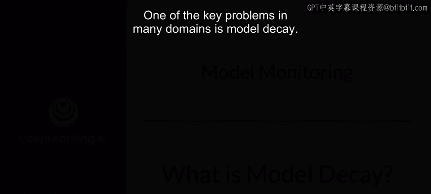
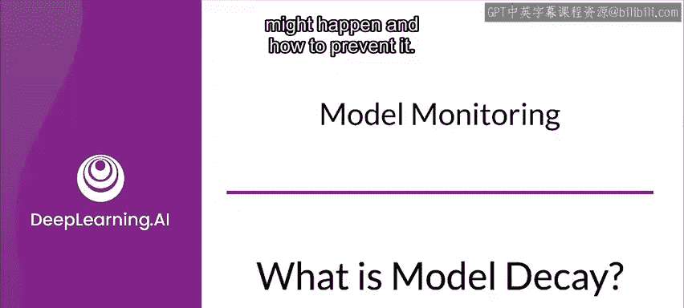
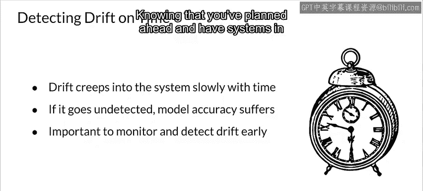

# 吴恩达《机器学习工程师的生产实践（MLOps）Machine Learning Engineering for Production》中英字幕 - P158：29_什么是模型衰减.zh_en - GPT中英字幕课程资源 - BV1pi4y167g5

One of the key problems in many domains is model decay。

 Let's explore this briefly now to get a better understanding of why this might happen and how to prevent it。

Production ML models often operate in dynamic environments over time dynamic environments change。

 that's what makes them dynamic。Think of a recommender system， for example。

 that is trying to recommend which music to listen to music changes constantly with new music becoming popular and taste changing。

If the model is static and continues to recommend music that is gone out of style。

 then the quality of the recommendations will decline。

The model is moving away from the current ground truth。

 it doesn't understand the current styles because it hasn't been trained for them。

So there are two main causes of model drift。Data drift and concept drift。

 Let's talk about each of them。Data drift occurs when statistical properties of the inputs。

 the features changes。As the input changes， the prediction requests。

 the input moves farther and farther away from the data that the model was trained with and model accuracy suffers。

Changes like these often occur in demographic features like ageIDS， which may change over time。

The graph on the right shows how there is an increase in mean and variance for the age。

 This is data drift。Concept drift occurs when the relationship between the features and the labels changes。

 when a model is trained， it learns a relationship between the inputs and ground truth or labels。

If the relationship between the inputs and the labels changes over time。

 it means that the very meaning of what you are trying to predict changes， the world has changed。

 but our model doesn't know it。For example， take a look at the graph on the right side。

 You can see that the distribution of the features for the two classes。

 the blue and red dots changes over time intervals T1， T 2 and T 3。

If your model is still predicting for T1 when the world has moved to T3。

 many of its predictions will be incorrect， I should also mention here that there are related forms of drift known as prediction drift or drift solely in your model's predictions and label drift。

 but I won't be discussing them in detail in this course。If you don't plan ahead for drift。

 it can slowly creep into your system over time。 How fast your system drifts depends on the nature of the domain that you're working in。

 Some domains like markets can change within hours or even minutes。 Others change more slowly。

If drift， either data drift or concept drift or both is not detected。

 then your model accuracy will suffer and you won't be aware of it。

This can lead to emergency retraining of your model， which is something to avoid。

So monitoring and planning ahead are important knowing that you've planned ahead and have systems in place just might make it easier for you to sleep at night。

