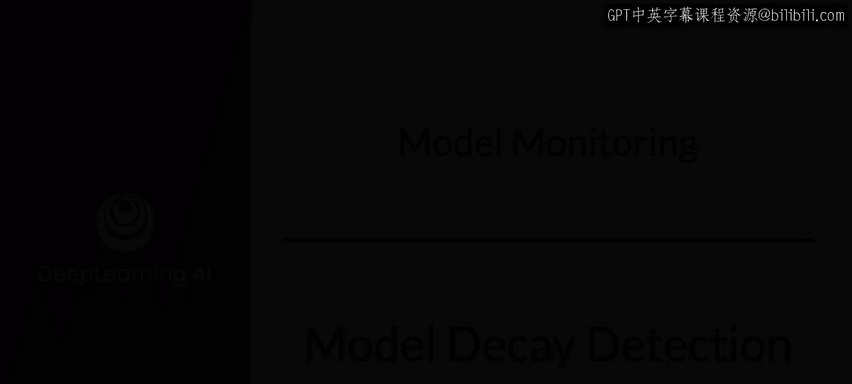
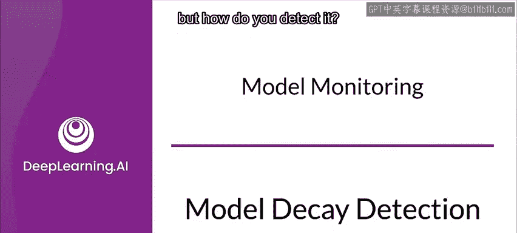
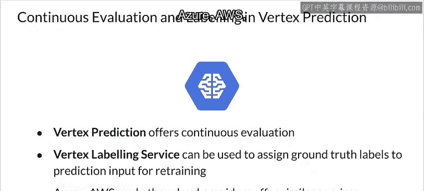
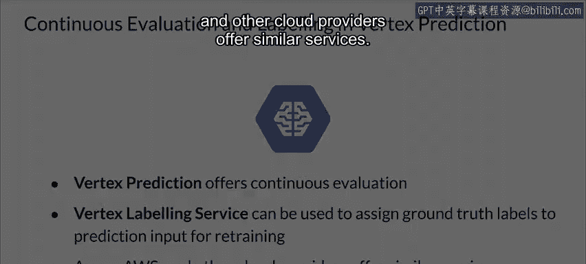

# 吴恩达《机器学习工程师的生产实践（MLOps）Machine Learning Engineering for Production》中英字幕 - P159：30_检测模型衰减.zh_en - GPT中英字幕课程资源 - BV1pi4y167g5

Okay， so far you've seen that model decay is a problem， but how do you detect it， Well。

 I'm glad you asked， let's talk about that now。

Detecting Dr， whether it's data drift or concept drift or both， starts with collecting current data。

You should collect all of the data in the incoming prediction request to your model along with the predictions that your model makes。

 if it's possible in your application， also collect the correct label or ground truth that your model should have predicted。

This is also extremely valuable for retraining your model。But at a minimum。

 you should capture the prediction request data， which you can use to detect data drift using unsupervised statistical methods。

The process is really straightforward。Once you're set up to continuously monitor and log your data。

 you employ tools which use well known statistical methods to compare your current data with your previous training data。

You also use dashboards to monitor for trends and seasonality over time essentially you'll be working with time series data since you have an ordered data that is associated with a time component。

And you don't have to reinvent the wheel here， there are good tools and libraries available to help you do this kind of analysis these include TensorFlow data validation or TFTV and the PK a multiflow library。

Cloud providers， including Google， offer managed services such as Google's vertex prediction that help you perform continuous evaluation of your prediction requests。

 continuous evaluation regularly samples prediction input and output from trained machine learning models that you've deployed to vertex prediction。

Vertex's data labeling service then assigns human reviewers to provide ground truth labels to your prediction input。

 or alternatively you can provide your own ground truth labels。

The data labeling service compares your model's predictions with the ground truth labels to provide continual feedback on how well your model is performing over time。

Azure， AWS and other cloud providers offer similar services。

