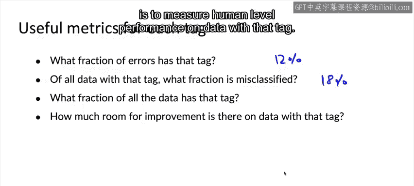

# 吴恩达《机器学习工程师的生产实践（MLOps）Machine Learning Engineering for Production》中英字幕 - P15：14_错误分析示例.zh_en - GPT中英字幕课程资源 - BV1pi4y167g5

The first time you train a learning algorithm。You can almost guarantee that it won't work。

 not the first time out。So I think of the heart of the machine learning development process as error analysis。

 which if you do it well， can tell you what's the most efficient use of your time in terms of what you should do to improve your learning algorithm's performance。

😊，Let's start with an example， Let me walk through an error analysis example using speech recognition when I'm carrying out error analysis。

 this is pretty much what I would do myself in a spreadsheet to get a handle on what are the errors of the speech system you might listen to maybe a hundred mislabeled examples from your depth set from a development set so let's say the first example was labeled with the ground truth label stir fried letters recipe but you're learning Ar's prediction was stir fed letters recipe if you have a couple of hypotheses for what are the major types of data in your data set。

 maybe you think some of the data has car noise some of the data has people noise then you can build a spreadsheet and I literally do this in a spreadsheet with a couple columns like this and when you listen to this example if this example has car noise in the back。

You can then make a check mark or other annotation in your spreadsheet to indicate that this example had car noise。

Then you listen to the second example， maybe sweetened coffee caught mis transscribe as Swedish coffee。

 and maybe this example had people noise in the background。

And maybe one example with sailaway songng was mistranstririve's Seaway songng and this again had people noise and less's catch up was transdri as lesss catchch up and maybe this example had both calm noise and people noise。

Note that these tags up on top don't have to be mutually exclusive during this process of error analysis as you listen to audio clips。

 you may come up with ideas for additional tags let's say this fourth example had a very low bandwidth connection and reflecting on the errors you're spotting。

 you remember maybe quite a few of the audio clips have a low bandwidth connection at this point you may decide to add a new column to your spreadsheet with one more tag that says low bandwidth and check that and maybe go back to see if some of the other examples also have a low bandwidth connection So even though I went through this example using a slides when I'm doing error analysis myself sometimes I'll literally fire up a spreadsheet program like Google Sheets or Excel or on a Mac the numbers program and do it like this in the spreadsheet this process helps you understand whether the。

As denoted by tags that may be the source of more of the errors and thus may be worthy of further effort and attention。

Until now， error analysis has typically been done via a manual process。

 say in a Jupyter notebook or tracking errors in the spreadsheet。

I still sometimes do it that way and if that's how you're doing it too that's fine。

 but there are also emerging MOs tools that making this process easier for developers for example。

 when my team landing AI works on computer vision applications， the whole team now uses landing lens。

 which makes this much easier than the spreadsheet。

You've heard me say that training a model is an iterative process。

 deploying a model is an iterative process， maybe it should come as no surprise that error analysis is also an iterative process where what a typical process would be is you might examine and tag some set of examples with an initial set of tags such as con noise and people noise and based on examining this initial set of examples。

 you may come back and say you want to propose some new tags with the new tags you can then go back。

To examine and tag even more examples， let me step through a few other examples of what such tags could be Take visual inspection you the problem of finding defects in smartphones some of the tags could be specific class labels such as does this going have a scratch or does evident dent and so on so it's fine if some of these tags are associated with specific class labels Y or some of the tags could be image properties is this picture of the phone blurry is that it gains a doubt background or light background is there are unwanted reflection in this picture the tags could also come from other forms of metadata。

What is the film model， what is the factory， which is the manufacturing line that captured the specific image and the goal of this type of process where you come up with tags。

 label more data， come over tags is to try to come up with a few categories where you could productively improve the algorithm。

s as in our earliest speech example， deciding to work on speech with car noises in the background。

 let me step through just one more example， product recommendations for an online ecommerce site you might look at what products a system is recommending to users and find the clearly incorrect or irrelevant recommendations。

And try to figure out if there are specific user demographics。

 such as are we really bad at recommending products to younger women or to older men alter something else。

 or are there specific product features or specific product categories where the recommendations are particularly poor and by itatively brainstorming and applying such tags you can hopefully come up with a few ideas for categories of data that are worth trying to improve your album's performance on as you go through these different tags Here are some useful numbers to look at First。

 what fraction of errors have that tag For example。

 if you listen to 100 audio clips and find that 12% of them。Were labeled with the。Car noise tag。

 then that gives you a sense of how important is it to work on car noise It tells you also that even if you fix all of the car noise issues。

 the performance may improve only by 12%。Which is actually not that or you can ask of all the data with that tag。

 what fraction is misclassified？So far we've only talked about tagging the mislabeled examples for time efficiency。

 you might focus your attention on tagging the mislabel， the misclassified examples。

 but if there's a taggged you can apply to both correctly labeled and to mislabeled examples。

 then you can ask of all the data of that tag what fraction is misclassified so for example。

 if you find that if all the data with con noiseise。18% of it is mistranstri。

 then that tells you that the performance on data with this type of tag has only a certain level of accuracy and tells you how hard。

These examples with car noise really are you might also ask what fraction of all the data has that tag This tells you how importance relative to your entire data are examples with that tag。

 so what fraction of your entire data has car noise and then lastly how much room for improvement is there on data with that tag。

And one example that you've already seen for how to do this analysis is to measure human level performance on data with that tag。

So by brainstorming different tags you can segment your data into different categories and then use questions like these to try to decide what to prioritize working on let's dive more deeply into an example of doing this in the next video。

