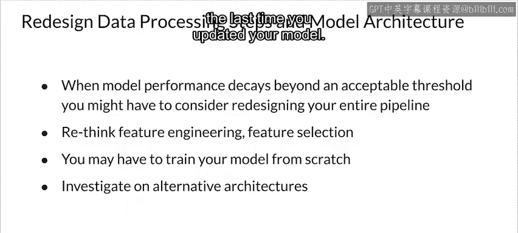

# 吴恩达《机器学习工程师的生产实践（MLOps）Machine Learning Engineering for Production》中英字幕 - P160：31_缓解模型衰减的方法.zh_en - GPT中英字幕课程资源 - BV1pi4y167g5

Okay， so now you've detected drift， which has led to model decay， so what can you do about it？

Well， let's discuss that now。First， the basics。 When you detect model decay。

 you need to let others know about it。 That means informing your operational and business stakeholders about the situation。

 along with some idea about how severe you think the drift has become。

And then you'll work on bringing the model back to acceptable performance。

 which is what I'll discuss now。Okay， so now that you've detected driftt， what can you do about it？

Well， first， try to determine which data in your previous training data is still valid by using unsupervised methods such as clustering or statistical methods that look at divergence。

 many options exist， including Kobec Liebbller or KL divergence。

 Jensen Shannon or JS divergence or the Komogaro Smmyrnov or KS test， this step is optional。

 but especially when you don't have a lot of new data。

 it can be important to try to keep as much of your old data as possible。

Another option is to simply discard that part of your training data set that was collected before a certain date and add your new data。

Or if you have enough newly labeled data， then you can just create an entirely new data set。

The choice between these options will probably be dictated by the realities of your application and your ability to collect new labeled data。

So now that you have a new training data set。You've basically two choices for how to train your model。

 fine tuning or starting over。You can either continue training your model。

 fine tuning it from the last checkpoint using your new data。

 or start over by reinitializing your model and completely retraining it。Either approach is valid。

 and the choice between these two options will largely be dictated by the amount of new data that you have and how far the world has drifted since the last time you trained your model。

Ideally， if you have enough new data， you should try both approaches and compare the results。

It's usually a good idea to establish policies around when you're going to retrain your model。

There's really no right or wrong answer here， so it will depend on what works in your particular situation。

You could simply choose to retrain your model whenever it seems to be necessary。

 That includes situations where you've detected drift。

But it also includes situations where you may need to add or remove class labels or features。

 for example。You could also always retrain your model according to a schedule。

 whether it needs it or not。In practice， this is what many people do because it's simple to understand and in many domains it works fairly well。

It can， however， incur higher training and data gathering costs than necessary。

 or alternatively it can allow for greater model decay than might be ideal。

 depending on whether your schedule has your model training too often or not often enough。

And finally， you might be limited by the availability of new training data。

This is especially true in circumstances where labeling is slow and expensive As a result。

 you may be forced to try to retain as much of your old training data as possible for as long as possible and avoid fully retraining your model。

If you can automate the process of detecting the conditions which require model retraining。

 that's ideal。That includes being able to detect model performance degradation and triggering retraining。

Or when you detect significant data drift。In both cases， in order to automate retraining。

 you should have data gathered and labeled automatically using a separate process and only retrain when sufficient data is available。

Ideally， you also have continuous training， integration and deployment set up as well to make the process fully automated for some domains where change is fast and frequent retraining is required。

 these automated processes become requirements instead of luxuries。

When your model decays beyond an acceptable threshold or when the meaning of the variable you are trying to predict deviates significantly。

Or you need to make changes like adding or removing features or class labels。

 you might have to redesign your data preproces steps and model architecture。

I like to think of this as an opportunity to make improvements。

You may have to rethink your feature engineering， feature selection。

 and so forth in order to make your model work with current data。

And retrain your model from scratch rather than applying fine tuning。

You might have to investigate other potential model architectures。

 which personally I find is a lot of fun。The point here is that no model lives forever。

 and periodically you need to go back to the drawing board and start over。

 applying what you've learned since the last time you updated your model。

