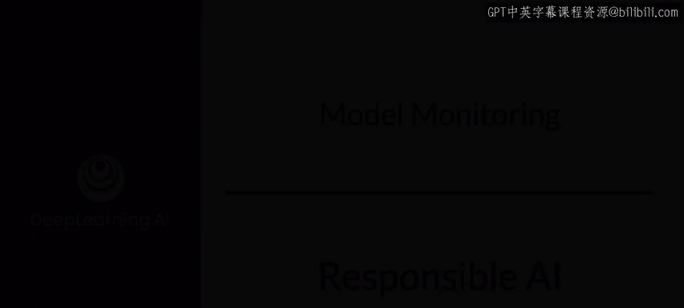
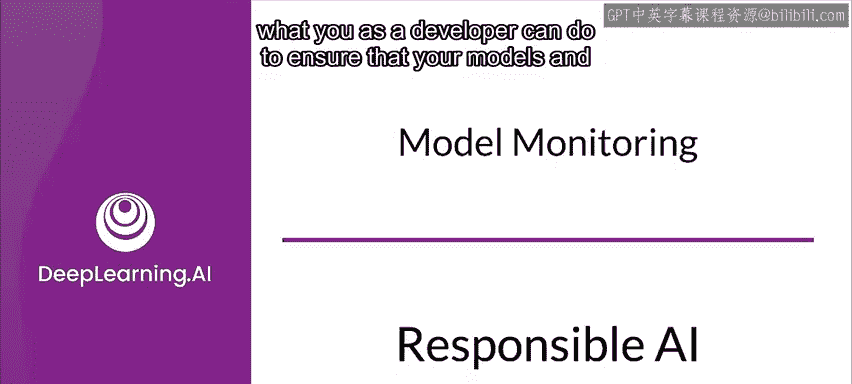
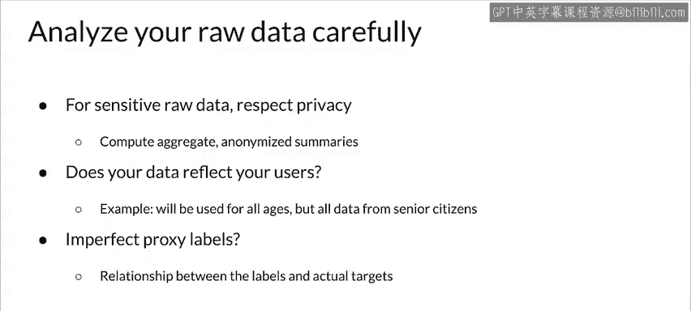

# 吴恩达《机器学习工程师的生产实践（MLOps）Machine Learning Engineering for Production》中英字幕 - P161：32_负责任的AI.zh_en - GPT中英字幕课程资源 - BV1pi4y167g5

Now let's look into some of the emerging issues concerning responsible AI and what you as a developer can do to ensure that your models and applications are as responsible as possible。

The development of AI is creating new opportunities to improve the lives of people around the world。

 from business to healthcare to education and beyond， but at the same time。

 it's also raising new questions about the best way to build fairness， interpretability。

 privacy and security into these systems。These questions are far from solved and are extremely active areas of research and development。

I encourage you to commit to following the development of this field and working to make sure that your models and applications are as responsible as you can make them。

 They will never be perfect， but there is already a lot that you can do with more tools and techniques being developed constantly。

The way actual users experience or system is essential to assessing the true impact of its predictions。

 recommendations and decisions。 For example， you should design your features with appropriate disclosures built in。

 clarityity and control is crucial to a good user experience。

Often it's also a good idea to consider augmentation and assistance。

Producing a single answer can be appropriate where there is a high probability that the answer satisfies a diversity of users and use cases。

 but in other cases， it may be better for your system to suggest a few options to the user。In fact。

 it can even be easier since it's often much more difficult to achieve good precision at one answer。

 top one versus precision at a few answers， maybe top three。

Try to plan for modeling potential adverse feedback early in the design process。

 followed by specific live testing and iteration for a small fraction of traffic before full deployment。

And finally， engage with a diverse set of users and different use case scenarios and incorporate that feedback both before and throughout your project development。

This will build a rich variety of user perspectives into the project and increase the number of people who benefit from the technology and help you catch potential issues early。

A fairly simple technique is to use several metrics rather than a single one。

 which can help you understand trade offs between different kinds of errors and experiences。

 Consider metrics， including feedback from user surveys。

 quantities that track overall system performance and short and long term product health。For example。

Click through rate and customer lifetime value respectively。

 and false positive and false negative rates sliced across different subgroups。 Of course。

 the metrics that you select are important。 you should try to ensure that your metrics are appropriate for the context and goals of your system。

 For example， a fire alarm system should have high recall。

 even if that means the occasional false alarm。Of course， as always， it all comes back to the data。

MO models will reflect the data that they're trained on。

 so analyze your raw data carefully to ensure you understand it。In cases where this is not possible。

For example， with sensitive raw data。Understand your input data as much as possible while respecting privacy。

For example， by computing aggregate anonymized summaries。

Consider whether your data was sampled in a way that represents your users for example。

 if your application will be used by people of all ages。

 but you only have training data from senior citizens。

 it might not work that well for other age groups。Imagine doing music recommendations when all of your data is from senior citizens。

My guess is that it might not perform that well for tweens。

Sometimes you're using your model to predict a proxy label for the actual target that you're interested in because labeling for the actual target is difficult or impossible。

In these cases， consider the relationship between the data labels that you have and the actual thing that you're trying to predict。

Are there problematic gaps， for example， if you're using data label X as a proxy to predict target y。

 in which cases is the gap between x and y problematic？

