# 吴恩达《机器学习工程师的生产实践（MLOps）Machine Learning Engineering for Production》中英字幕 - P162：33_安全私密AI的法律要求.zh_en - GPT中英字幕课程资源 - BV1pi4y167g5

So a legal side to practicingract responsible AI。 There are already legal requirements in some countries and regions。

 and this trend is growing。 Expposure to civil liability is another concern。

 Let's explore some of the issues now。

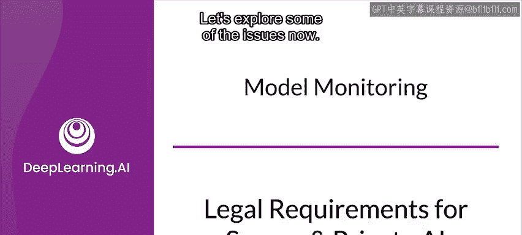

Training data， prediction requests， or both can contain very sensitive information about people。

For prediction requests， those people are your users。

 privacycy of sensitive data should be protected。 This includes not only respecting the legal and regulatory requirements。

 but also considering social norms and typical individual expectations。

 What safeguards do you need to put in place to ensure the privacy of individuals。

 considering that M models may remember or reveal aspects of the data that they've been exposed to。

What steps are needed to ensure users have adequate transparency and control of their data？

It's not just up to you to decide what is required。In Europe， for example。

 you need to comply with the general data protection regulations or GDPR， and in California。

 you need to comply with the California Consumer Privacy Act or CCPA。

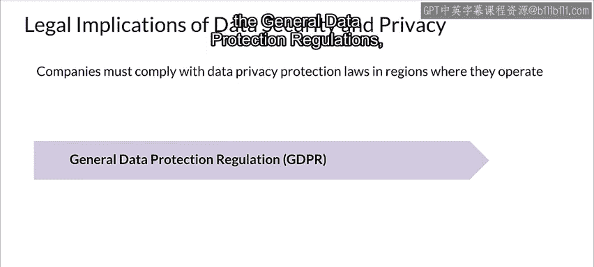

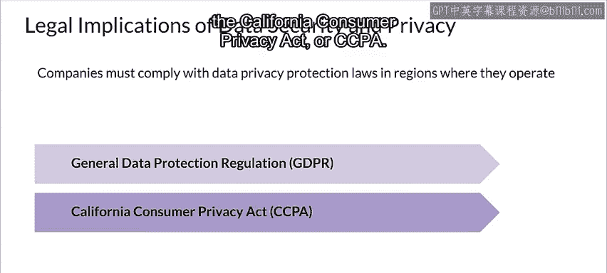

The general data protection regulation or GDPPR was enacted by the E U in 2016 and became a model for many national laws outside the E U。

 including Chile。Japan， Brazil， South Korea， Argentina， and Kenya。

It regulates the data protection and privacy in the European Union and the European economic area。

The GDPR gives individuals control over their personal data and requires that companies should protect the data of employees and consumers。

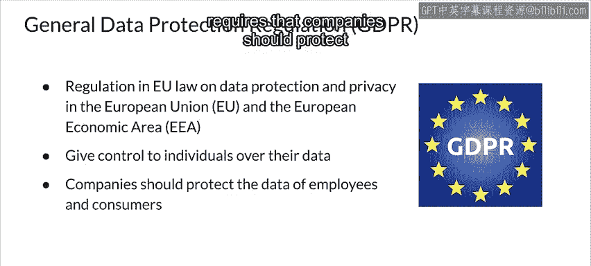

When data processing is based on consent， the data subject， usually an individual person。

 has the right to revoke their consent at any time。

The California Consumer Privacy Act or CCPA was modeled after the GDPR and has similar goals。

 including enhancing the privacy rights and consumer protections for residents of California。

 It states that users have the right to know what personal data is being collected about them。

 including whether the personal data is sold or disclosed in some way。

 who supplied their data and who received their data。

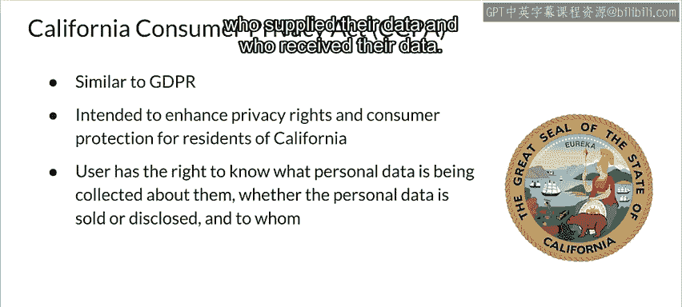

Users can access the personal data which a company has for them， block the sale of their data。

 and request a business to delete their data。Security and privacy are closely linked for some problems or harms in machine learning。

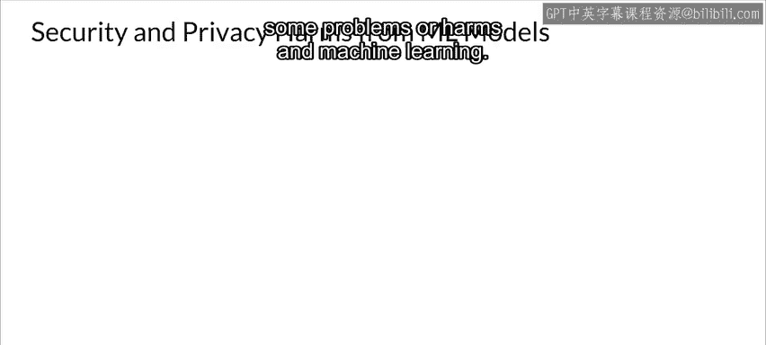

Informational harms are caused when information is allowed to leak from the model。

There are at least three different types of informational harms， including membership inference。

 where an attacker can determine whether or not an individual's data was included in the trading set。

Model inversion where the attacker is actually able to recreate the training set。

And model extraction where an attacker is able to recreate the model itself。

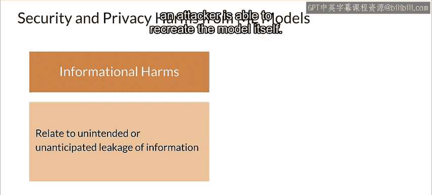

Behavioral harms are caused when an attacker is able to change the behavior of the model itself。

This includes poisoning attacks where the attacker is able to insert malicious data into the training set。

And evasion attacks where the attacker makes small changes to prediction requests to cause the model to make bad predictions。

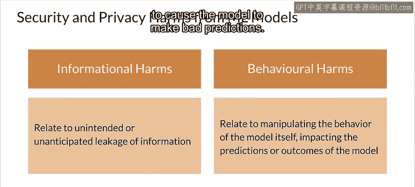

So it's important to defend your model against attacks as well as ensuring privacy and security of user data。

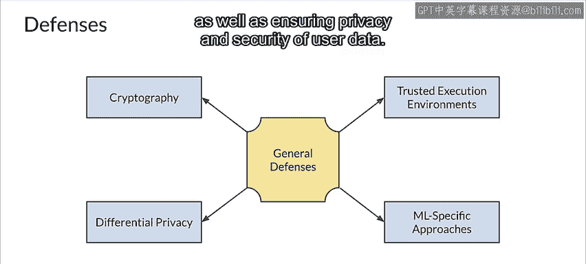

Let's discuss a few approaches for defending against attacks。

You should consider privacy enhancing technologies such as secure multiparty computation or SC。

Or fully homomorphic encryption or FHE when training and serving your models。 brieflyly。

 SC enables multiple systems to collaborate securely to train and or serve a model while keeping the actual data secure through the use of shared secrets。

 FHE， on the other hand， enables developers to train their models on encrypted data without decrypting at first。

FEG in particular allows users to send an encrypted prediction request and receive back an encrypted result。

During the entire process， the data is never decrypted except by the user。However。

 you should be aware that it currently FHE is very computationally expensive。

The goal here is that using cryptography， you can protect the confidentiality of your training data。

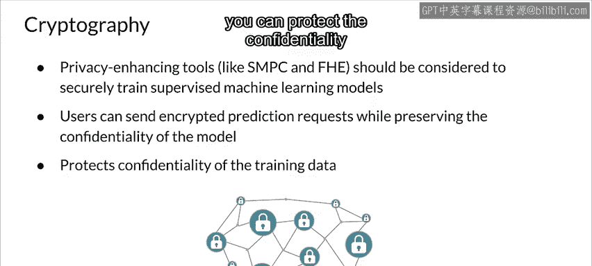

Roughly a model is differentially private if an attacker seeing its predictions cannot tell if a particular user's information was included in the training data。

By implementing differential privacy， you can responsibly train models on private data。

It provides provable guarantees of privacy， mitigating the risk of exposing sensitive training data。

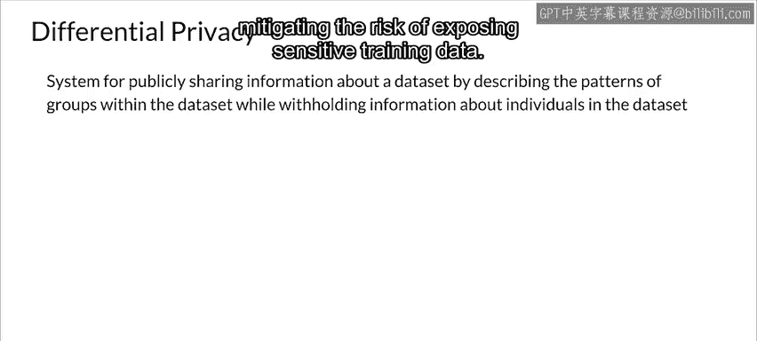

Let's briefly discuss three different approaches to implementing differential privacy。

Differentially private sarcchastic gradient descent or DPSSGD。

Private aggregation of teacher ensembles or PATE。And confidential and private collaborative learning or CA PCC。

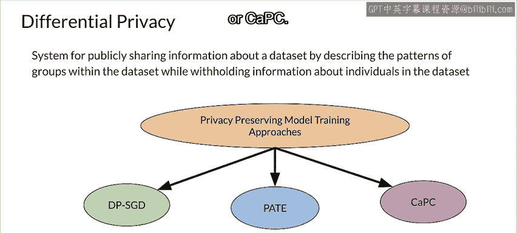

If an attacker is able to get a copy of a normallyly trained model。

Then they can use the weights to extract private information。

Differently private stochastic gradient descent or DPS SGD eliminates that possibility by applying differential privacy throughout training。

 It does that by modifying the mini batch stochastic optimization process by adding noise。

 The result is a trained model， which retains differential privacy because of the post processing immunity property of differential privacy。

Post processing immunity is a fundamental property of differential privacy。

 it means that regardless of how you process the model's predictions。

 you can't affect their privacy guarantees。

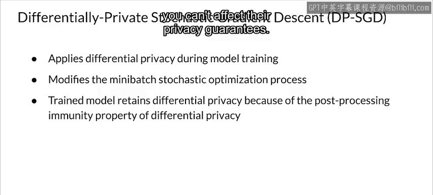

Next， let's take a look at private aggregation of teacher ensembles or PATE。

PATTE begins by dividing up sensitive data into K partitions with no overlaps。

 It then trains K models on that data separately as teacher models and then aggregates their results in an aggregate teacher model。

This is the same sort of teacher student used for knowledge distillation。

During the aggregation for the aggregate teacher， you will add noise to the output in a way that won't affect the resulting predictions。

All of these models and the sensitive data are not available to end users including attackers for deployment。

 you will create a student model。To train the student model。

 you will take unlabeled public data and feed it to the aggregate teacher model。

 the output of this process is labeled data， which maintains privacy。

You will use this data as the training set for the student model。After training。

 you will discard everything on the left side of this diagram and deploy only the student model for use。

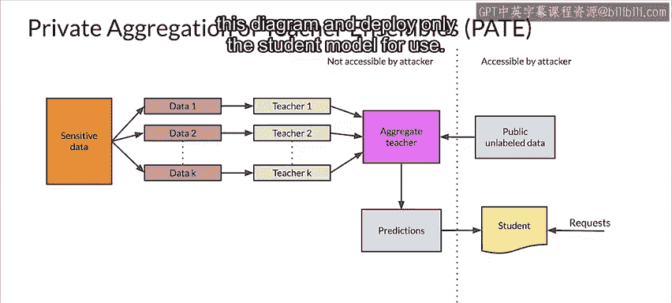

Confidential and private collaborative learning or CAPC enables multiple developers using different data to collaborate。

 to improve their model accuracy without sharing information。

This preserves both privacy and confidentiality。To do that。

 it applies techniques and principles from both cryptography and differential privacy。

This includes using homomorphic encryption or HE to encrypt the prediction requests that each collaborating model receives so that information in the prediction request is not leaked。

It then uses PATE to add noise to the predictions from each of the collaborating models and uses voting to arrive at a final prediction again without leaking information。

A great example of how CAPC can be used is to consider a group of hospitals who want to collaborate to improve each other's models and predictions。

Because of healthcare privacy laws， they can't share information directly， but using CAPC。

 they can achieve better results while preserving the privacy and confidentiality of their patients。

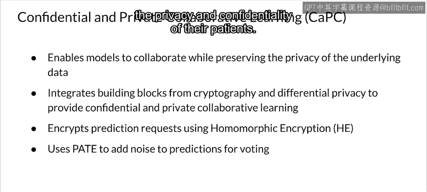