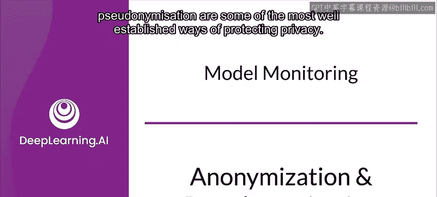
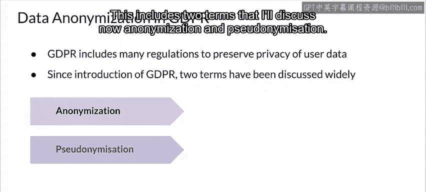
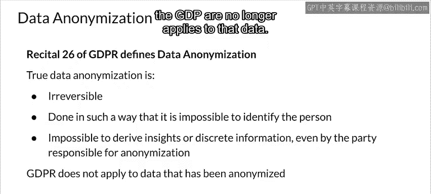
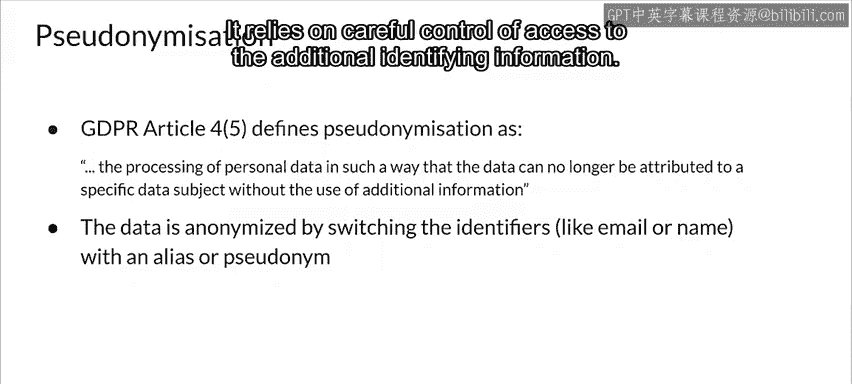
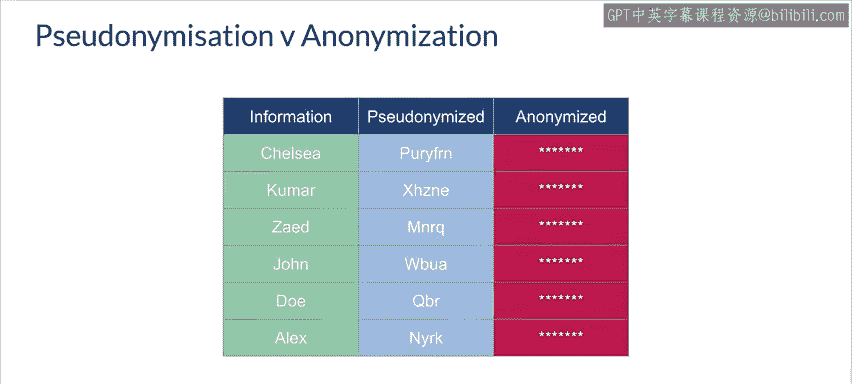
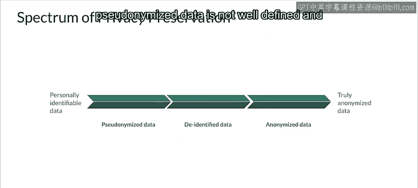
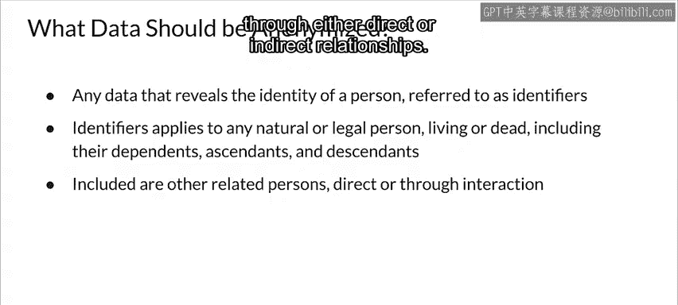

# 吴恩达《机器学习工程师的生产实践（MLOps）Machine Learning Engineering for Production》中英字幕 - P163：34_匿名与伪匿名.zh_en - GPT中英字幕课程资源 - BV1pi4y167g5

Anonymization and pseudodonymization are some of the most well established ways of protecting privacy。

 so let's discuss them now。

The GDPR includes many regulations to preserve privacy of user data and includes the definitions of many of the terms that it uses。

This includes two terms that I'll discuss now， anonymization and pseudonymization。

Anonymization removes personally identifiable information or PII from data sets so that people who the data describes remain anonymous for the GDPR recital 26 defines acceptable data anonymization to be irreversible。

And done in such a way that is impossible to identify the person。

It's impossible to derive insights or discrete information even by the party responsible for anonymization。

Once data has been acceptably anonymized， the GDPR no longer applies to that data。

Sudanmization is a bit different。This is a reversible process。

 meaning that it's still possible to identify the individual if the right additional information is included。

Seudonomization can be implemented with data masking or encryption or tokenization。

 it relies on careful control of access to the additional identifying information。

So to be clear， the biggest difference between anonymization and pseudodonnymization is that pseudodonnymized data can be reversed using an additional set of information or an encryption key。

 while anonymization is irreversible。

A lot of methods， mechanisms and tools have been developed over the years that produce data with various levels of both anonymity and the capability of being identified。

It ranges from personally identifiable to truly anonymized data。Personally。

 identifiable data contains name， address， phone， email， etc。

 while data which is purely anonymous and in accordance with GDPR guidelines。

 does not include personally identifiable information or PII and cannot be connected to PII。

 even with additional information。Sudonymized and de identifiedentified data form the intermediary category of the spectrum they are indeed a way of preserving certain aspects of data privacy。

 but not to the level of truly anonymized data。Note， however。

 that the difference between deidified data and pseudonymized data is not well defined。

 and many discussions will group them together as one thing。

So。What part of your data should you anonymize？Basically， everything that is part of PII。

That includes any data that reveals the identity of a person which are known as identifiers。

And with the term identifiers， I mean any natural or legal person living or dead。

 including their dependenceants， their ascendants and descendants。

This also includes other related persons who might be identifiable through either direct or indirect relationships。

For example， this includes features such as family names， patronnyms， first names， maiden names。

 aliases， address， phone， bank account details， credit cards， tax IDs， and so forth。

