# 吴恩达《机器学习工程师的生产实践（MLOps）Machine Learning Engineering for Production》中英字幕 - P164：35_被遗忘权.zh_en - GPT中英字幕课程资源 - BV1pi4y167g5

I'm sorry， who are you again， never mind。Anyway， it turns out that you have a right to be forgotten。

 so let's discuss that now， shall we？

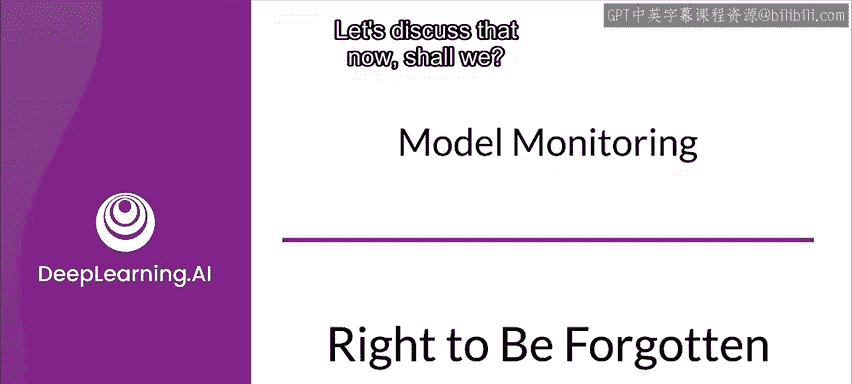

First， some clarification of terms when the GDPR refers to a data subject， it means a person。

And when it refers to a controller， it means a person or organization who has control over a data set containing personally identifiable information or PII。

Now that we've got there out of the way， let's ask the question。

When does a person have the right to be forgotten？Well。

 there's a fairly long list of reasons for why an individual has the right to have their personal data erased。

So rather than trying to remember these， I encourage you to refer to the GDPR。The list includes。

The personal data is no longer necessary for the purpose an organization originally collected it or processed it or。

An organization is relying on individual's consent as the lawful basis for processing the data。

 and that individual withdraws their consent。Or。An organization is relying on legitimate interests as its justification for processing an individual's data。

 and the individual objects to this processing， and there is no overriding legitimate interest for the organization to continue with the processing。

Gore。An organization is processing personal data for direct marketing purposes and the individual objects to this processing。

Or an organization processed an individual's personal data unlawfully。Or。

An organization must erase personal data in order to comply with a legal ruling or obligation or。

An organization has processed a child's personal data to offer them information society services。

 an information society might be a social network， for example。If any of those conditions are met。

 you must delete the person's data， in general， these are mostly common sense。However， in some cases。

 an organization's right to process someone's data might override their right to be forgotten。

Here are the reasons cited in the GDPR that override the right to be forgotten。

The data is being used to exercise the right of freedom of expression and information。Or。

The data is being used to comply with a legal ruling or obligation。

Or the data is being used to perform a task that is being carried out in the public interest or when exercising an organization's official authority。

Or the data being processed is necessary for public health purposes and serves in the public interest。

Or the data being processed is necessary to perform preventative or occupational medicine；

 This only applies when the data is being processed by a health professional who is subject to a legal obligation of professional secrecy。

Or。The data represents important information that serves the public interest， scientific research。

 historical research， or statistical purposes， where the erasure of the data would be likely to impair or halt progress towards the achievement that was the goal of the processing。

Or the data is being used for the establishment of a legal defense or in the exercise of other legal claims。

Furthermore， an organization can request a reasonable fee or deny a request to erase personal data if the organization can justify that the request was unfounded or excessive。

But in general， you should avoid overriding an individual's right to be forgotten unless you strongly meet one of these conditions when。

 in doubt， err on the side of privacy。

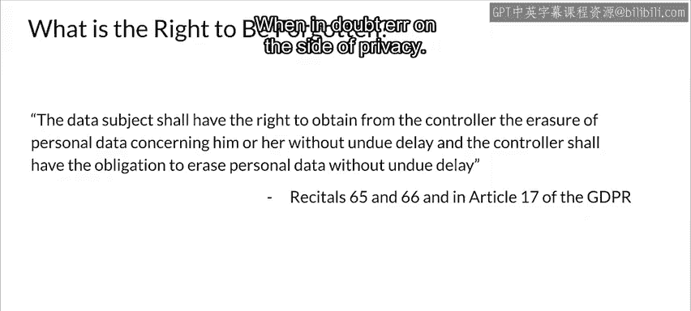

You also have the right to have your personal information corrected or rectified。

This might be important in situations like your credit history， health history。

 or employment history。

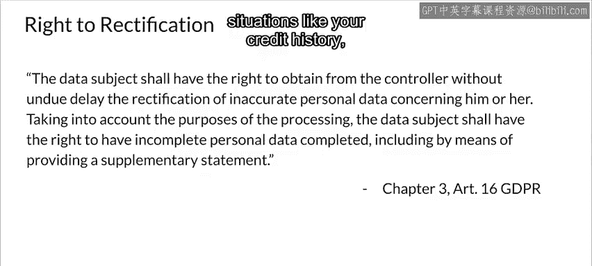

The GDPR also defines a number of other rights which people or data subjects have these include the right of access by the data subject。

 the right to restriction of processing， the right to data portability， and the right to object。

As a general rule， it's best to err on the side of privacy and consider any personal information that you have in your data as sensitive。

You should restrict access to it and keep it safe。Above all。

 you should think of it as the property of the person whose information it is and honor their wishes。

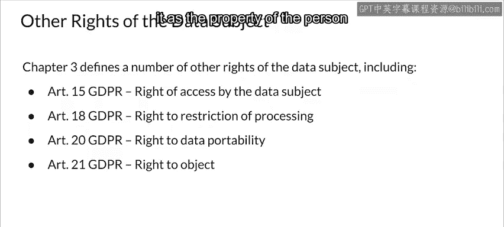

When you receive a valid request to have personal information deleted。

 you need to identify all of the information related to the content requested to be removed。

You also need to identify and remove all of the metadata associated with that person。

If you've run any analysis or trained any models， the derived data and logs and models must also be removed or corrected。

 The goal here is as much as possible to make it as if you never had their data。

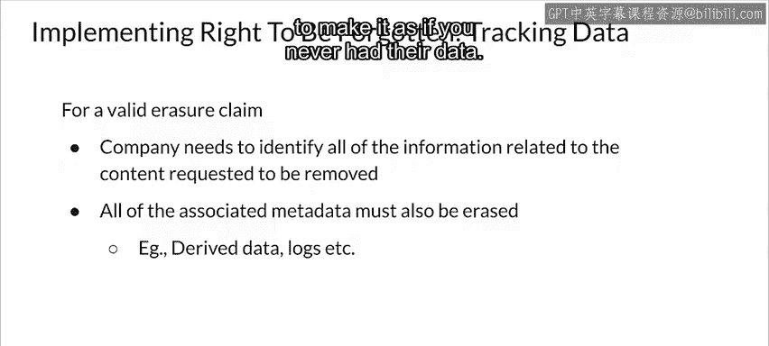

There are basically two ways to delete data which will satisfy the requirements of the GDPR。

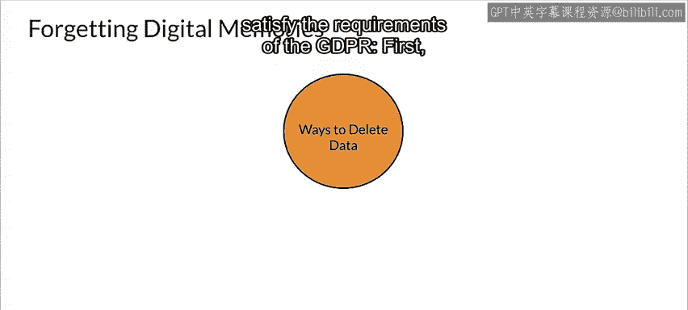

First， you can anonymize the data， which， as you saw previously。

 will make it non personally identifiable under the terms of the GDPR。

 and the GDPR will no longer apply to anonymize data。

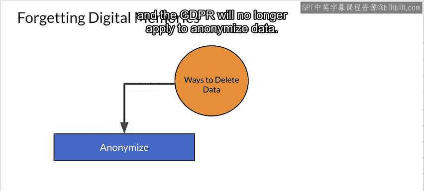

Second， you could do a hard delete of the data， meaning actually delete the data。

 including any rows in your database， which might contain it。Normally。

 your first impulse might be to always just do a hard delete。But often there are issues with that。

 so anonization is another option。

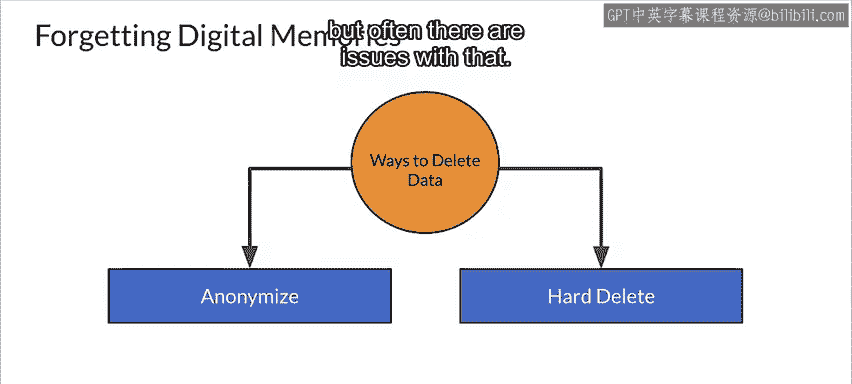

In a database or any other similar relational data store， deleting records can cause havoc。

 part of this is because user data is often referenced in multiple tables。

 So deleting those records breaks the connections， which can be difficult。

 especially in large complex databases。 For example， it can break foreign keys。 On the other hand。

 anonymization keeps the records and only anonymizes the fields containing PI。

 While still satisfying the requirements of the GDPR。

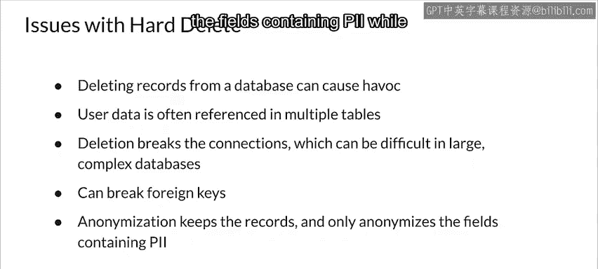

There are several challenges in implementing the right to be forgotten。

The process of identifying whether or not data privacy has been violated is itself a challenging task。

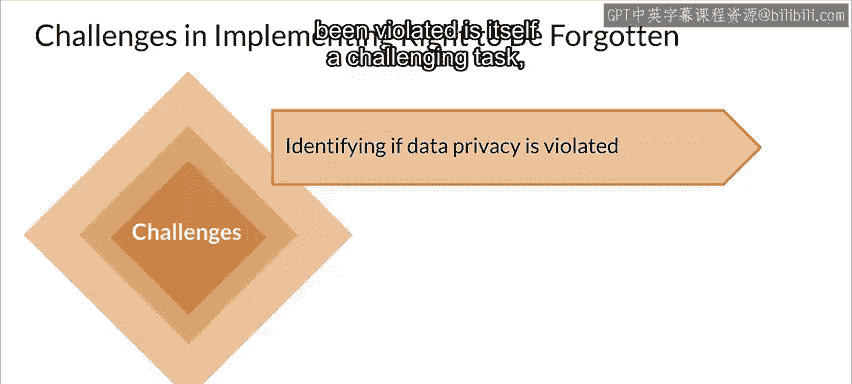

In order to enforce the GDPR， several organizational changes are needed。

 including policy changes and training employees in how to enforce the right to be forgotten and one last consideration that can be tricky。

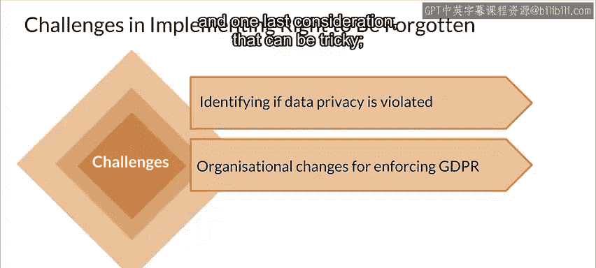

If your organization maintains multiple backups of your data， which actually you should。

Making sure that your personal data has been deleted from all of your backups is challenging。

You might very well have to change your data storage and back implementation to maintain compliance with a GDPR。

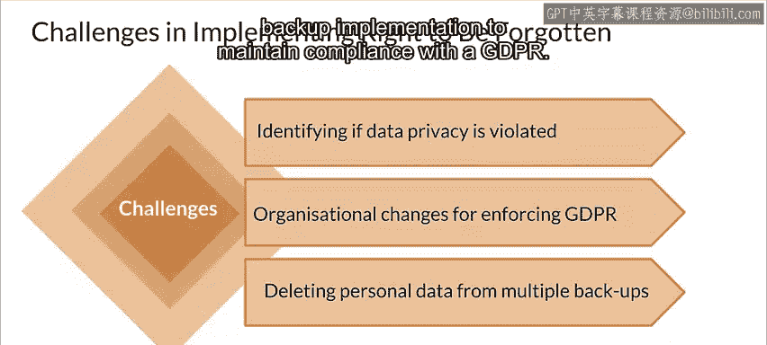

Issues like GDPR and the Right to be forgotten are already important to operating in a business environment。

And understanding the machine learning issues around them will only get increasingly important。

We've given you a basic understanding of today's reality in this area。

 but I strongly encourage you to keep watching for new developments。

 also I think it's always important to respect the privacy of your customers and treat any information or PII that you have with great care。

 and I strongly encourage you to do so。