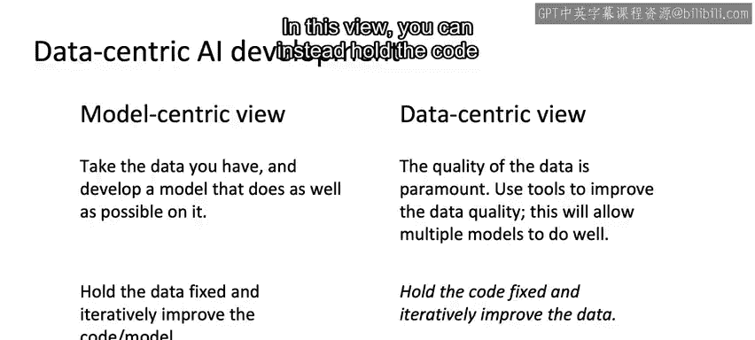

# 吴恩达《机器学习工程师的生产实践（MLOps）Machine Learning Engineering for Production》中英字幕 - P19：18_面向数据的AI开发.zh_en - GPT中英字幕课程资源 - BV1pi4y167g5

Let's say that error analysis has caused you to decide to focus on improving your learning algorithm's performance on data with a certain category tag。

 say speech with car noise in the background Let's take a look at how you can take a data centric approach to improving your learning algorithms performance you've heard me speak before about model centric versus data centric AI development。

Here's a little more detail on what I mean with a model centric view of AI development。

 you would take the data you have and then try to work really hard to develop a model that does as well as possible on the data because a lot of academic research in AI was driven by researchers downloading a benchmark data and trying to do well on that benchmark most academic research on AI is model centric because the benchmark data is a fixed quantity so in this view model centric development you would hold the data fix and iteratively improve so in this model centric view。

You would hold the data fix and iteratively improve the code or the model。

There's still an important role to play in trying to come up with better models。

 but there's a different view of AI developments， which I think is more useful for many applications。

 which is to shift a bit from a modelcentric toward a datacentric view In this view。

 we think of the quality of the data as paramount and you can use tools such as error analysis or data augmentation to systematically improve the data quality and for many applications I find that if your data is good enough。

 there are multiple models that will do just fine So in this view you can instead hold the code fix and iteratively improve the data there's a role for model centric development and there's a role for datacentric development if you've been used to modelcentric thinking for most of your experience with machine learning。

 I would urge you to consider taking a。

Tocentric view as well， where when you're trying to improve your learning algorithm's performance。

 try asking。How can you make your data even better？

One of the most important ways to improve the quality of a data is data augmentation。

 so let's go on to the next video where we'll start to take a look at data augmentation。

