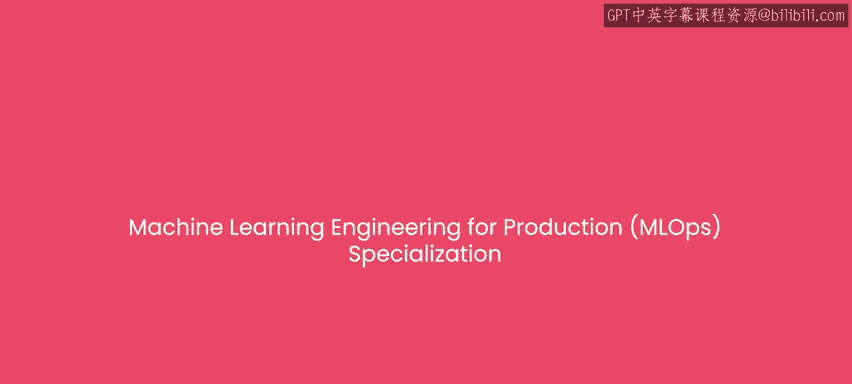
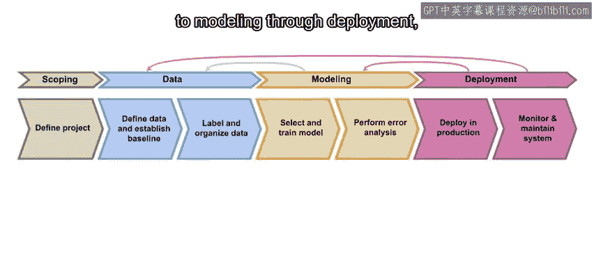
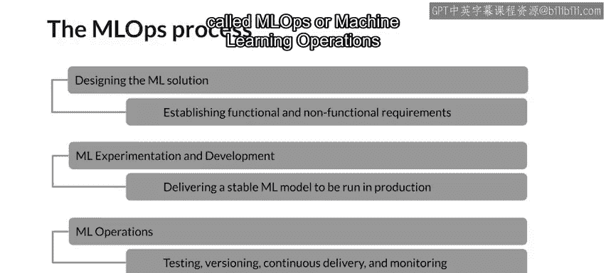

# 吴恩达《机器学习工程师的生产实践（MLOps）Machine Learning Engineering for Production》中英字幕 - P1：0_专项课程概述.zh_en - GPT中英字幕课程资源 - BV1pi4y167g5

Hi， welcome to this specialization on Ma learning， Engineing for production and MOOs。

Say you've trained an accurate machine learning model in a Jupiter notebook， you celebrate that。

 and you might now be wondering， you know， now what do I do？

After reaching the milestone of developing a good model。

 actually putting your model into production so that you have a working system that is making useful predictions that still requires much more。

 This specialization will teach you the skills you need to build and deploy production machine learning systems you learn about the full machine learning project lifecycle from scoping out your project to data to modeling through deployment so you really execute the machine learning project all the way from start to finish。

 one common misconception is that the only difference between developing a model in a Jupyter notebook on your local machine and deploying that model into production is literally just the deployment piece。

 maybe just a bunch of software engineering， but that's not true it's not just a bunch of software engineering there are machine learning challenges to production as well that on edges in the process of developing a model in a Jupyter notebook this discipline of building and maintaining production system。

That is the processes and tools for doing all this is sometimes called MLOs or machine learning operations and you learn about that too I'm thrilled to be bringing you this new specialization with two fantastic instructors from the Google Tensorflow team Robert Crow and Lawrence Mioni。

😊。

Robert Crow is a TensorFlow developer engineer at Google， a data scientist and TensorFlow advocate。

 Robert has a passion for helping developers quickly learn what they need。

 hopefully what you need to be productive。And Lawnce Moroni leads AI advocacy at Google and is also an instructor of three other tentensor field specializations with Deeplein AI and is author of the book AI and Machine Learning for Codes so glad to have both of you with us for the specialization I'm delighted to work with you again。

 it's always a pleasure As you said， Andrew， in addition to building a first working model in a production system you need to handle a whole range of issues including things like datad where the distribution of the data you trained on may eventually become different。

 very different from the distribution of the data that you're running inference on a key topic that we'll discuss is change The world changes and your model needs to be aware of that change。

In this specialization， we'll also introduce you to several related topics outside of machine learning。

You can look at production， machine learning as both machine learning itself and the knowledge and skills required in modern software development。

If you're working on a machine learning team and industry。

 you' really need expertise in both machine learning and software to be successful。

 This is because your team will not just be producing a single result。

 You'll be developing a product or service that will operate continuously and may be a mission critical part of your company's work。

 That's right。 And I can say from my own experience that oftentimes the most challenging aspects of building machine learning systems turn out to be the things that you least expected。

 like deployment。😊，It's all very well being able to build a model。

 but getting that into people's hands and seeing how they use it can be very eye opening。

 You might think you have the perfect model for the perfect scenario。

 but your users could have different opinions， and it's always really good to learn from them。

 They might be， for example， okay with a round Rob and trip to a server for a frequently updated model or they might insist that their data never leaves their device so you need to know the best ways to keep their own device models really fresh。

 This specialization contains four causes that provide you with the knowledge and hands on practice to get a production machine learning system up and running。

😊，In the first course which I teach， you see an overview of the entire life cycle of a production machine learning project from scoping to getting data to modeling to deployment The second course is all about data and how it evolves over time。

With this course， you'll build data pipelines by gathering， cleaning。

 and validating data sets using TensorFlow extended or TFX and the TFX family of libraries。

To understand your data evolution， you'll track changes with MO metadata using data provenance as a conceptual framework The third course is focused on machine learning modeling pipelines in production。

In this course， you'll learn how to manage modeling resources to best serve inference requests and minimize costs。

 you'll also use analytics to address model fairness。

 explainability issues and mitigate bottle deckcks Cose 4 is all about deployment and this means of course that you want to get ready to serve your users requests。

Now， this can be exciting and challenging all at the same time。 So in course 4。

 you'll deliver deployment pipelines from model serving that might require many different infrastructures。

 You'll also apply best practices to maintain a continuously operating production system that stays up to date and importantly。

 keeps your users' needs front of mind。😊，As a learner in this specialization。

 we're assuming that you're comfortable with Python programming and machine learning and that you have some familiarity with one of the deep learning frameworks in Python like Tensorflowlow。

 Caris or Pytorch。 If you've completed the deep learningning specialization offered by deep learningarning do AI。

 you should be in great shape to start this specialization。 Al， of course。

 if you've completed the deep learningarning do AI TensorflowlowDevelop C program。

 you'll be really well prepared to start the specialization。 Great， well with that。

 let's get startedted。 That sounds great to me。 Sound good， let's do it。😊。

