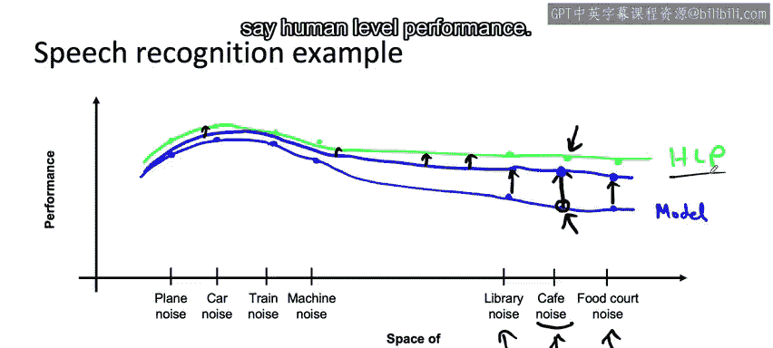

# 吴恩达《机器学习工程师的生产实践（MLOps）Machine Learning Engineering for Production》中英字幕 - P20：19_对数据增强有用的图示.zh_en - GPT中英字幕课程资源 - BV1pi4y167g5

There's a picture， a conceptual picture that I found useful for thinking about data augmentation and how this can help the performance of a learning algorithm。

 let me share this picture of you since I think you find it useful too when trying to decide whether to use data augmentation take speech recognition there could be many different types of noise in speech input such as car noise。

 play noise tray noise， machine noise or cafe noise or library noise which isn't that loud or food court noise。

😊，Maybe these types of noises are more similar to each other because they're all mechanical types of noise and these types of noise may be a little bit more similar to each other with mainly people talking and interacting with each other so let me share you a picture did I keep in mind when I'm planning out my activities on getting more data through data augmentation or through actual data collection of any of these types of data in this diagram the vertical axis represents performance。

 say accuracy。And on the horizontal axis， and this is a conceptual kind of a thought experiment type of axis。

 I'm going to represent the space of possible inputs。So for example。

 their speech with car noise and play noise and tray noise sound a bit like car noise so they're quite similar and machine noise is a little bit further away by machine noise I'm picturing the sounds of a washing machine or a very loud air condition I they。

Then you may have speech with cafe noise， library noise or food court noise。

 and those are maybe more similar to each other than to these types of mechanical noise。

Your system will have different levels of performance on these different types of input。

 let's say the performance is this for data play noise， that with car noise， tray noise。

 machine noise， and it does worse on data with library noise， cafe noise。Food quarter noise。

 And so I think of there as being a curve or maybe think of this like a。

One dimensional piece of rubber band or like a rubber sheet。

That shows how accurate your speech system is as a function of the type of input it gets。

A human will have some other level of performance on these different types of data。

 So maybe a human is a bit better or play noise， bit better on car noise。And so on。

 and maybe they are much better。Then your algorithm on library noise。

 cafe noise and food court noise。 So the human level performance is。Represents it。V some other curve。

And let me just。Labeled is as the current。Model's performance in blue。

So this gap represents an opportunity for improvement。Now。

 what happens if you use data augmentation or maybe not data augmentation。

 but go out to a bunch of actual cafes to collect a lot more data with cafe noise in the background？

What you would do is you would take this point and imagine grabbing a hold of this blue rubber bands or this rubber sheet and pulling it upward。

Right so。That's what you're doing if you collect or somehow get more data with cafe noise and add that your training cell。

 you're pulling up the performance of the algorithm on inputs with cafe noise and what that will tend to do is pull up this rubber sheet。

In the adjacent region as well， so if performance on cafe noise goes up。

 probably performance on the nearby points will go up too。

And performance on faraway points may or may not go up as much。

It turns out that for unstructured data problems。Pulling up one piece of this rubber sheet is unlikely to cause a different piece of the rubber sheet to dip down really far below instead pulling up one point causes nearby points to be pulled up quite a lot and far away points may be pulled up a little bit。

 all of you're lucky maybe more than a little bit， but when I'm planning how to improve my learning algorithm's performance and where I hope to get it to。

And getting more data in those places to itly pull up with those pieces。

Or those parts of the rubber sheet to get them closer to human level performance。

And when you pull up part of the rubber sheet， the location of the biggest gap may shift to somewhere else。

 and error analysis will tell you what is the location of this new biggest gap that may then be worth your effort to collect more data on and therefore to try to pull up one piece at a time。

 and this turns out to be a pretty efficient way to decide where on the blue rubber sheet to pull up next to try to get performance closer to say human level performance。

I hope this analogy of a rubber band or a rubber sheet and repeatedly pulling up a point on this rubber sheet will help you predict the effects of collecting more data that's associated with a specific categoryd or a specific tag。

How do you get more of this data， Let's take a look at how you can perform data augmentation and some best practices of doing so in the next video。

