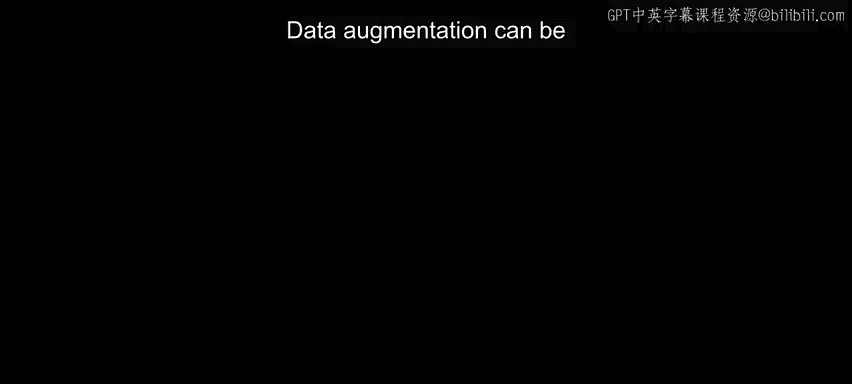
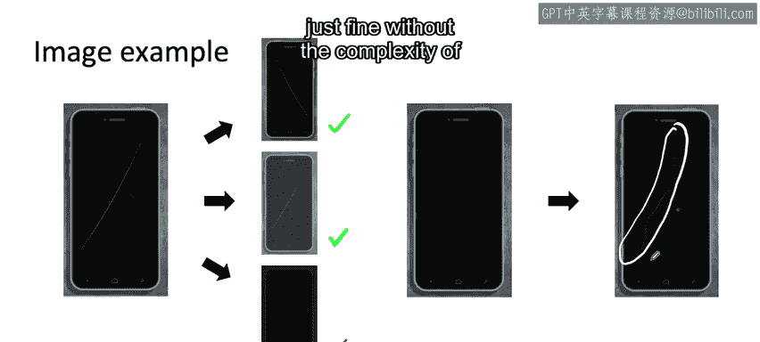
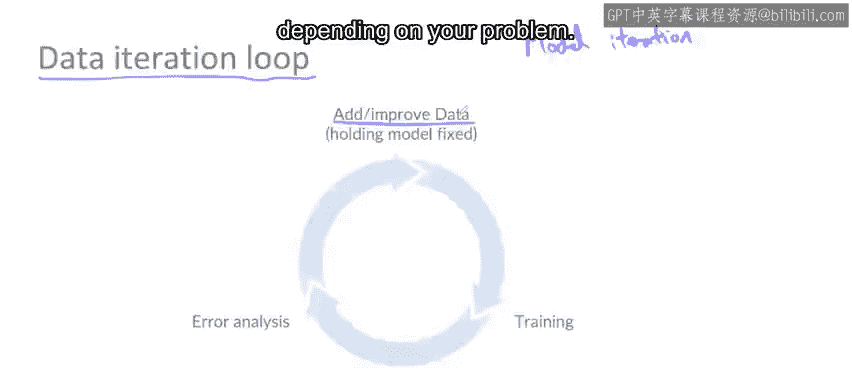

# 吴恩达《机器学习工程师的生产实践（MLOps）Machine Learning Engineering for Production》中英字幕 - P21：20_数据增强.zh_en - GPT中英字幕课程资源 - BV1pi4y167g5

Data augmentation can be a very efficient way to get more data。

 especially for unstructured data problems such as images， audio maybe text。

 but when carrying out data augmentation， there are a lot of choices you have to make whether the parameters how do you design the data augmentation setup let's dive into this to look at some best practices text speech recognition。

 given an audio clip like this AI is the new electricity。😊，If you take background cafe noise。

 it sounds like this。And add these two audio clips together。

Literally take the two waveforms and sum them up， then you can create a synthetic example that sounds like this。

AISo it sounds like someone saying AI is a new electricity in a noisy cafe。

This is one form of data augment that lets you efficiently create a lot of data that sounds like。

Data collected in the cafe， or if you take the same or the is the new electricity。

And add it to background music。Then it sounds like someone saying it with maybe the radio on in the background。

 AI is the new electricity。Now， when carrying out data augmentation。

 there are few decisions you need to make。What types of background noise should you use and how loud should the background noise be relative to the speech？

Let's take a look at some ways of making these decisions systematically The goal of data augment is to create examples that your learning algorithm can learn from as a framework for doing that。

 I encourage you to think of how you can create realistic examples that the algorithm does poorly on because if the algorithm already does well on those examples then there's less for it to learn from。

 but you want the examples to still be ones that a human or maybe some of the baseline can do well on。

Because otherwise， one way to generate examples that the algorithm does poorly on would be to just create examples that are so noisy that no one can hear what anyone said。

 but that's not hopeful。You want examples that are hard enough to challenge the algorithm but not so hard that they're impossible for any human or any algorithm to ever do well on and that's why when I am generating new examples using data augmentation I try to generate examples that meet both of these criteria Now one way that some people do data augmentation is to generate an augmented data set and then train the learning algorithm and see if the algorithm does better on the depth set and then fit around with the parameters for data augmentation and train the learning algorithm again and so on this turns out to be quite inefficient because every time you change your data augmentation parameters。

 you need to train your neural network or train your learning algorithm all over and this can take a long time instead I found that using these principles allows you to sanity check that your new data generated using。

Data augmentation is useful without actually having to spend the maybe hours or sometimes days of training a learning algorithm on that data to verify that it will result in the performance improvement so specifically peerA checklist you might go through when you are generating new data。

One， does it sound realistic， you want your audio to actually sound like realistic audio of the sort that you want your algorithm to perform on two is the X to Y mapping clear In other words。

 can humans still recognize what was said This is to verify 。

2 here and three is the algorithm currently doing poorly on this new data。

And that helps you verify point1。 if you can generate data that meets all of these criteria。

 then that will give you a higher chance that when you put this data into your trading set。

And retrain the algorithm that that will result in you successfully pulling up part of this rubber sheet。

 Let's look at one more example using images this time。

Let's say that you have a very small set of images of smartphones with scratches。

Here's how you may be able to use data augmentation， you can take the image and flip it horizontally。

 just results in a pretty realistic image， the phone buttons are now on the other side。

 but this could be a useful example to add to your training set or you could implement contrast changes of actually brightened up the image here。

So the scratch is a little bit more visible or you could try darkening the image。

 but in this example， the image is now so dark that even I as a person can't really tell if there's a scratch there or not and so whereas these two examples on top would pass the checklist we had earlier that the human can still detect the scratch well。

 this example is too dark it would fail that checklist and so I would try to choose a data augmentation scheme that generates more examples that look like the ones on top and fear of the ones that look like the ones here at the bottom and in fact。

 going off the principle that we want images that look realistic。

 that humans can do well on and hopefully the algorithm does poorly on you can also use more sophisticated techniques such as take a picture of a film with no scratches and use Photoshop in order to artificially draw a。

And this technique， literally using Photoshop can also be an effective way to generate more examples because this example of a stretch here。

You may or may not be able to see it depending on the video compression and image contrast where you're watching this video。

 but with a scratch here， this looks like a pretty realistic stretch。

 doest actually generate to the photoshop and I as a person can recognize this scratch and so if the learning algorithm isn't detecting this right now。

 this would be a great examples to add。I've also used more advanced techniques like GANs generative adversarial networks to synthesize scratches like these automatically。

 although I've found that techniques like that can also be overkill。

 meaning that theres simpler techniques that are much faster to implement that work just fine without the complexity of building a GN to synthesize scratches。

You may have heard of the term model iteration。Which refers to iteratively training a model。

 using our analysis and then trying to decide how to improve the model。

Taking a datacentric approach to AI development， sometimes it's useful to instead use a data iteration loop where you repeatedly take the data and a model。

 train your learning algorithm， do error analysis and as you go through this loop。

 focus on how to add data or improve the quality of the data and for many practical applications。

 taking this data iteration loop approach。With a robust hyperparmeter search， that's important too。

 but taking a data iteration loop approach results in faster improvement to your learning algorithm's performance。

 depending on your problem。

So when you're working on an unstructured data problem， data augmentation。

 if you can create new data that seems realistic that humans can do quite well on。

 but that the algorithm struggles on。That can be an efficient way to improve your learning algorithm's performance。

And so if you found through error analysis that your learning algorithm does poorly on speech with cafe noise。

 data augmentation to generate more data with cafe noise could be an efficient way to improve your learning algorithm's performance。

Now， when you add data to your system， question I've often been asked is。

 can adding data hurt your learning algorithm's performance？

Usually for unstructured data performance， the answer is no with some caveats。

 but let's dive more deeply into this in the next video。

