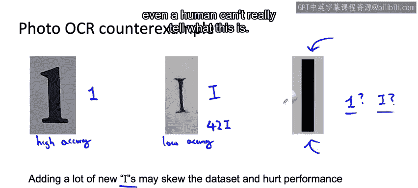

# 吴恩达《机器学习工程师的生产实践（MLOps）Machine Learning Engineering for Production》中英字幕 - P22：21_增加数据会伤害模型吗.zh_en - GPT中英字幕课程资源 - BV1pi4y167g5

For a lot of machine learning problems， the training sets and depth and test set distribution start up being reasonably similar。

 but if you're using data augmentation， you're adding to specific parts of the training set such as adding lots of data with cafe noise。

 so now your training set may come from a very different distribution then the depth set and the test set。

Is this going to hurt your learning algorithm's performance usually the answer is no with some caveats when you're working on unstructured data problems。

 but let's take a deeper look at what that really means。

If you are working on an unstructured data problem。And if your model is large。

 such as a neural network that is quite large and has large capacity and does low bias。

 and if the mapping from X to Y is clear and by that I mean given only the input X。

 humans can make accurate predictions。Then it turns out。

Adding accurately labeled data rarely hurts accuracy。 This is an important observation， because。

Adding data through data augmentation or collecting more of one type of data can really change your input data distribution the probability of X。

Let's say at the start of your problem， 20% of your data had cafe noise。But using augmentation。

 you added a lot of cafffe noise so now this is 50% of your data is data with cafffe noise in the background。

 It turns out that so long as your model is sufficiently large。

 then it won't stop it from doing a good job on the cafe noise data as well as doing a good job on noncafe noise data In contrast。

 if your model was small， then changing your input data distribution this way may cause it to spend too much of its resources modeling cafe noise settings and this could hurt this performance on noncafe noise data but if your model is large enough。

 then this isn't really an issue。 the second problem that could arise is if the mapping from X to Y is not clear。

 meaning given X， the true label of Y is very ambiguous。

This doesn't really happen much in speech recognition。

 but let me illustrate this with an example from computer vision。This is very rare。

 so it's not something I would worry about for most practical problems。

 but let's see why this is important One of the systems I had worked on many years ago used Google Street view images to read host numbers in order to more accurately geolocate buildings and holess in Google Maps。

So one of the things that system did was take us input pictures like this and figure out what is this digit。

 so clearly this is a one。And this is a。Alphabet I。You don't see a lot of eyes in street view images。

 but there are some buildings。 You know， you may see a sign that says navigate to。Hos number 42 I。

But health numbers really rarely have an alphabet I in it。Now。

 if you find that your algorithm has very high accuracy。On recognizing ones。But low accuracy。

On recognizing eyes， one thing you might do is add a lot more examples of eyes into your training set and the problem and this is a rare problem is there are some images that are truly ambiguous。

 is this a one？Or is this an I？And if you were to add a lot of new eyes to your training set。

 especially ambiguous examples like this， then that may skew the data to have a lot more eyes and hurt performance。

Because we know that there are a lot more ones than eyes on house numbers。

 if the learning algorithm sees a picture like this。

 it would be safer to guess that this is a one rather than that this is an I。

But if data augmentation skews the data in the direction of having a lot more eyes rather than a lot of ones。

 then it may cause the algorithm to guess poorly on an ambiguous example like this。

So this is one rare example where adding more data could hurt performance。

 and this example of one versus I is one that contradicts。The second bullet， because for some images。

 the mapping from X to Y is not clear in particular， given only。An image like this on the right。

 even a human can't really tell what this is Just to be clear。

 the example that we just went through together is a pretty rare almost corner case and is quite unusual for data augmentation or adding more data to hurt the performance of your learning algorithm so long as your model is big enough。

 maybe your neural network is big enough to learn from a diverse set of data sources。

 but I hope that understanding this rare case where it could hypothetically hurt gives you more comfort with using data augmentation or collecting more data to improve the performance of your algorithm。

 even if it causes your training set distribution to become different from your depth set and test set distribution。

😊。

So far our discussion has focused on unstructured data problems， how about structured data problems。

 it turns out there's a different set of techniques that's useful for structured data let's take a look at that in the next video。

