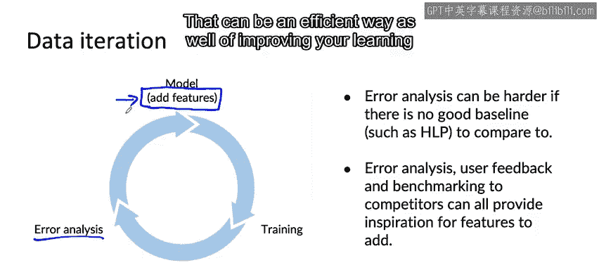

# 吴恩达《机器学习工程师的生产实践（MLOps）Machine Learning Engineering for Production》中英字幕 - P23：22_增加特征.zh_en - GPT中英字幕课程资源 - BV1pi4y167g5

For many structured data problems， it turns out that creating brand new training examples is difficult。

 but there's something else you could do， which is to take existing training examples and figure out if there are additional useful features you can add to it。

Let's take a look at an example， let me use an example of restaurant recommendations where if you're running an app that has to recommend restaurants to users that may be interested in checking out certain restaurants。

 one way to do this would be to have a set of features for each user or for each person。

And a set of features for each restaurant that then get fed in to some learning algorithm。

 say a neural network and a neural network。Whose job it is to predict whether or not this is a good recommendation。

 whether to recommend this restaurant to that person。In this particular example。

 which is a real example， error analysis show that the system was unfortunately frequently recommending to vegetarians restaurants that only had meat options that were users that were pretty clearly vegetarian based on what they had ordered before and the system was still sending to them maybe a hot new restaurant that it recommended because it was a hot new restaurant but it didn't have good vegetarian options so this wasn't a good experience for anyone and there was a strong desire to change this now I didn't know how to synthesize new examples of users or new examples of restaurants because this application had a fixed pool of users and they were only so many restaurants so rather than trying to use data augmentation to create brand new people or restaurants to feed to the training set。

😊，I thought it was more fruitful to see if there were features to add to either the person inputs or to the restaurant inputs specifically one feature you can consider adding is a feature that indicates whether this person appears to be vegetarian and this doesn't need to be a binary value feature 01 it could be soft features such as the percentage of fruit ordered that was vegetarian or some other measure of how likely they seem to be vegetarian and a feature to add on the restaurant side would be does this restaurant have vegetarian options or good vegetarian options。

Based on the menu for structured data problems， usually you have a fixed set of users or a fixed set of restaurants or fixed set of products。

 make it hard to use data augmentation or collect new data for new users that you don't have yet on restaurants that may or may not exist instead adding features。

Can be a more fruitful way to improve the performance of the algorithm to fix problems like this one identify through error analysis。

 additional features like these。Can be handed or they could。

 in turn be generated by some learning algorithm。Such as having a learning algorithm。

 try to read a menu and classify meals as vegetarian or not。

Or having people code this manuallyally could also work depending on your application。

 Some other food delivery examples， we found that there were some users that would only ever order our tea and coffee。

And some users that will only ever order pizza So if the product team wants to improve the experience of these users。

 a machine learning team might ask whether are the additional features we can add to detect who are the people that only order tea or coffee or who are the people that only ever order pizza and enrich the user features so as to help the learning algorithm make better recommendations for restaurants that these users may be interested in Over the last several years there's been a trend in product recommendations of a shift from collaborative filtering approaches to what contentbased filtering approaches。

Collaborative filtering approaches is loosely an approach that looks at the user tries to figure out who's similar to that user and then recommends things to you that people like you also liked in contrast。

 a contentbased filtering approach will tend to look at you as a person and look at the description of the restaurant or look at the menu of the restaurant and look at other information about the restaurant to see if that restaurant is a good match for you or not the advantage of content-based filtering is that even if there's a new restaurant or a new product that hardly anyone else has liked by actually looking at the description of the restaurant rather than just looking at who else like the restaurant。

 you can more quickly make good recommendations This is sometimes also called the coldstar problem。

how do you recommend a brand new product that almost no one else has purchased or like or disliked so far and one of the ways to do that is to make sure that you capture good features for the things that you might want to recommend unlike collaborative filtering which requires a bunch of people to look at a product and decide if they like it or not before it can decide whether a new user should be recommended the same product so data iteration for structured data problems may look like this you start up with some model。

Train the model and then carry out error analysis。E analysis can be harder on structured data problems if there is no good baseline such as human level performance to compare to。

And human level performance is hard for structured data because it's really difficult for people to recommend good restaurants even to each other。

 but I found that error analysis can discover ideas for improvement so can user the feedback and so can benchmarking to competitors。

 but through these methods if you can identify a category or a certain type of tag associated with your data that you want to drive improvement。

 then you may be able to go back to select some features to add such as features to figure out who' vegetarian and what restaurants have good vegetarian options that would help you to improve your model and because the specific application may have only a finite list of users and restaurants the users in restaurants you have。

 maybe all the data you have which is why adding features to the examples you have maybe。

A more fruitful approach compared to trying to come up with new users or new restaurants and of course。

 I think features are a form of data too， which is why this form of data iteration where error analysis helps you decide how to modify the features。

That can be an efficient way as well of improving your learning algorithm's performance。

I know that many years ago， before the rise of deep learning。

 part of the hope for deep learning was that you don't have to hand design features anymore。

 I think that has for the most part， come true for unstructured data problems so I use the handdes features for images I just don't do that anymore let the learning algorithm figure it out but even with the rise of modern deep learning。

 if your data size isn't massive。 there is still designing a features driven by error analysis that can be useful for many applications today the larger data set。

 the more likely it is that a pure endtoend deep learning algorithm can work but for anyone other than the largest tech companies and sometimes even them for some applications designing features。

 especially for structured data problems can still be a very important driver of performance improvements maybe just don't do that for unstructured data nearly as much because learning algorithms are very good。

And learning features automatically for images， audio and for text， maybe。

 but for structured data is okay to go in and work on the features。

