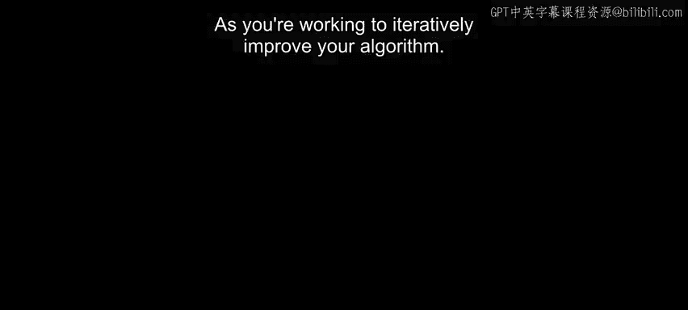
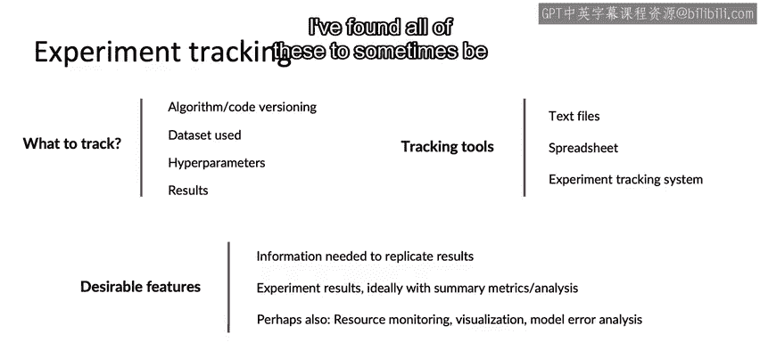

# 吴恩达《机器学习工程师的生产实践（MLOps）Machine Learning Engineering for Production》中英字幕 - P24：23_实验跟踪.zh_en - GPT中英字幕课程资源 - BV1pi4y167g5

As you're working to iteratively improve your algorithm。

 one thing that'll help you be a bit more efficient is to make sure that you have robust experiment tracking let's take a look at some best practices。

When you're running dozens or hundreds or maybe even more experiments it easy to forget what experiments you have already run。

 having a system for tracking your experiments can help you be more efficient in making the decisions on the data or the model or hyperparameter to systematically improve your algorithm's performance。

 when you are tracking the experiments you've run， meaning the models you've trained。

Here are some things I would urge you to track One is to keep track of what algorithm you' are using and what version of code keeping a record of this will make it much easier for you to go back and replicate an experiment you had run maybe two weeks ago and whose details you may not fully remember anymore second keep track of the data you use third hyperpar and fourth save the results somewhere this should include at least the highlevel metrics such as accuracy or F1 school or the relevant metrics。

 but if possible it be useful to just save a copy of the trained model so how can you track these things here are some tracking tools you might consider a lot of individuals and sometimes even teens will start off with text files so when I'm running experiment by myself。

I might use a text file to just make a note with a few lines of text per experiment to note down what I was doing this does not scale well。

 but it may be okay for small experiments A lot of teams then migrate from text files to spreadsheets。

 especially shared spreadsheets if you're working on the team。

Where different columns of a spreadsheet can keep track of the different things you want to track for the different experiments you're running。

And spreadsheets actually scale quite a bit further。

 especially shared spreadsheets that multiple members of a team may be willing to look at。

 but beyond a certain point， some teams will also consider。

Migrating to a more formal experiment tracking system。

 the space of experiment tracking systems is still evolving rapidly。

 and so there's a growing set of tools out there。But some examples include Wasing biases， Coms。

 MLflow， sageMakers Studio， Latin AI， where I'm CEO also has his own experiment tracking to。

 focusing on computer vision and manufacturing applications。When I'm trying to use a tracking tool。

 whether a text file or a spreadsheet or some larger system， here are some of the things I look at。

Tt is。Does it give me all the information needed to replicate the results and when in in terms of replicability？

One thing to watch out for is if your learning algorithm pulls data off the internet because data off the internet can change。

 that can decrease replicability unless you're careful in how your system is implemented。Second。

 tools that help you quickly understand the experimental results of a specific training run。

 ideally with useful summary metrics and maybe even a bit of a in depth analysis。

Can help you more quickly look at your most recent experiments or even look at older experiments and remember what had happened finally some other features to consider resource monitoring。

 how much CPU or GP memory resources did it use or tools to help you visualize the trained model or even tools that help you with a more in-depth error analysis。

I found all of these to sometimes be useful features of experiment tracking frameworks。

Rather than worrying too much about exactly which experiment tracking framework to use though。

 the number one thing I hope you take away from this video is do try to have some system。

 even if it's just a text file or just a spreadsheet by keeping track of your experiments and include as much information as it convenient to include because later on。

 if you're trying to look back， remember how you had generated a certain model。

 having that information would be really useful for helping you to replicate your own result。

