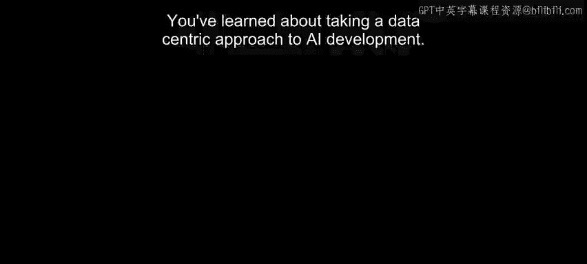
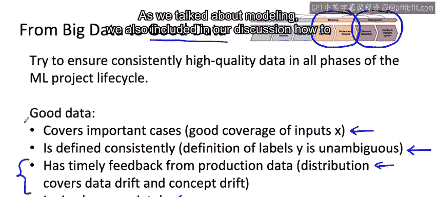

# 吴恩达《机器学习工程师的生产实践（MLOps）Machine Learning Engineering for Production》中英字幕 - P25：24_从大数据到好数据.zh_en - GPT中英字幕课程资源 - BV1pi4y167g5

You've learned about taking a data centric approach to AI development in this last video for this week。

 I'd like to leave you with a thought on shifting from big data to good data Here's what I mean。

A lot of modern AI had grown up in large consumer internet companies with maybe a billion users and thus companies like that have a lot of data on their users if you have big data like that by all means it could help the performance of your tremendously but both a software consumer internet。

 but equally importantly for many other industries。

 there just isn't a billion data points and I think it may be even more important for those applications to focus not just on big data but on good data I found that if you're able to ensure consistently high quality data in all phases the machine learning project lifecycle that is key to making sure that you have a high performance and reliable machine learning deployment What do I mean by good data I think good data covers the important。

Cs？So you should have good coverage of different inputs X and if you find out that you don't have enough data with speech with cafe noise。

 data augmentation can help you get more data， get more diverse inputs X to give you that coverage so we spent quite a bit of time talking about this in this week's material good data is also defined consistently with definition of labels Y that's unambiguous we haven't talked about this yet but we'll go into much greater depth on this next week good data also has timely feedback from production data we actually talked about this last week when we were covering the deployment section in terms of having monitoring systems to track concept drift and data drift and finally you do need a reasonable size。

DaSo to summarize during the machine learning project lifecycle we've talked about during the deployment phase last week。

 how to make sure you have timely feedback this week as we talked about modeling。

 we also included in our discussion， how to make sure you have hopefully good coverage of important cases。

Next week， when we dive into。Data definition will spend much more time to talk about how to make sure your data is defined consistently and I hope that with the ideas conveyed last week。

 this week and next week， you'll be armed with the tools you need to give your learning algorithm good data through all phases of the machine learning project lifecycle So that's it Congratulations on getting to the end of this week's videos on modeling。

I look forward to diving more deeply with you into the data part of the full cycle of a machine learning project and next week we'll also have a short optional section on scoping machine learning projects I look forward to seeing you next week。

😊。