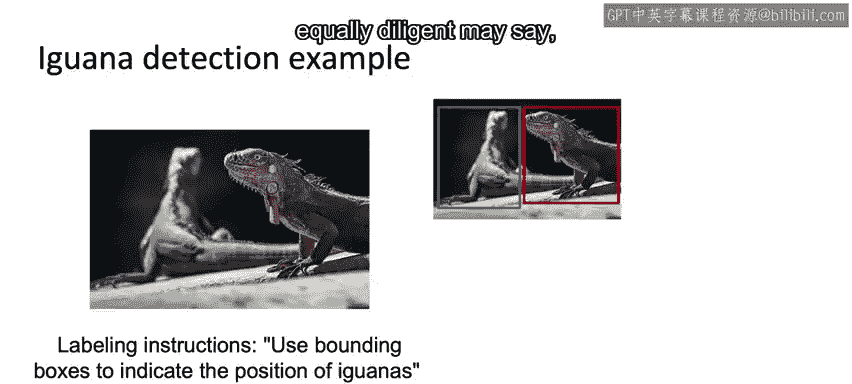
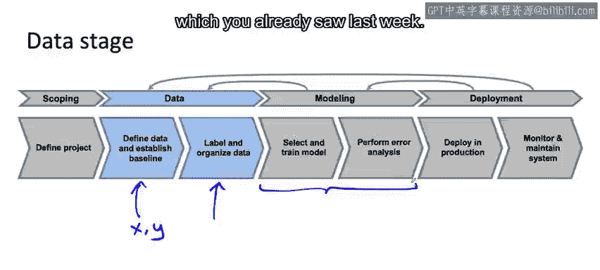

# 吴恩达《机器学习工程师的生产实践（MLOps）Machine Learning Engineering for Production》中英字幕 - P26：25_数据定义为何困难.zh_en - GPT中英字幕课程资源 - BV1pi4y167g5

Welcome back， you're now in the third and final week of this course just one more week and then you'll be done with this first course of the specialization。

😊，This week we dive into data， How do you get data that sets up your training your modeling for success。

 But first， why is defining what data to use even hard， Let's look at an example。

 I'm going use the example of detecting Iguanas one of my friends Karen custom fruit is really like Iguanas so have bunch of Iguana pictures floating around Let's say that you've gone into the forest and collected hundreds of pictures like these and you sent these pictures to labels with the instructions。

 please use bounding boxes to indicate the position of Iguanas one labor may label it like this and say one Iguana to Iguanas This labor to a good job。

 a second labor that is equally hardwork equally diligent may say look the Iguana on the left has a tale that goes all the way to the right of this image So the second labor may say one Iguana to Iguanas good job labor how to this labor either a third layer。

y say， well I'm going to look through all hundreds of images and label them all and I'm going to use bounding boxes and so let me indicate the position ianas and draw a bounding box like that three diligent hardworking labelers can come up with these three very different ways of labeling iguanas and maybe any of these is actually fine I would prefer the top two rather than third one。

 but any of these labeling conventions could result in your learning algorithm learning a pretty good iguana detector but what is not fine is if one third of your labelers use the first and one third。

 a second and onet the third labeling convention because then your labels are inconsistent and this is confusing to the learning algorithm Well the Iguana example was a fun one you see this type of effect in many practical computer vision problems as well。

Let's use the phone defect detection example， if you ask the laborer to use bounding boxes to indicate significant defects a。

 maybe one laborer would look at and go oh well， clearly the scratch is the most significant defect。

 let me draw a bounding box on that。A second laborer may look at this phone and say there're actually two significant defects There's a big stretch and then there's that small mark there It's called a pit mark kind of like if someone poked a phone with a sharp screwewdriver I think the second labor probably did a better job but then a third labor may look at this and say well here's a boundarying box that shows you where the defects are between these three labels probably the one in the middle would work the best but this is a very typical example of inconsistent labeling that you will get back from a labeling process with even slightly ambiguous labeling instructions and if you can consistently label the data with one convention maybe the one in middle your learning algorithm will do better what we will do in this week is dive into best practices for the data stage of the full cycle of a machine learning project。

Specifically， we'll talk about how to。Define what is the data， what should be X。

 and what should be Y， and establish a baseline。And doing that well will set you up to label and organize the data well。

 which would give you a good data set for when you move into the modeling phase。

 which you already saw last week， many machine learning researchers and many machine learning engineers had started off downloading data off the internet to experiment with models so using data prepared by someone else。

 nothing at all wrong with that and for many practical applications the way you prepared your data will have a huge impact on the success of your machine learning project。

In the next video we'll take a look at some more examples of how data can be ambiguous so that this will set us up later this week for some techniques for improving the quality of your data let's go on to the next video。

