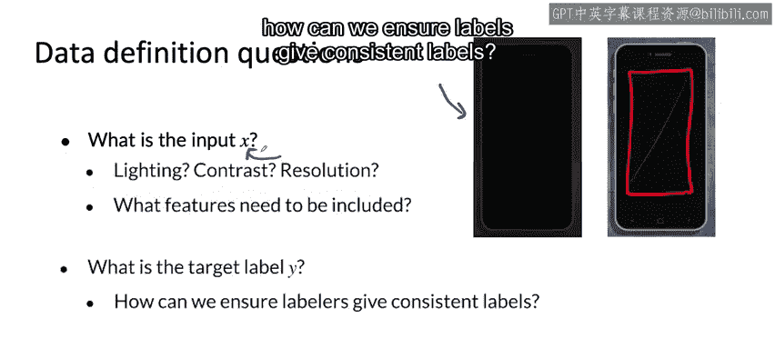

# 吴恩达《机器学习工程师的生产实践（MLOps）Machine Learning Engineering for Production》中英字幕 - P27：26_更多标签歧义示例.zh_en - GPT中英字幕课程资源 - BV1pi4y167g5

In the last video， you saw how the right bounding boxes for an image can be ambiguous。

 Let's take a look at some more label ambiguity examples。😊。

We briefly touched on speech recognition in the first week of this course， here's another example。

Given this audio clip。s。Sounds like someone was standing on a busy roadside asking for the nearest gas station and then a car drove past so did they say something right after that。

 I don't know so one way to transcribe this would be nearest gas station and in some places people spell with twoMs so that would be a different way to spell it and we could have used dot dot dot or ellipses instead of the comma as well which would be another ambiguity。

Or given the audio had noise after the last word。Ands guest station。

Did they say something off the nearest gas station， I'm not sure actually。

 so would you transcribe it like this instead？So they are combator in many ways to trans this。

With 1 m or  two ms， commmerole ellipses， whether they write unintelligible at the end of this。

Being able to standardize on one convention will help your speech recognition algorithm。

 Let's also look an example of structured data。A common application in many large companies is user ID merge that's when you have multiple data records that you think correspond to the same person and you want to merge these user data records together for example。

 say you run their website that offers online listings of jobs so this may be one data record that you have from one of your registered users with the email first name last name and address Now say your company acquires a second company that runs a mobile app that allows people to log in to chat and get advice from each other about their resumes。

It seems synergistic for your business if you run a listing of online jobs。

 maybe you merge or acquire a second company that runs a mobile app。

That lets people chat about their resumes and from this mobile app。

 you have a different database of users。 So given this。Data record。And this one。啊。

Do you think these two are the same person One approach to the user ID merge problem is to use a supervised learning algorithm that takes input to user data records and tries to output either one or zero。

Based on whether it thinks these two are actually the same physical human being if you have a way to get ground truth data records such as if a handful of users are willing to explicitly link the two accounts。

 then that could be a good set of labeled examples to train an algorithm。

 but if you don't have such a ground truth set of data。

 what many companies have done is ask human labels。

 sometimes a product management team to just manually look at some pairs of records that have been filter to have maybe similar names or similar zip codes。

 and then to just use human judgment to determine if。

These two records appear to be the same person because whether these two records really is the same person is genuinely ambiguous。

 they may and they may not be。Different people will label these records inconsistently。

And if there's a way to just get them to label the data a little more consistently。

 you see some examples of how to do this later， even when the ground truth is ambiguous。

 then that can help the performance of your learning algorithm Use ID merging is a very common function in many companies。

 Let me just ask you to please do this。Only in ways that are respectful of the user's data and their privacy。

 and only if you are using the data in a way。Consistence with what they have given you permission for you know user privacy is really important a few other examples from structured data。

If you are trying to use the learning algorithm。To look at a user account like these。And predict。

Is it？A bot。Or a spam account。Sometimes that can be ambiguous。Or if you look at a online purchase。

Is this a fraudulent？Transaction。So has someone still an account and is using a stolen account to interact with your website or to make purchases？

Sometimes that too is ambiguous。Or if you look at someone's interactions with your website and you want to know。

Are they looking for a new job at this moment in time based on how someone behaves on a job board website or a resume chat app。

 you can sometimes guess if they're looking for a job， but it's hard to be sure。

 so that's also a little bit ambiguous in the face of potentially very important and valuable prediction tasks like these the ground truth can be ambiguous。

And so if you ask people to take their best guess at the ground truth label for to like these。

Giving labeling instructions that results in more consistent and less noisy and less random labels will improve the performance of your learning algorithm。

 So when defining。The data for your learning algorithm。Here are some are some important questions。

First， what is the input X， for example， if you are trying to detect defects on smartphones。

For the pictures you're taking is the lighting good enough， is the camera contrast good enough。

 is the camera resolution good enough？So if you find that you have a bunch of pictures like these。

 which is so dark， it's hard even for a person to see what's going on。

The right thing to do may not be to take this input X and just label it。

 It may be to go to the factory and politely request improving the lighting because it is only with this better image quality that the labeler can then more easily see stretches like this and。

Label them。So sometimes if your sensor or your imaging solution or your audio recording solution is not good enough。

 the best thing you could do。Is recognized that if even a person can't look at the input and tell what's going on。

Then improving the quality of。Your sensor。Or improving the quality of the input X。

That can be an important first step to ensuring your learning algorithm kind of reasonable performance。

And for structured data problems， defining whether the features to include can have a huge impact on your learning algorithm's performance。

 for example， for user ID merge， if you have a way of getting the user's location。

 even a rough GPS location， if you have permission from the user to use that can be a very useful cue for deciding whether two user accounts actually belong to the same person。

 and of course please do this type of thing only if you have permission from the user to use their data this way。

 in addition to defining the input X。You also have to figure out what should be to target label Y and as you've seen from the preceding examples。

 one key question is how can we ensure labelers give consistent labels In the last video in this video you saw a variety of problems with the labels being ambig years or in some cases the input X not being sufficiently informative such as an image is too dark let's take these data issues and put them into most systematic framework that will allow us to devise solutions in the more systematic way let's go on to the next video to take a look。

