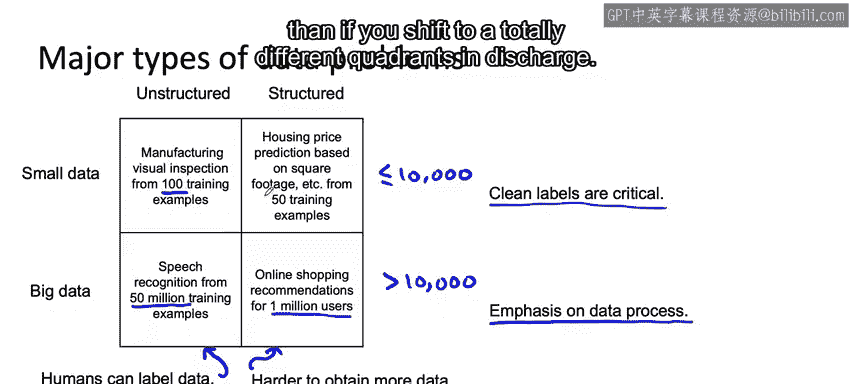

# 吴恩达《机器学习工程师的生产实践（MLOps）Machine Learning Engineering for Production》中英字幕 - P28：27_主要的数据问题类型.zh_en - GPT中英字幕课程资源 - BV1pi4y167g5

I'd like to share with you a useful framework for thinking about different major types of machine learning projects it turns out that the best practices for organizing data for one type can be quite different than the best practices for a totally different type let's take a look at one these major types of machine learning projects Let's fill in this two by two grid one axis will be whether your machine learning problem uses unstructured data or structured data I found that the best practices for these are very different。

Mainly because humans are great at processing unstructured data。

 like images in audio and text and not as good at processing structured data like database records。

The second axis is the size of your dataset， do you have a relatively small dataset or do you have a very large dataset there's no precise definition of what exactly is small and what is large。

 but I'm going to use as a slightly arbitrary threshold。Whether you have over 10，000 examples or not。

And clearly， this boundary is a little bit fuzzy。And the transitions from small to big data sets is a gradual one。

 but I found that best practices for if you have， say。100 or 1 thousand0 examples。

 smaller data sets is pretty different than we have a very large data set。

And the reason I chose to number at 10000。Is that's roughly the size beyond which it becomes quite painful to examine every single example yourself You know。

 if you have 1 thousand examples， you could probably examine every example yourself。

But when you have 100，000 examples， 10，000，100，000 million examples is。

It becomes very time consuming for you as an individual or maybe a couple of machine learning engineers to manually look at every example。

 so that affects。The best practices as well， let's look at some examples if you are training a manufacturing visual inspection from just  a hundred examples of stretch phones。

That's unstructured data because this is image data and it's a pretty small data set if you are trying to predict housing prices。

Based on the size of thehulls and other features of thehulls from just 50 training examples。

 then there's a structured data set。Withve just。Real value features。And a relatively small data sets。

If you are carrying out speech recognition from 50 million training examples。

 there's unstructured data， but you have a lot of data。

Or if you are trying to recommend products so online shopping recommendations and you have a million users in your database。

 then there's a structured problem with relatively large amount of data for a lot of unstructured data problems。

 people。Can help you to label data and data augmentation。

s as synthesizing new images or synthesizing new audio。

 and there's some emerging techniques for synthesizing new text as well。

 but data augmentation can help。So for manufacturing， vision inspection。

You can use data augmentation to maybe generate more pictures of smartphones or for speech recognition data augmentation can help you synthesize audio clips with different background noise In contrast for structured data problems。

It can be harder to obtain more data and also harder to use data augmentation if only 50 houses have been sold recently in that geography。

 well it's hard to synthesize new houses that don't exist。

Or if you have a million users in your database， again it's hard to synthesize new users that don't really exist and it's also harder。

 not impossible the worth trying， but it may or may not be possible to get humans to label the data So I find that the best practices for unstructured versus structured data are quite different The second axis is the size your data when you have a relatively small data having clean labels is critical。

If you have 100 training examples， then if just one of the examples is mislabel。

 that's 1% of your data set。And because the data is small enough for you or a small team to go through it efficiently。

 it may well be your worth of your while to go through that1 hundred examples and make sure that every one of those examples is labeled in a clean and consistent way。

 meaning according to a consistent labeling standard In contrast， if you have。A million data points。

It can be harder， maybe impossible。For a small machine learning team to manually go through every example。

 having clean labels is still very helpful。 Don't get me wrong Even when you have a lot of data。

 clean labels is better than non cleanan ones。But because of the difficulty of having the machine learning and journey team go through every example。

 the emphasis is on data processes。In terms of how you collect install store the data。

 the labeling instructions you may write for a large team of crowdsourcece labelers。

 and once you have executed some data process such as asked a large team of labelers to label a large set of audio clips。

 it can also be much harder to go back and change your mind and get everything relabeled。

So let's summarize for unstructured data problems， you may or may not have a huge collection of unlabelled examples X。

 maybe in your factory you actually took many thousands of images of smartphones。

 but you just haven't bothered to label all of them yet。

This is also common in the self driving car industry where many self driving car companies have collected tons of images of cars driving around。

 but just have not yet gotten that data labeled。For these unstructured data problems。

 you can sometimes get more data by taking your unlabeled data X and asking humans to just label more of it this doesn't apply to every problem but for the problems where you do have tons of unlabeled data。

 this can be very helpful。And as we've already mentioned， data augmentation can also be helpful。

For structured data problems it usually harder to obtain more data because you only have so many users or only so many holess for installed that you can collect data from and human labeling on average is also harder。

 although there are some exceptions such as in the last video where you saw that we could try to ask people to label examples for the user ID merge problem。

 but in many cases where we ask humans to label structured data。

 even when it's a completely fine idea， completely worthwhile to ask people to try to label if two records are the same person。

There's more likely to be a little bit more ambiguity where even the human labor sometimes finds it hard to be sure what is the correct label Lastly。

 let's look at small versus big data where I use the slightly arbitrary threshold of whether you have。

More or less than， say， 10，000， they put training examples。For small data sets。

 clean labels are critical。And the dataset may be small enough for you to manually look through the entire dataset and fix any inconsistent labels Further the labeling team is probably not that large。

 it may be one or two or just a handful of people that created all the labels so if you discover an inconsistency in the labels say one person label Iguanas one way and the different person label Iguanas a different way。

 you can just get the two or three labels together and have them talk to each other and hasel and agree on one labeling convention for the very large dataset sets。

 the emphasis has to be。On data process and if you have 100 labelers or even more。

 it's just harder to get100 people into a room to all talk to each other and hash out the process。

And so you might have to rely on a smaller team to establish a consistent label definition。

 and then share that definition with all， say， hundred or more labelers and ask them to all implement the same process。

I want to leave you one last thought， which is that。

I found this categorization of problems into unstructured versus structured small versus big data。

 I found this to be helpful for predicting， not just whether。Data processes。

Generalize from one to another problem， but also whether other machine learning ideas generalize from one to another。

So one tip， if you are working on a problem from one of these four quadrants， then on average。

 advice from someone that has worked on problems in the same quadrants will probably be more useful。

Then advice from someone that's worked in a different quadrant。

I found also in hiring machine learning engineers， someone that's worked in the same quadrant as the problem I'm trying to solve will usually be able to adapt more quickly to working on other problems in that quadrant because the instincts and decisions are more similar within one quadrant than if you shift to a totally different quadrant in this chart。

I've sometimes heard people give advice like oh if you're building a computer vision system。

 always get at least 10 labeled examples and I think people that give advice like that are well-meaning and I appreciate that they're trying to give good advice but I' found that advice to not really be useful for all problems machine learning is very diverse and it's hard to find one size fits all advice like that。

 I've seen computer vision problems built with 100 examples or 100 examples for a class between systems built with 100 million examples and so if you are looking for advice on a machine learning project。

 try to find someone that's worth in the same quadrant as the problem you are trying to solve。😊。

Now we talked about one formulation of different types of machine learning problems。

 there's one aspect I would like to dive into with you in the next video which is how for small data problems having clean data is especially important let's take a look at the next video of why this is true。

