# 吴恩达《机器学习工程师的生产实践（MLOps）Machine Learning Engineering for Production》中英字幕 - P29：28_小数据与标签一致性.zh_en - GPT中英字幕课程资源 - BV1pi4y167g5

In problems of a small data set， having clean and consistent labels is especially important。

 let's start with an example。One of the things I used to do is use machine learning to fly helicopters One thing you might want to do is take us input to voltage applied to the motor or to the helicopter rotor and predict what is the speed of the rotor you can have this type of problem not just a flying helicopters before other control problems where you're controlling the speed of a motor so let's say you have a data that looks like this where you have five examples so a pretty small data because this data that is the output Y is pretty noisy is difficult to know what is the function you should use to map voltage to the rotor speed in RPM。

Maybe it should be a straight line。Something like that。Or maybe something like that。

 or maybe it should go up and then be flat like that， or maybe it should be a curve like that。

 really hard to do。When you have a small data set， five examples in noisy labels is difficult to fit a function confidently。

Now if we had a ton of data。

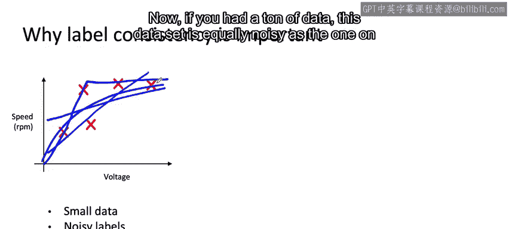

This data is equally noisy as the one on the left， but you just have a lot more data。

Then the learning algorithm can average over the noisy dataset sets， and you can now fit。

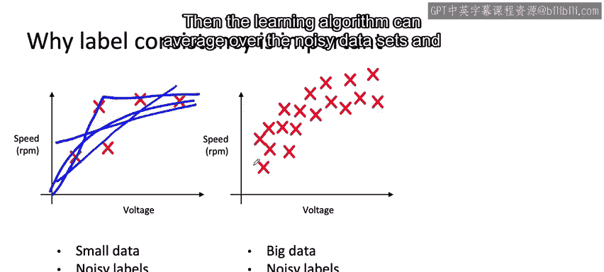

Function， you pretty confidently， looks like curve should be something like that。

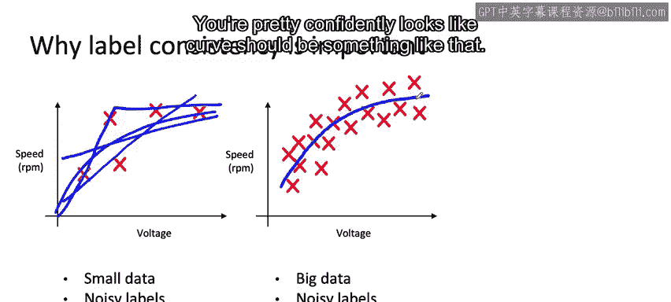

A lot of AI had recently grown up in large consumer internet companies。

 which may have 100 million users or a billion users and does very large data sets。

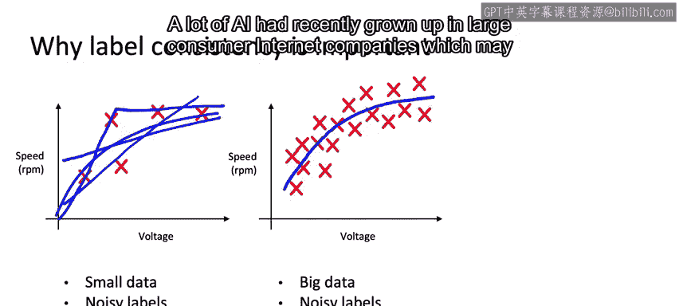

And so I think some of the practices for how to deal with small dataset sets have not been emphasized as much as would be needed to tackle problems where you don't have 100 million examples。

 but only1 thousand0 or even fewer， so to me， the interesting case is what if you still have a small data。

 five examples， same as the example on the left。

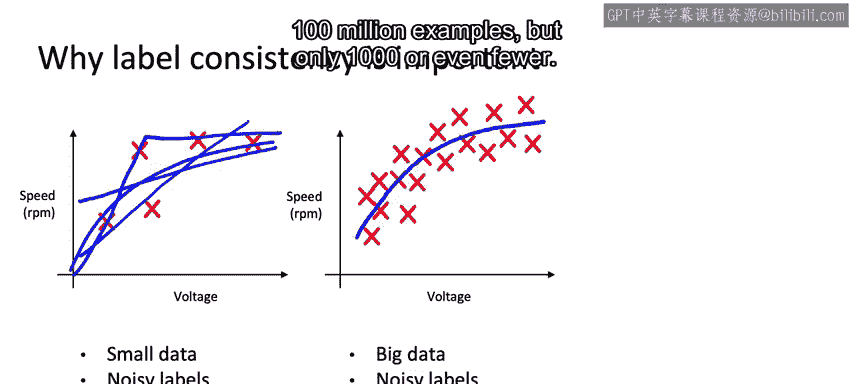

But you now have clean and consistent labels。 In this case。

 you can pretty confidently fit a function。Through your data。And with only five examples。

 you can build a pretty good model for predicting speed as a function of the input voltage。

I've trained computer vision systems with just 30 images and had to work just fine。

And the key is usually to make sure that the labels are clean and consistent。

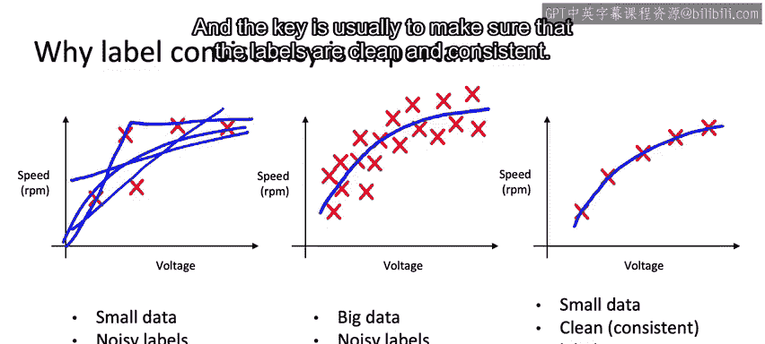

Let's take a look at another example of phone defect inspection the task is to take us input pictures like these and to decide whether there is a defect or not on the phone。

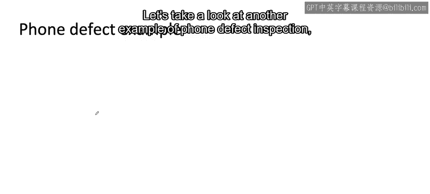

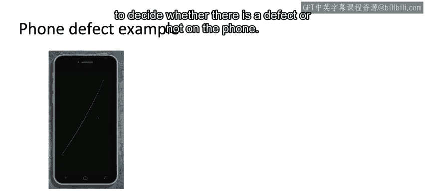

Now， if labeling instructions are initially unclear， then labels will label images inconsistently。

 it may be that when there's a giant scratch， you know， sufficiently large one。

That everyone would agree as a defect and if there's a tiny little thing that inspectors will ignore it。

 but there's this region of ambiguity where different inspectors will label different scratches。

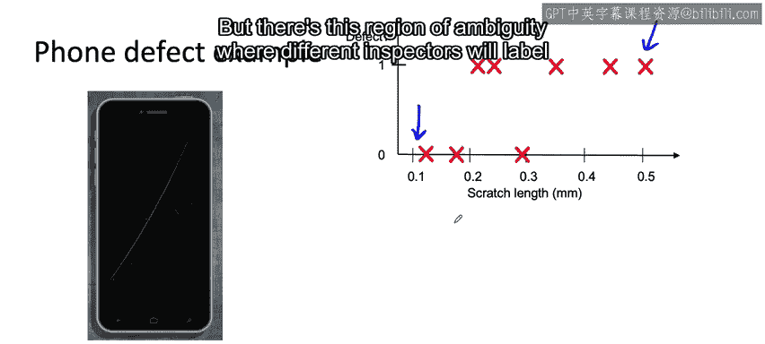

With a length between 0。2 and 0。4 in slightly inconsistent ways。

 so one solution to this would be to say why don't we try to get a lot more pictures of phones or scratches and then see what the inspectors do and then maybe eventually we can train a neural network they can figure out from the image what is and what isn't a stretch on average。

 maybe that approach could work， but it'd be a lot of work and require collecting a lot of images I found that it can be more fruitful to ask the inspectors to sit down and just try to reach agreement on what is the size of stretch that would cause them to label a stretch of a bounding box versus decide is too small and not worth bothering labeling so in this example if the labelers can agree that the point of transition from where little ding becomes a defect。

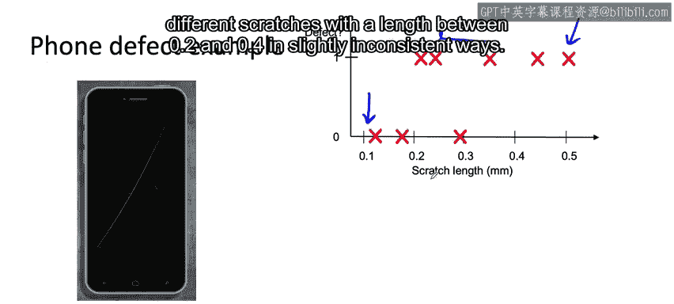

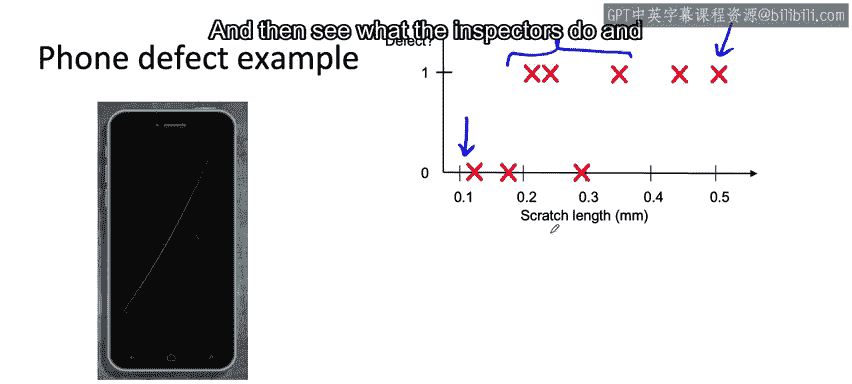

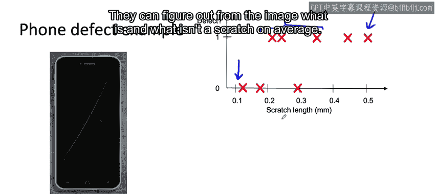

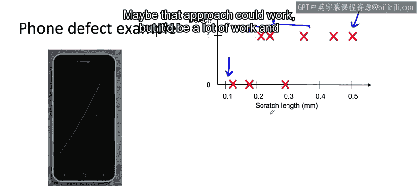

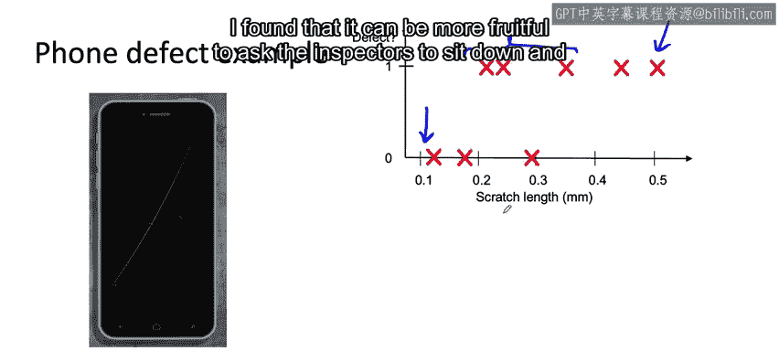

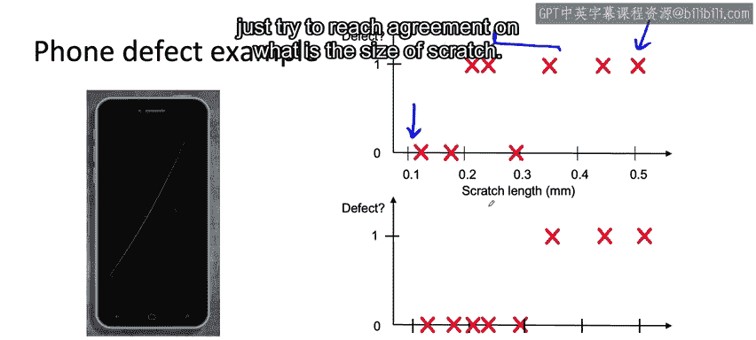

Is a length of 0。3， then the way they label the images becomes much more consistent and it becomes much easier for learning algorithm to take as input images like this and consistently decide whether something is a scratch or a defect。

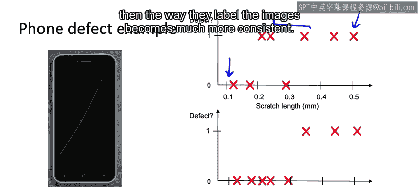

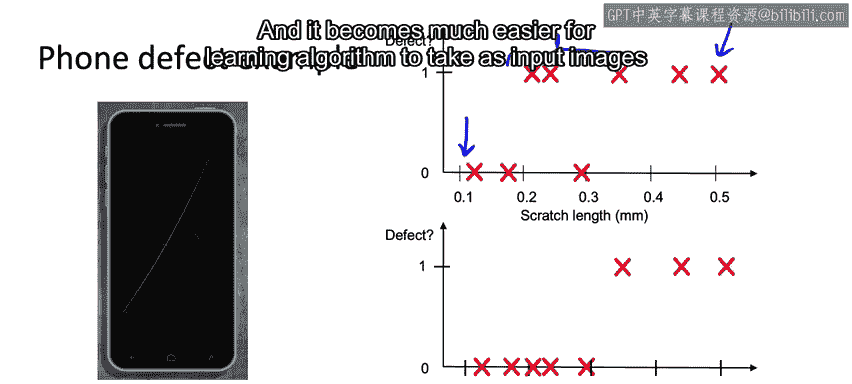

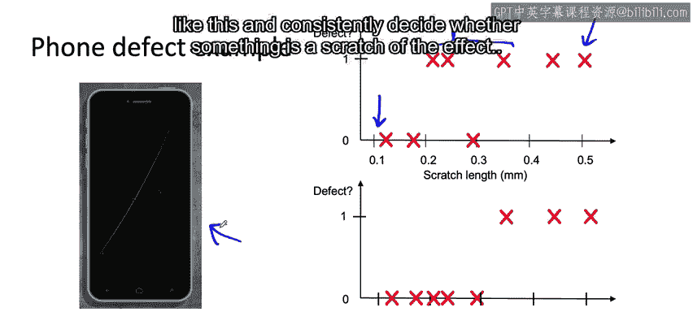

Just to be clear， in this example， the input to the learning algorithm is images like that on the left。

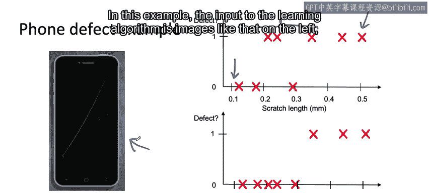

Not the stretch length like that on the right， but the point is if you can get inspectors to agree what is a stretch and what is in a stretch and to define the task as putting bounding boxes around defects that over 0。

3 millimeters in length。Then that will cause your images to be labeled more consistently and allow your learning algorithm to achieve higher accuracy even when your data set isn't that big so you've seen a couple examples now of how label consistency helps a learning algorithm I want to wrap up this video with one more thought。

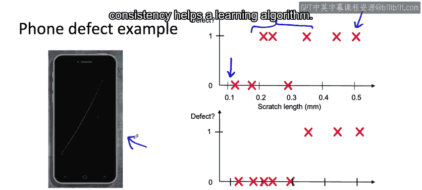

Which is that big data problems can have small data challenges too。

Specifically， problems with a large data set， but where there's a long tail of rare events。

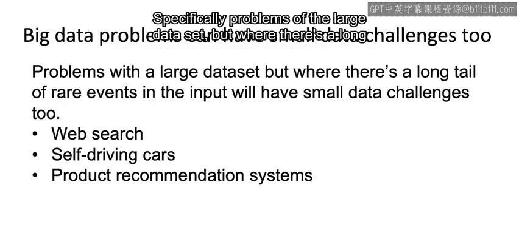

In the input， well have small data challenges too。

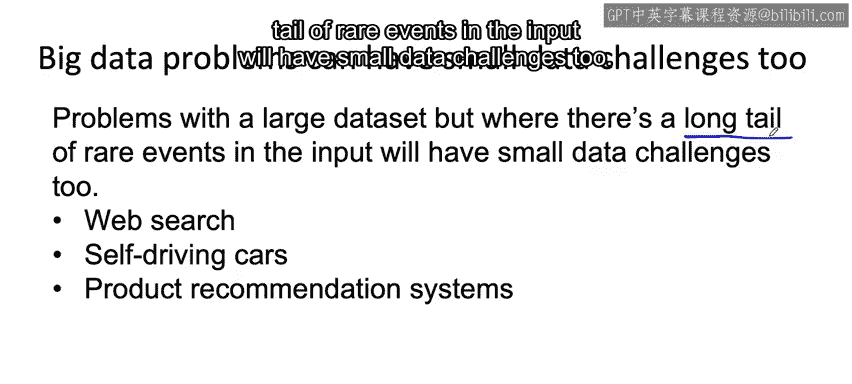

For example， the large web search engine companies all have very large data sets of web search queries。

 but many web queries are actually very rare。

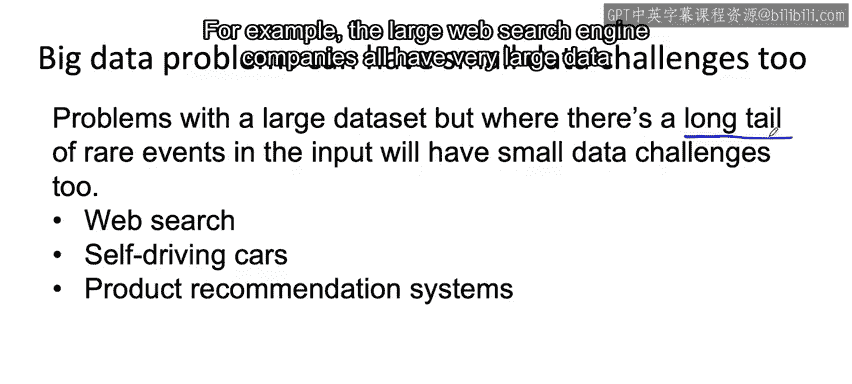

And so the amount of click stream data for the rare queries is actually small or ticksile driving cars。

Selfdriving car companies tend to have very large data sets collected from driving hundreds of thousands or millions of hours or more。

 but there are rare occurrences that are critical to get right to make sure a self-driving car is safe。

 such as that very rare occurrence of a young child running across a highway or that very rare occurrence of a truck parked across a highway so even if a self-driving car has a very large data。

 the number of examples it may have of these rare events is actually very small and so ensuring label consistency in terms of how these rare events are。

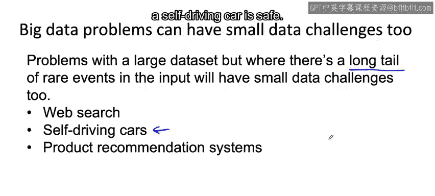

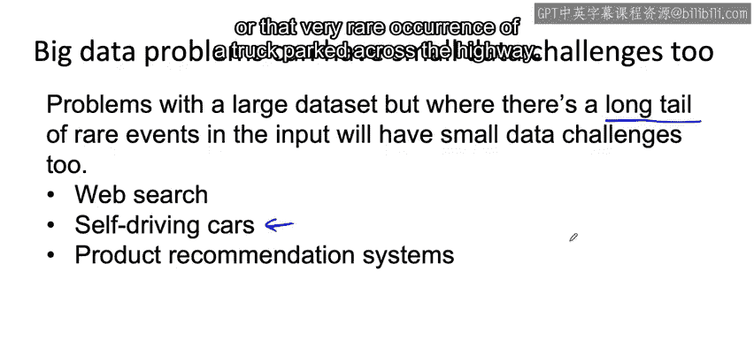

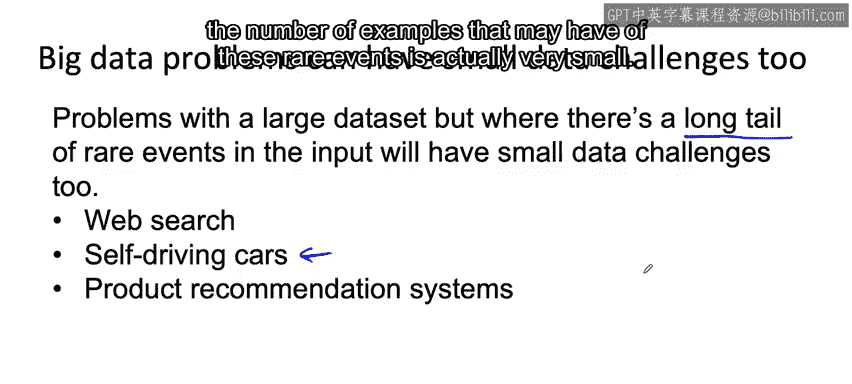

Detected and labeled is still very helpful for improving self driving costs or product recommended systems。

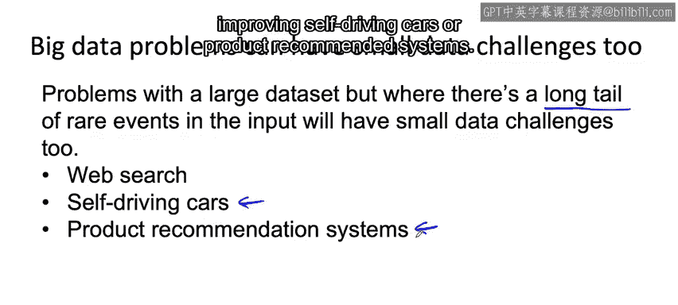

If you have a catalog of hundreds of thousands or millions or more items。

 or product recommendation systems， if you have an online catalog of anywhere from thousands to hundreds of thousands to sometimes even millions of catalogs to sometimes even millions of items。

 then you will have a lot of products where the number sold of that item is quite small。

 and so the amount of data you have of users interacting with the items in the long tail is actually small。

 and if there's a way which is not easy， but there's a way to make sure that data is clean and consistent then that too will help you learning algorithm in terms of how it recommends or doesn't recommend items in the long tail where the amount of data per item will tend to be low。

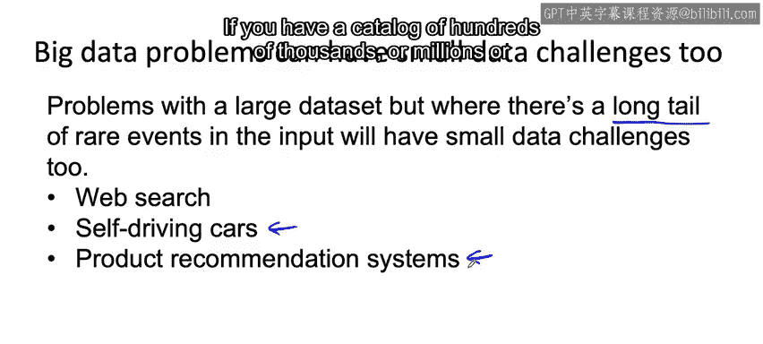

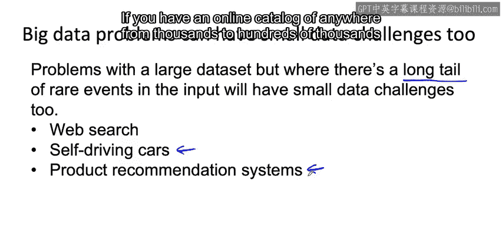

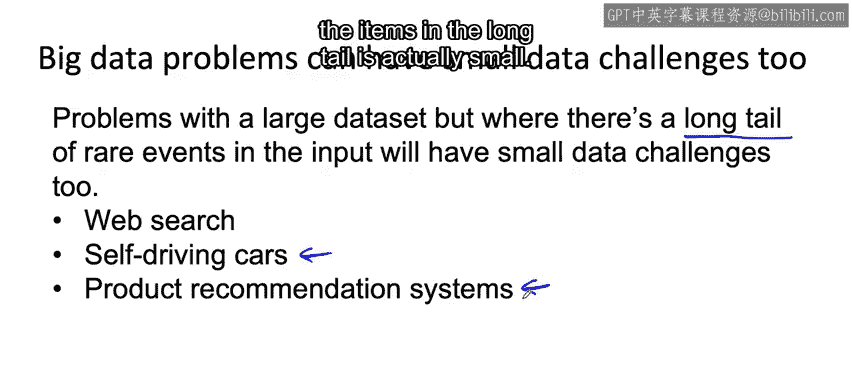

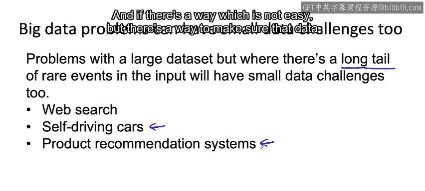

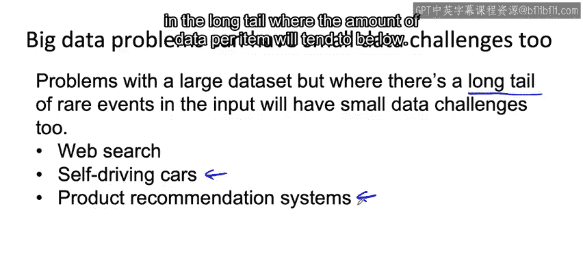

So when you have a small data， label consistency is critical， even when you have a big data。

 label consistency can be very important， it's just that found it easier on average to get to label consistency on smaller data sets than on very large ones。

In the next video we'll look at some concrete ideas and best practices for improving your dataset label consistency let's go on to the next video。

