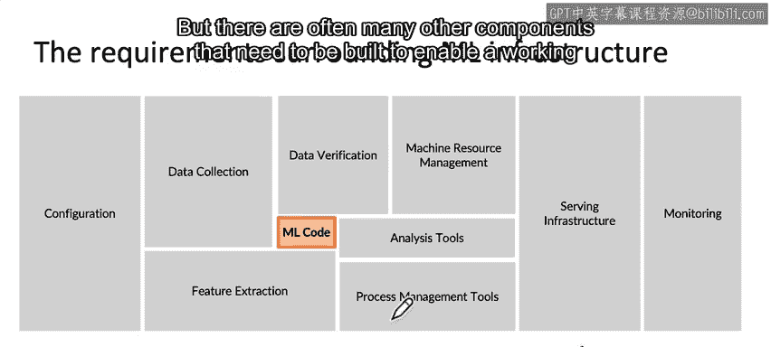

# 吴恩达《机器学习工程师的生产实践（MLOps）Machine Learning Engineering for Production》中英字幕 - P2：1_欢迎.zh_en - GPT中英字幕课程资源 - BV1pi4y167g5

Hi and welcome to Machine Learning Engineing for Product。😊，A lot of learners have asked me，Hey。

 Andrew， I've learned to train a machine learning model， now what do I do？😊。

Machine learning models are great， but unless you know how to put them into production。

 it's hard to get them to create the maximum amount of possible value。

 or for those of you that may be looking for a position in machine learning。

 many interviewers will ask， have you ever deployed a machine learning algorithm in production？😊。

In this four course specialization， the first course taught by me， the second。

 third and fourth courses taught by Robert Crow， who's exped atist from Google。

 we hope to share with you the practical hands-on skills and techniques you need to not just build a machine learning model but also to put them into production and so by the end of this first course and by the end of this specialization I hope you have a good sense of the entire lifecycle machine learning project from training model to put into production and really how to manage the entire machine learning project let's jump in。

😊，Let's start to with an example， let's say you're using computer vision to inspect phones coming off a manufacturing line to see if there are defects on them。

 so this bone shown on the left doesn't have any scratches on it。

 but if there was a stretch or track or something，A computer vision algorithm would hopefully be able to find。

This type of scratch or defect and maybe put the bounding box around it as part of quality control。

If you get a data set of stretch phones， you can train a computer vision algorithm。

 maybe in your network to detect these types of defects。

 but what do you now need to do in order to put this into production deployment This would be an example of how you could deploy a system like this you might have an edge device by edge device I mean a device that is living inside the factory that is manufacturing these smartphones and that edge device would have a piece of inspection software whose job it is to take a picture of the phone。

 see if there's a stretch and then make a decision on whether this phone is acceptable or not This is actually commonly done in factories is called automated visual defect inspection What the inspection software does is it will control a camera that will take a picture of the smartphone as it rolls off the manufacturing line。

And it then has to make an API call to pass this picture to a prediction server。

 and the job of the prediction server is to accept these API calls， receive an image。

 make a decision as to whether or not this phone is effective and return is prediction and then the inspection software it can make the appropriate control decision。

 whether to let the server move on in the manufacturing line or whether to shove it to a side because was effective and not acceptable。

So after you have trained a learning algorithm， maybe trained in neural network to take as input X pictures of phones。

And add them to why predictions about whether the phone is defective or not。

You still have to take this。Machine learning model。Put it in a prediction server。

 set up API interfaces and really write all of the rest of the software in order to deploy this learning algorithm into production This prediction server is sometimes in the cloud。

😊，And sometimes the prediction server is actually at the edge as well， in fact， in manufacturing。

 we use edge deployments a lot because you can't have your factory go down every time your internet access goes down。

But cloud deployments with prediction server is a server in the cloud is also used for many applications。

 Let's say you write all the software。 What could possibly go wrong。

It turns out that just because you've trained a learning algorithm that does well on your test set。

 which is to be celebrated， it's great when you do well on you whole test set。Unfortunately。

 reaching that milestone doesn't mean you're done， there can still be quite a lot of work and challenges ahead。

To get a valuable production deployment running。For example。

Let's say your training set has images that look like thislis。

There's a。Good phone on the left， the one in the middle has a big scratch across it。

 and you've trained your learning algorithm to recognize that phones like this on the left are okay。

Meaning there are no defects and maybe draw bounding boxes around scratches or other defects it finds in foams。

When you deploy it in the factory， you may find that the real high production deployment gives you back images like this。

Much darker ones because the lighting factory。Because the lighting conditions in the factory have changed for some reason compared to the time when the training set was collected。

 this problem is sometimes called concept drift or data drift。

 you learn more about these terms later in this week。

But this is one example of the many practical problems that we as machine learning engineers should step up to solve if we want to make sure that we don't just do well on the Holout test set。

 but that our systems actually create value in a practical。

Production deployment environment I've worked on quite a few projects where my machine learning team and I would successfully nail a proof of concept and by that I mean we train a model in a Jupiter notebook and it will work great and we will celebrate that you know you should celebrate it when you have a learning algorithm and work well in a Jupiter notebook or in a development environment。

😊，But it turns out that sometimes I've seen many projects where that's success。

 which is a great success。The practical deployments is still maybe another six months of work。

 and this is just one of many of the practical things that a machine learning team has to watch out for and handle in order to actually deploy these systems。

Some machine learning engineers will say it's not a machine learning problem to address these problems。

 you know， the dataset set changes， some machine learning engineers think， well。

 is that a machine learning problem？My point of view is that our job is to make these things work and so if the data set has change is I think of it as my responsibility when I work on a project to step in and do what I can to edge the data distribution as it is rather than as I wish it is so this specialization will teach you about a lot of these important practical things for building machine learning systems that work not just in the lab。

 not just in the Jupyter notebook but in a production deployment environment。😊。

A second challenge of deploying machine learning models in production is that it takes a lot more than machine learning code。

 Over the last decade， there's been a lot of attention on machine learning models。

 So your neural network or other algorithm that learns a function mapping from some input to some output。

And there's been amazing progress in machine learning models。

But it turns out that if you look at a machine learning system in production。

 if this little orange rectangle represents the machine learning code。

 the machine learning model code， then this is all the code you need for the entire machine learning project。

I feel like for many machine learning projects， maybe only 5 to 10%， maybe even less of the code。

 it's machine learning code， and I think this is one of the reasons why when you have a proof of concept model working。

Maybe maybe Juid a notebook。It can still be a lot of work to go from that initial proof of concept to the production deployment。

 so sometimes people refer to the POC or the proof of concept to production G。

And a lot of that gap is sometimes just the sheer amount of work it is to also write all of this code out here。

Beyond the initial。Machine learning model code。 So what is all this other stuff。

 This is a diagram that of adapted from a paper by D Sully and others。

Beyond the machine learning code， there are also many components。

 especially components for managing the data such as data collection， data verification。

 feature extraction， and after you are serving it how to monitor the system or monitor the data comes back help you analyze it but there are often many other components that need to be built to enable a working production deployment so in this course you learn what are all of these other pieces of software needed for a valuable production deployment。

But rather than looking at all of these complex pieces。

 one of the most useful frameworks I found for organizing the workflow of a machine learning project is to seally plan out the life cyclee of a machine learning project。

 let's go to the next video to dive into what is the full life cycle of a machine learning project and I hope this framework will be very useful for all of your machine learning projects that you plan to deploy in the future let's go to the next video。

😊。