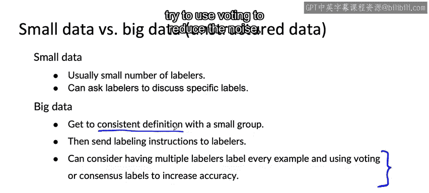

# 吴恩达《机器学习工程师的生产实践（MLOps）Machine Learning Engineering for Production》中英字幕 - P30：29_提高标签一致性.zh_en - GPT中英字幕课程资源 - BV1pi4y167g5

Let's take a look at some ways to improve the consistency of your labels here's a general process you can use。

If you are worried about labels being inconsistent。

 find a few examples and have multiple labelers label the same example。In some cases。

 you can also have the same labeler， label and example。

Wait a while until they've hopefully forgotten or technical deterists wash out。

 but let them take a break and then come back and relabel it and see if they're even consistent with themselves。

When you find that there's disagreements。Have the people responsible for labeling。

 this could be the machine learning engineer， it could be the subject matter exp such as the manufacturing exp that's responsible for labeling what is a stretch and what isnt a stretch and or the dedicated labelers discussed together what they think should be a more consistent definition of a label why。

And try to have them reach an agreement。And ideally， also document and write down that agreement。

And this definition of why。Can then become an updated set of labeling instructions that they can go back to label new data or to relabel old data。

During this discussion， in some cases， the labelers will come back and say they don't think the input X has enough information。

 if that's the case， consider changing the input X。So for example， when we saw the pictures of films。

 they were so dark that we couldn't even tell what was going on。

That was a sign that we should consider increasing the illumination。

 the lighting with which the pictures were taken， but of course I know this isn't always possible。

 but sometimes this can be a big hole and then all this is an iterative process so after improving act or after improving the label instructions。

You would ask the team to label more data and if you think there are still disagreements。

 then repeat the whole process of having multiple labelers label the same example。

 measure disagreement and so on Let's look at some examples one common outcome of this type of exercise is to standardize the definition of labels so between these ways of labeling the audio clip you heard on the earlier video。

 perhaps the labelers will standardize on this as a convention。

Or maybe they'll pick a different one and that could be okay too。

But at least this makes the data more consistent。Another common decision that I've seen come out of a process like this is merging clause。

 so if in your labeling guidelines， you ask labelers to label deep stretches on the surface of the phone as well as shallow stretches on the surface of the phone。

 but if the definition between what constitutes a deep stretch，Versus a。Shallow scratch。

 barely visible here， I know。Its unclear then you end up with labels very inconsistently labeling things as deep versus shallow scratches。

 Sometimes the factory does really need to distinguish between deep versus shallow scratches。

Sometimes fact need to do this to figure out what was the cause of the defect。But sometimes。

I found that you don't really need to distinguish between these two classes。

And you can instead merge the two classes into a single class。Say to scratch class。

And this gets rid of all of the inconsistencies。With different labelers labeling the same thing deep versus shallow。

 so mesion classes isn't always applicable， but when it is it simplifies the task for the learning algorithm。

 one other the technique I've use is to create a new class or create a new label to capture uncertainty。

So， for example。Let's say you ask labelers to label phones as defective or not based on the length of the scratch so here's a sequence of smartphones with larger and larger scratches so not sure if we can see these on your display。

 but let me just make them a little bit more visible here and I know that all of these are really large scratches if this is a real phone you're buying so this is just for illustrative purposes。

And maybe everyone agrees that the giant scratch is its defect。Tiny scratch is not a defect。

 but they don't agree on what's in between。If it was possible to get them to agree。

 then that would be one way to reduce label ambiguity， but if that turns out to be difficult。

 then here's another option， which is to create a new class where you now have three labels。

 you can say it's clearly not an defect or clearly a defect or just acknowledge that some examples are ambiguous and put them in a new borderline clause。

And if it becomes easier to come up with consistent instructions for this lead cost problem。

 because maybe some examples are genuinely borderline。

Then that could potentially improve livinging consistency。

Let me use speech illustration to illustrate this further。Given this audio clip nearest。

I really can't tell what they said。Nearest。And if you were to force everyone to transcribe it。

 some labelers will transcribe nearly go， some will say maybe they'll say nearest grocery。

 and it's very difficult to get to consistency because the audio clip is genuinely ambiguous。

To improve labeling consistency， it may be better to create a new tag， the unintelligible tag。

 and just ask everyone to label this as nearest。Unintelligible。

And this can result in more consistent labels than we were to ask everyone to guess what they heard when it really is。

Unintelligible let me wrap up with some suggestions for working with small versus big datas to improve label consistency and we've just been talking about unstructured data or problems where we can count on people to label the data for small data sets。

 there's usually a small number of labelers and so when you find an inconsistency。

 you can ask the labelers to sit down and discuss a specific image or specific audio clip and try to drive toward agreement for big data sets it would be more common to try to get to a consistent definition with a small group。

And then send the labeling instructions to a larger group of labelers。

 one other technique that is commonly used， but I think overus in my opinion。

 is that you can have multiple labelers label every example and then let them vote and voting is sometimes called consensus labeling in order to increase accuracy I find that this type of voting mechanism technique it can work but is probably overuse in machine learning today。

Where what I've seen a lot of teams do is have inconsistent labeling instructions and then try to have a lot of labelers in in voting to try to make it more consistent。

 but before resorting to this， which I do use but more of a last resort。

 I would usually first try to get to more consistent label definitions to try to make the individual labelist choices less noisy in the first place。

 rather than take a lot of noisy data and then try to use votinging to reduce the noise。

I hope that the tools you just learned for improving label consistency will help you to get better data for your machine learning tasks。

One of the gaps I see in the machine learning world today is that there's still a lack of tools。

 MLOs or machine learning ops tools for helping teams to carry out this type of process more consistently and repeatably so it's not you know us trying to figure this out in a Jupyter notebook but instead to have tools help us to detect when labels andcon and to help facilitate the process and improving the quality of the data so this is something I look forward to hopefully our community working on and developing。

😊，In terms of improving label quality， one of the questions that often comes up is what is human level performance on a task I find human level performance to be important and sometimes misuse concept let's take a deeper look at this in the next video。

