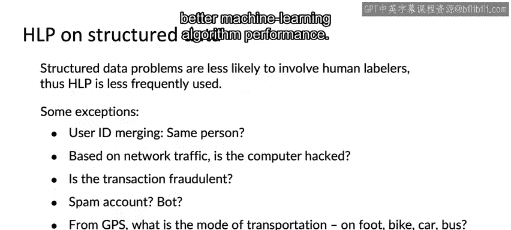

# 吴恩达《机器学习工程师的生产实践（MLOps）Machine Learning Engineering for Production》中英字幕 - P32：31_提高人类水平表现.zh_en - GPT中英字幕课程资源 - BV1pi4y167g5

I think the use of HLP in machine learning had taken off partly because it helped people get papers published to show they can beat HLP。

 but there's also been a bit misused in settings where they go is to build a valuable application。

 not just to publish a paper。When the ground truth is externally defined。

 then there are fewer problems with HLP， when the drown truth really is some real ground truth。

 for example， I've done a lot of work on medical imaging working on you know AI for diagnosing from Xrays or things like these and given an x-ray image if you want to predict a diagnosis。

 if the diagnosis is defined according to say a biopsy， so biological or medical test。

 then HLP helps you measure how well does a doctorer versus a learning algorithm predict the outcome of a biopsy or a biological medical test。

 I find that to be really useful。But when the ground truth is defined by a human。

 maybe even a doctor labeled an X image， then HLP is just measuring how well can one doctor predict another doctor's label versus how well can one learning algorithm predict another doctor's label and that too is useful but it's different than if you're measuring how well you versus a doctor are predicting some ground truth outcome from a medical biopsy So to summarize when the ground truth label is externally defined such as the medical biopsy then HLP gives an estimates for base error and a reducible error in terms of predicting the outcome of that medical test。

 the biopsy but there are also a lot of problems where the ground truth is just another human label the visual inspection example we had from the previous video showed this where the inspector had 66。

7%。Accuracy rather than just aspiring to beat。The human inspector。

 it may be more useful to see why the ground truth。

 which is just some other inspector compared to this inspector， don't agree。 For example。

 if we look at the length of the different scratches that they labeled， say on these six examples。

 these were the lengths of the scratches and if we speak of the inspectors and have them agree that 0。

3 mm is the threshold above which a stretch becomes a defect then what we would do is then what we realize is that for the first example。

 both labeled at one totally appropriately for the second example the ground truth here is one but is less than 0。

3 so we really should change this。To 0， then 0。5 gets 11，0。2000。1。

 and this example has a stretch of 0。1。But really， this should have been。A zero。

 if we go through this exercise of getting the ground truth labor。And this inspector to agree。

 then we actually just raised human level performance from 66。7% to 100%。

 at least as measured on these six examples so but notice what we've done。

By raising HLP to 100% we've made it pretty much impossible for a learning algorithm to beat HLP。

 so that seems terrible， you can't tell a business owner anymore you beat HLP and does they must use your system but the benefit of this is you now have much cleaner。

 more consistent data and that ultimately will allow your learning algorithm to do better。

 So when you go is to come up with a learning algorithm that actually generates accurate predictions rather than just prove for some reason that you can beat HLP I find this approach of working to raise HLP to be more useful to summarize when the ground truth of label Y comes from a human。

HLP being quite a bit less than 100% may just indicate that the labeling instructions or labeling convention is ambiguous。

 On the last slide， you saw an example of this in visual inspection。

 you also see this in speech recognition where the comma versus ellipses。Dot dot， dot。

That type of ambiguous labeling convention will also cause HLP to be less than 100%。

 Imping label consistency will raise human level performance。And this makes it harder。

 unfortunately for your learning algorithm to beat HLP。

 but the more consistent labels will raise your machine learning algorithm performance。

 which is ultimately likely to benefit the actual application so far we've been discussing HLP on unstructured data。

But some of these issues apply to structured data as well。

 you already know that structured data problems are less likely to involve human labors and does HLP is less frequently used。

 but there are exceptions you saw previously the user ID emerging example where you might have a human label where the two records belong to the same person。

Or of worktime projects where we would look at network traffic into a computer to try to figure out if the computer was hacked and we asked human IT experts to provide labels for us Sometimes it's hard to know if a transaction is fraudulent and you just ask a human to label that。

Or is this account a STm account or a bot generated account or from GPS？

What is the mode of transportation is this person on foot or on a bike or in a car？Or in the bus。

 it turns out buses stop at bus stops and so you can actually kind of tell if someone's in a bus or in a car based on the GPS traces and for problems like these。

 it would be quite reasonable to ask a human to label the data。

 at least on the first pass for learning algorithm to make such predictions as these and so when the ground truth label you're trying to predict comes from one human。

 the same questions of what does HLP mean it is a useful baseline to figure out what is possible sometimes when measuring HLP you realize that low HLP stems from inconsistent labels。

And working to improve HLP。By coming up with a more consistent labeling standard will both raise HLP and give you cleaner data with which to improve your learning algorithm's performance Here's what I hope you take away from this video First。

 HLP is important for problems where human level performance can provide a useful reference I do measure it and use it as a reference for what might be possible and to drive error analysis and prioritization。

Having said that， when you're measuring HLP， if you find that HLP is much less than 100%。

 also ask yourself if some gap between HLP and complete consistency is due to inconsistent labeling instructions。

 because that turns out to be the case， then improving labeling consistency will raise HLP。

 and also give cleaner data for your learning algorithm。

 which will ultimately result in better machine learning algorithm performance。

Here's what I hope you take away from this video HLP is useful and important for many applications for problems where I think how well humans perform is a useful reference。

 I do measure HLP and I use that to get a sense of what might be possible and also use HLP to drive error analysis and prioritization。

Having said that， if in the process of measuring HLP。

 you find that HLP is much less than perfect performance， much lower than 100%。

 then it's also worth asking yourself if that gap between HLP and 100% accuracy maybe be due to inconsistent labeling instructions。

 because if that's the case， then improving labeling consistency will both raise HLP but more importantly help you get cleaner and more consistent labels which would improve your learning algorithms performance。

