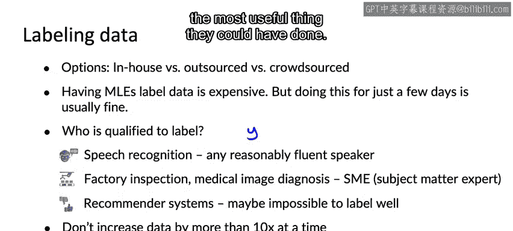

# 吴恩达《机器学习工程师的生产实践（MLOps）Machine Learning Engineering for Production》中英字幕 - P33：32_获取数据.zh_en - GPT中英字幕课程资源 - BV1pi4y167g5

You've learned about how to define what should be the data， what should be the definition of y。

 what should be the definition of the input X， but how do you actually go about obtaining data for your task。

 Let's take a look at some best practices。One key question I would urge you to think about is how long。

 how much time should you spend obtaining data？You know that machine learning is a highly iterative process where you need to pick a model。

 hyperparmeters， have a data set， then train carrier or analysis and go around this loop multiple times to get to good model let's say for the sake of argument that training your model for the first time takes a couple days。

Maybe much shorter or maybe longer， and let's say just for the sake of arguments that carrying out error analysis。

For your project， for the first time， may take a couple days。If this is the case。

 I would urge you not to spend 30 days。Collecting data。

 because that will delay by whole month you're getting into this iteration。Instead。

 I urge you to get into this iteration loop as quickly as possible。

So if training a model and error analysis might take just a couple days。

 I would urge you to ask yourself， what if you were to give yourself only two days to collect data。

 would that help get you into this loop？Much more quickly。Maybe two days is too short， but I've seen。

Far too many teams take too long to collect their initial data set before they train the initial model。

Whereas I've really come across a team where I said， hey。

 you really should have spent more time collecting data。And after you've trained your initial model。

 Carra analysis there's plenty of time to go back and collect more data。

I've found for a lot of projects I've led when I go to the team and say， hey everyone。

 we're going to spend at most seven days collecting data， so what can we do？😊。

I found that posing the question that way often leads to much more creative ways。

 ways that still 100% respect use of privacy and follow regulatory considerations if any。

But much more creative strappy ways to get a lot of data quickly and that allows you to enter this iteration loop much more quickly and let the project make faster progress one exception to this guideline is if you have worked on this problem before and if from experience you know you need at least a certain training set size then it might be okay to invest more effort upfront to collect that much data so because I've worked on speech recognition I have a good sense of how much data I'll need to do certain things and I know it's just not worth trying to train certain models if I have less than certain number of hours of data。

But a lot of the time， if you're working on a brand new problem and if you're not sure and it's often hard to tell even from the literature。

 but if you're not sure just how much data is needed。

 then it's much better to quickly collect the small amount of data trailer model and then use error analysis to tell you if it's worth your while to go out to collect more data。

 in terms of getting the data you need。One other step I often carry out is to take inventory of possible data sources。

 let's continue to use speech recognition as an example。

 if you were to brainstorm a list of data sources， this is maybe what you might come up with。

 maybe already own 100 hours of transscribed speech data。And because you already own it。

 the cost of that is zero， or you may be able to use a crowdsourcing platform and pay people to read text so you provide them a piece of text and ask them to read it out loud and just creates text data where you already have to transcriptscribe because theyre reading a piece of text that you have or you may decide to take audio that you have that hasn't been labeled yet and to pay for it to be transcribed。

It turns out this is more expensive on a per hour basis than paying people to read text。

 but this results in audio that sounds more natural because people aren't reading。

So for 100 hours of data it may cost $6000 to get high qualityality transcripts。

 or you may find some commercial organizations that could sell you data through an exercise like this。

 you can brainstorm what are the different types of data you might use as well as their associated costs One column that's missing from this did I find very important is the time cost so how long would it take you to execute the project to get these different types of data。

For the own data， you could get that instantaneously for crowdsource reading。

 you may need to implement a bunch of software， find the right crowdsourcing platform。

 carry around software integration， So you might estimate that there's two weeks of engineering work paying for data to be labeled is simpler but still is work to organize and manage whereas purchasing data maybe there's a purchase order process that may be much quicker I find that some teams won't go through an inventory process like this and would just pick a random idea。

And maybe decide to use crowdsourcing and reading to collect data， but if you can sit down。

 write to all the different data sources and think through the tradeoffs， including costs and time。

 then that can help you to make often better decisions about what sources of data to use。

And so if you have especially pressed with time， based on this analysis。

 you may decide to use the data to your video and maybe purchase some data and use that over。

The middle two options in order to get going more quickly。

 in addition to the amount of data you can acquire and the financial costs and the time cost。

 other important factors， does application dependence will include data quality where you may decide。

 for example， that paying for labels actually gives more natural audio than having people sound like they're reading。

As well as。Really importantly， privacy and regulatory constraints if you decide to get data labeled。

 here are some options you might think through as well the three most common ways to get data labeled are in health where you have your own team labeled the data。

Vus outsource where you might find some complete that labels data and have them do it for you versus Csource where you might use a crowdsourcing platform to have a large group collectively label the data the difference between outsource versus trialsource is that depending on what type of data you have that may be specialized companies that could help you get a label quite efficiently some of the tradeoffs between these options having machine learning engineers label data is often expensive but I find that to get a project going quickly having machine learning engineers do this just for a few days is usually fine and in fact this can help build the machine learning engineer intuition about the data。

When I'm working on a new project， I often don't mind spending a few hours or maybe a day or two labeling data myself if that helps me to build my intuition about the project。

But beyond a certain point， you may not want to spend all your time as a machine learning engineer labeling data and you might want to shift to more scalable labeling processes depending on your application。

 there may be also different groups or subgroups of individuals that are going to be more qualified to provide the labels why。

If you're working on speech recognition， then maybe almost any reasonably fluent speaker can listen to audio and transcribe it。

So speech recognition， because of the number of people that speak a certain language has a very large pool of potential laborers。

 or hopefully they won't be careful and diligent for more specialized applications like factory inspection or medical image diagnosis。

A typical person off the street probably can't look at a medical Xray image and diagnose from it or look at a smartphone and determine what is and what isn't a defect so more specialized task like these usually require an SME or subject matter expert in order to provide accurate labels。

And finally， there some applications was very difficult to get anyone to give good labels。

Take product recommendations。There are probably product recommendation systems that are giving better recommendations to you than even your best friends or maybe your significant other。

 And for this， you may just have to。Rely on purchase data by the user as a label rather than get humans to label this。

When you're working on an application， figuring out which of these categories of application you're working on and identifying the right type of person or persons to help you label。

Will be an important step to making sure your labels are high quality。One last tip。

 let's say you have。A thousand examples and you've decided you need a bigger data set。

How much bigger should you make your data set？One tip of given a lot of teams is dont increase your data by more than 10x at a time。

So if you have a thousand examples and you've changed your model on a thousand examples。

Maybe it's worth investing to try to increase your data set to 3，000 examples， or maybe at most 10。

000 examples。But I would first do a 10 x or less than 10 x increase first。Train another model。

 carry out error analysis and only then figure out if it's worth increasing it substantially beyond that。

 because once you increase your data size by 10 x so many things change is really difficult。

 I found this really hard to predict what will happen。

When your data size increases even beyond that it's also fine to increase your data size 10% or 50% or just your 2 x at the time。

 so this is only an upper bound for how much you might invest to increase your data size and this guideline hopefully will help teams avoid over investinging in tons of data。

Only to realize that collecting quite damaged data wasn't the most useful thing they could have done。

 I hope the tips in this video will help you to be more efficient in how you go about collecting your data。

Now when you collect your data， one of the things you might run into is the need to build a data pipeline where your data doesn't come all at once。

 but there are multiple preprocessing steps that your data has to go through let's go to the next video to take a look at some best practices for building data pipelines。

