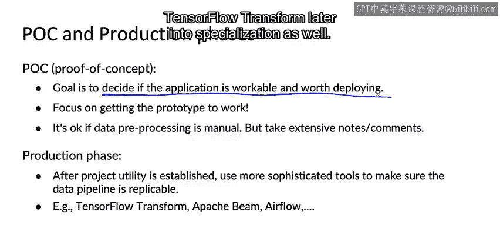

# 吴恩达《机器学习工程师的生产实践（MLOps）Machine Learning Engineering for Production》中英字幕 - P34：33_数据管道.zh_en - GPT中英字幕课程资源 - BV1pi4y167g5

Data pipelines， sometimes also called data cascades。

 refers to when your data has multiple steps of processing before getting to the final output。

 there's some best practices relevant for managing such data pipelines。Let's start to an example。

 Let's say that given some user information， you would like to predict if。

The given user is looking for a job because if they're looking for a job at this moment in time。

 you may want to surface job ads or other pieces of particularly useful information to them。

 So given raw data。Such as the data on top， there's often some sort of preproces or data cleaning。

Before the data is fed to a learning algorithm that then tries to predict。Why。

Are they looking for a job？And data cleaning may include things like spam cleanup。

 such as removing the spam accounts and maybe also user ID merge。

 which we talked about in an earlier video。For the sake of this example。

 let's say that spam cleanup and user ID merge are done with just scripting。So。

Explit sequences of instructions that tells your code when is an account to be considered spammi and when should two user IDs be merged Of course。

 these systems could be built using machine learning algorithms as well。

 which makes them even a little bit more complex to manage Now。

 when you have strips for the data cleaning。One of the。

Issues you run into is replicability when you take these systems into production deployment。

 let's say during the development of the system you have input data fed through preprocessing scripts and the preprocessed data is fed to a machine learning algorithm and after some amount of work。

Your learning algorithm does well on the test set。During the development phase you may have seen that preprocessing scripts can be quite messy。

 it may be you hacking something up， processing data。

 mailing a file to a different member of your team。

 having them have a few incantations in Python or some scripting language to process the data and then having them mail the process data back to you when you take this system to production。

 you then have new data which has to be fed through a similar set of scripts because this data is going to be fed to the same machine learning algorithm。

And your machine learning algorithm on this data is what will run in your product。

 So the key question is。If。Your preprocessing was done with a bunch of scripts spread out on a bunch of different people's computers and laptops。

 how do you replicate the scripts to make sure that the input distribution to your machine learning algorithm was the same for the development data and the production data。

I find that the amount of effort that you should invest to make sure that the preprocessing scripts are highly replicable can depend a little bit on the phase of the project。

I know that it may be fashionable to say that everything you do should be 100% replicable and I'll probably get some criticism for not hewing to that line。

 but I find that a lot of projects do go through a proof of concept or POC phase and then a production phase where during the proof of concept phase。

 the primary goal。Is just to decide if the application is workable and worth building and deploying my advice to most teams is doing the proof concept phase。

 focus on getting the prototype to work。And it's okay if some of the data preprocessing is manual if the project succeeds。

 you need to replicate all this preprocessing later， so my advice would be take extensive notes。

 write extensive comments to increase the odds that you can replicate all this preprocessing later。

 but this is also not the time to get bogged down in tons of process just to ensure replicability。

When the focus is really to just decide if the application。

Is workable and it's worth taking to the next phase Once you've decided that this project is worth taking to production。

Then you know it's going to be really important to be able replicate any preprocessing scripts。

 so in this phase that's when I would use more sophisticated tools to make sure the entire data pipeline is replicable and this is when tools which can be a little bit more heavyweight。

 but tools like Tensorflowlow transform A hashi beam airflow and so on become very valuable。

And in fact， you learn more about Tensorflow transform later into specialization as well in this video you learned about data pipelines and when to invest in their replicability。

It turns out many applications have significantly more complex data pipelines than what we saw in this video and for those settings you also have to think about what metadata you want and perhaps also keep track and take care of data provenance and lineage let's go on to the next video to look at these topics。

