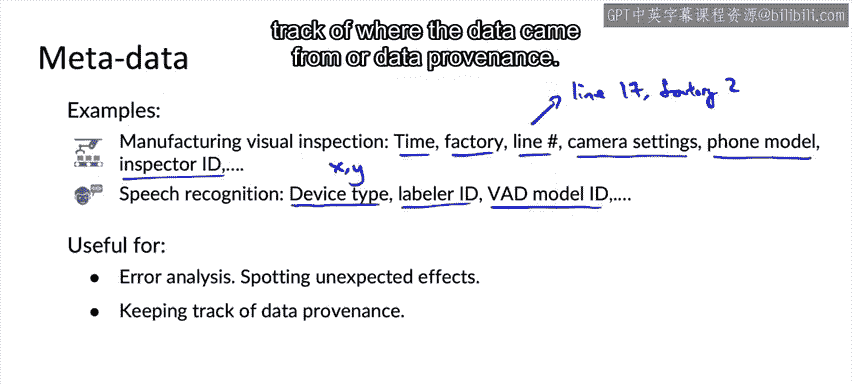

# 吴恩达《机器学习工程师的生产实践（MLOps）Machine Learning Engineering for Production》中英字幕 - P35：34_元数据、数据溯源和血统.zh_en - GPT中英字幕课程资源 - BV1pi4y167g5

For some applications having and tracking metadata data provenance and data lineage can be a big help What do these words even mean Let's look at an example Here's a more complex example of a data pipeline building on our previous example of using user records to predict if someone is looking for a job at a given moment in time let's say you start off with a spam data this may include a list of known spaM accounts as well as features such as。

A list of blacklisted IP addresses that spammers are known to use。

 you might also implement a learning algorithm。 So a piece of machine learning code and train your learning algorithm on the spam data set thus giving you an anti spam model。

 So these arrows indicate flow of information or flow of computation where training your M code on the spam data gives you your anti spam model。

 You then take your user data and apply the antis spam model to it to get the D spa user data。

We're following our usual convention that things with a purple rectangle around it represent pieces of code Now taking your DS spamed user data next you might want to carry out user ID merge to do that you might start off with some ID merge data so this would be label data telling you some pairs of accounts that actually correspond to the same person。

Have a machine learning algorithm implementation， train the model on that。

 and this gives you a learned ID merge model that tells you when to combine two accounts into a single user ID。

You take your ID merge model， apply it to the DS spa user data。

 this gives you your cleaned up user data then finally based on the clean user data。

 hopefully some of this labels with whether someone' is looking for a job。

 you would then have another machine learning model trained on it to give you a model to predict if a given user is looking for a job or not。

 and this is then used to make predictions。On other users or maybe across your whole database of users。

So this level of complexity of a data pipeline is not atypical in large commercial systems。

 and I've seen data pipelines or data cascades that are even far more complicated than this。

 One of the challenges of working with data pipelines like this is what if after running this system for months。

 you discover that。Oops， the IP address blacklist you are using has some mistakes in it。

In particular， what if you discover that there were some IP addresses？That were incorrectly。

Blacklisted。Maybe because the provider。From whom you had purchased the blacklisted IP addresses。

 found out that there were some IP addresses that multiple users use。

 such as if multiple users on the corporate campus or university campus shared an IP addresses for security reasons。

 but the organization creating the blacklist IP addresses thought it was family because so many people shared an IP address。

 this has happened before。So the question is。Having built up this big complex system。

 if you were to update your spam data， won't that change your spam model and therefore that and therefore that and therefore that and therefore that。

 and how do you go back and fix this problem， especially if each of these systems was developed by different engineer and you have files spread across the laptops of your machine learning engineering development team？

So to make sure your system is maintainable， especially when a piece of data upstream。

Ends up needing to be changed。 It can be very helpful to keep track of data provenance。

 as well as lineage data provenance refers to where the data came from。

 So who did you purchase the spam IP address from。And lineage refers to the sequence of steps。

Needed to get to the end of the pipeline at the very least。

 having a extensive documentation could help you reconstruct data provenance and lineage。

 but to build robust maintainable systems， not in proof of concept stage。

 but in the production stage， there are more sophisticated tools to help you keep track of what happened so you can change part of the system and hopefully replicate the rest of the data pipeline without too much unnecessary complexity。

To be honest， the tools for keeping track of data provenance and lineage are still immature in today's machine learning world。

 I find that extensive documentation can help and some formal tools like Tensorflow transform can also help。

But solving this type of problem is。Still not something that we are great at as a community yet to make life easier。

 both for managing data pipelines， as well as for error analysis and driving machine learning development。

There's one tip I want to share， which is to make extensive use of metadata。

 so metadata is data about data。For example， in manufacturing visual inspection。

 the data would be the pictures of phones and the labels。

But if you have metadata that tells you at what time was this picture of a phone taken。

 what factory was this picture from， what's the line number。

 what were the camera settings such as camera exposure time and camera aperture。

 what's the number of the phone you're inspecting， what is the idea of the inspector that provided this label these are examples of data about your data set X and Y。

And this type of metadata can turn out to be really useful。

 because if you discover during machine learning development that for some strange reason。

Line number 17。In factory 2。Gens images that produce a lot more errors for some reason。

 then this allows you to go back to see what was funny about line 17 in factory2。

But if you had not storeded the factory and line number metadata in the first place。

 then it would have been really difficult to discover this during error analysis。

 so I found many times when I happened to maybe even get lucky and store the right metadata only to discover a month later that that metadata helped generate a key insight that helped the project move forward。

So my tip is if you have a framework or set of MLO tools for storing metadata that will definitely make life easier。

 but even if you don't， just like you rarely regret commenting your code。

 I think you will rarely regret storing metadata that could then turn out to be useful later and just like if you don't comment your code in a timely way is much harder to go back to commented later in the same way if you don't store the metadata in a timely way。

 it can be much harder to go back to recapture and organize that data one more example for speech recognition。

If you have audio recorded from different brands of smartphones， let's say that in advance。

 or if you have different labelers labeling your speech。

 or if you use a voice activity detection model， then let's keep track of what's the version number of the voice activity detection model that you use。

And all of these means that in case for some reason。

 one version of the VAT voice activity detection system results in much larger errors。

 this significantly increases the odds of your discovering that and being able to use that to prove your learning algorithm performance。

 so to summarize。Mettaadata can be very useful for error analysis and spotting unexpected effects or tal categories of data that have some unusually poor performance or something else。

To suggest how to improve your system and of course， maybe not surprisingly。

 this type of metadata is also very useful for keeping track of where the data came from of data provenance the takeaway from this video is that for large complex machine learning systems that you might need to maintain keeping track of data provenance and lineage can make your life much easier。

And as part of building out these systems， consider keeping track of metadata。

 which can help you with tracking data provenance， but also error analysis。

Before we wrap up this section， there's just one more tip I hope to share with you。

 which is the importance of balanced trained de test splits， let's go on to the next video。

