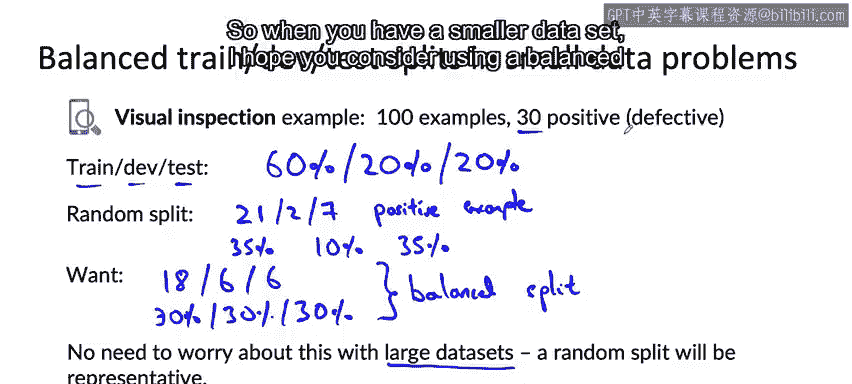

# 吴恩达《机器学习工程师的生产实践（MLOps）Machine Learning Engineering for Production》中英字幕 - P36：35_平衡的训练集、开发集和测试集.zh_en - GPT中英字幕课程资源 - BV1pi4y167g5

Many of us are used to taking a data and randomly splitting it into train de and tests It turns out when your data is small。

 having balanced trained de and test tests can significantlyly improve your machine learning development process let's take a look。

 let's use our manufacturing visual inspection example。Say your training set has 100 images。

 so pretty small data set and with 30 positive examples， so 30 defective phones and 70 non defective。

If you were to use a trained de test split of 60% of the data in the training set。

20% in the de will hold a validation set and。20% in the test set， then if you were to use a random s。

 just by chance， it's not inconceivable that you may end up with。21 positive examples in training。

 two in death and seven in test。This是 be。Quite。Likely just by random chance。

 And this means the training set。Is 35%。Positive， not that far from 30% positive in the overall data set。

But your depth set is 10% positive。And your test set is 35%。Positive， so two out of 20 is 10%。

7 out of the 20 is 35%。And this makes your death sets。Quite non representative。

Because in your depth set， you have only two。Or 10% positive examples。

Rather than 30% positive examples。But when your data set is small。

 then all of your 20 deficit set examples is just a higher chance。

Of this slightly less representative split。 So what we would really want is for the training set of exactly 18 positive examples。

Deaf set have exactly six positive examples and the test set to have exactly six positive examples。

And this would be 30%。30%。30%。And if you could get this type of split。

 this would be called a balance split。Where each of your trained deaf and tests has exactly 30% positive examples。

 and this makes your data sets more representative of the true data distribution。

There's no need to worry about this effect when you have a large data set。

 if you have a very large data set， a random split will very likely be representative。

Meaning that the percentage of positive examples will be quite close to your overall data。

But when you have a small data set。With just 20 de set examples and 20 test set examples。

Then explicitly making sure you have a balanced lit。

Can make your depth set and test set more reliable measures of your learning algorithm's performance。

 This is one of those little techniques that turns out to make a big difference to your performance when you're working on a small data problem。

 but that you don't really need to worry about if you have a very large data set。

So when you have a smaller data set， I hope you consider using a balanced trained De test split as well in terms of how you set up your data。

So when you're working on a smaller data problem， I hope that using a balanced chain De test split will help you with you learning algorithm。

And so that's it congratulations on getting to this point in this course you've finished the data section of videos and in the last two weeks you also learned about modeling and deployment there's just one last optional section that you can watch if you want on scoping I hope you come with me to watch the optional scoping videos as well we talk about how to select a project to work on but either way congrats on finishing all the required videos of this course I hope you've learned a lot and that these ideas will be useful for all the machine learning projects。

😊。