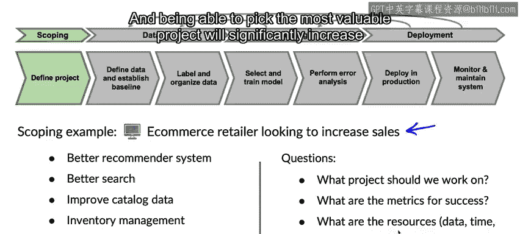

# 吴恩达《机器学习工程师的生产实践（MLOps）Machine Learning Engineering for Production》中英字幕 - P37：36_什么是确定范围.zh_en - GPT中英字幕课程资源 - BV1pi4y167g5

Picking the right project to work on is one of the most rare and valuable skills in AI today in the next few videos I'd like to share with you some best practices for scoping。

 picking what project to work on and also planning out the scope of the project。

I remember when I was younger， I tended to just jump into the first proche that I got excited about and you know。

 sometimes I was lucky and it worked out okay。Now that I've had a little bit more experience。

 I find that if you by yourself or your team is going to spend a lot of time。

 weeks or months or even longer working on a project。

 it's well worth your while to think through a few options and try to select the most promising project to work on before putting so much effort into it。

So with that， let's dive into scoping。Let's use the example of an e-commerce retailer looking to increase scale if you were to sit down and brainstorm what an ecom company could do。

 you might come up with many ideas such as maybe a better product recommendation system or better search so people can find what they're looking for or you may find that the catalog data is missing fields or is incomplete and this affects search a recommendations results so you might start the project improve the quality of the catalog data。

Or you may help them with inventory management， such as deciding how many shirts to buy and where to ship the shirts。

Or with price optimization， with a quick brainstorming session。

 you may be able to come up with dozens of ideas for how to help this e-commerce retailer。

The questions that we would like to answer in the scoping process are what project or projects should we work on？

What are the metrics for success and what are the resources such as data time people needed to execute this project。

 what I've seen in a lot of businesses is that of all the ideas you could work on。

 some are going to be much more valuable than others。

 maybe two times or five times or ten0 times more valuable than a different idea and being able to pick the most valuable project will significantly increase the impact of your work。

Machine learning is a general purpose too， there are a lot of things we could do with machine learning。

 how do we pick valuable projects to work on let's dive more deeply into the scoping process in the next video。

😊。