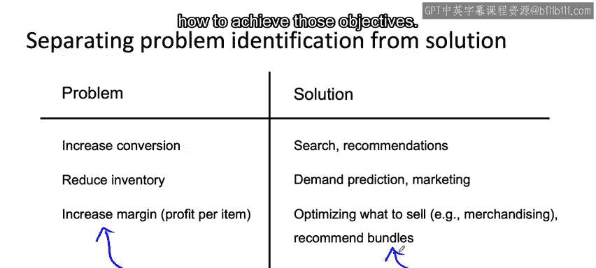

# 吴恩达《机器学习工程师的生产实践（MLOps）Machine Learning Engineering for Production》中英字幕 - P38：37_确定范围过程.zh_en - GPT中英字幕课程资源 - BV1pi4y167g5

I'd like to share with you a process for scoping projects that hope would be valuable for how you decide what to work on when I'm speaking with a company for the first time about their AI projects。

 this is the process that I use as well let's dive in。When brainstorming prizees a work on。

 the first thing I do is usually get together with a business or product owner。

 often not an AI person， but someone that understands a business or an application and to brainstorm with them。

What are their business or application problems， and at this stage。

 I'm trying to identify a business problem， not an AI problem。

So if I'm speaking with an econ retail business， like the example from the previous video。

I might ask what are the top few things， top three things you wish were working better and maybe they'll share business problems like theyd like to increase conversions。

 number of people that go to the website and convert to a sale or reduce inventory so you don't need as much stuff sitting around in the warehouse。

Or increase margin， increase the profit per item sold。

At this point in the process I'm not trying to identify an AI problem。

 in fact I'll often tell my partners I don't want to hear about your AI problems。

 I want to hear about your business problems and then it's my job to work with you to see if there is an AI solution and sometimes there isn't and that's fine too feel free to use the exact same words as well when brainstorming projects with your non-AI partners if you want。

Having identified a few business problems like the three examples on the right， only then do I see。

Or start to brainstorm if there are possible AI solutions。

Not all problems can be solved by AI and that's okay。

 but hopefully we'll come up with some ideas for using machine learning algorithms to address some of the business problems。

I find that it's helpful for this process to separate out the identification of the problem。

From the identification。Of the solution， as engineers。

 we are pretty good at coming up with solutions。But。

Having a clear articulation of what is the problem first often helps us come up with better solutions this type of separation between problem and solution is something you might hear about in the writings on design thinking as well after brainstorming a variety of different solutions I would then assess the feasibility and the value of these different solutions Sometimes you hear me use the word diligence。

To refer to this phrase， diligence is a term that actually comes from the legal field。

 but it basically means double checking if an AI solution really is technically feasible and valuable or double checking something that you're hoping is true really is true after validating technical feasibility and the value or ROI return on investments that you can then project。

 if it still looks promising， if it still looks promising。

 we then flesh out the milestones for the project and finally budget for resources。

Let's take a deeper look at this process of identifying problems。And solutions。

And we use these three examples from Econ。So the first one， increase conversion。一。

The business is once to increase conversions， you may have different ideas for doing that。

 For example， you may want to improve the quality of the。

Websites search results so people find more relevant products when they search。

Or you might decide to try to offer up better product recommendations based on their purchase history。

It is quite common that one problem may lead to multiple ideas for solutions。

 and you may be able to brainstorm other ideas as well。

 such as maybe a redesign of how products are displayed on a page or you may find interesting ways to surface the most relevant product reviews to help users understand the product and does hopefully purchase it。

 so there could be many ways to increase conversions。

 take the next problem from the previous slide of reducing inventory。

 maybe you could imagine a demand prediction project to better estimate how many people buy something from you so you don't purchase too many or too few and have more accurate inventory in your warehouses。

Or you may decide to come up with a marketing campaign to drive sales for specifically the products that you bought too many of so as to steer more purchases of stuff sitting in your warehouse and that could also reduce inventory and there could be many other ideas for solutions。

Or for the problem of increasing margin， you may come up with some ways to use machine learning to optimize what to sell。

 what is worth selling and what is not worth selling in econ retail。

 sometimes this is called merchandising， just deciding what to sell or you can recommend bundles where if someone buys a camera。

 maybe you can recommend to them a protective camera case and these bundles can also increase margin。

The problem identification is a step of thinking through what are the things you want to achieve。

And solution identification is a process of thinking through how to achieve those objectives。

One thing I still see too many teams do today is jump into the first project that they're excited about in my experience if you have deep domain knowledge about an application or industry。

 maybe the first thing your gut gets excited about could be okay。

 but even then I find it worthwhile to first engage in divergent thinking where you brainstorm a lot of possibilities to be followed by convergent thinking where you then narrow down to one or a small handful of the most promising projects to focus on。

😊，One thing I hope you might avoid is working really hard on a project and creating a certain amount of monetary or social value if for the same amount of work there's a different project that could have created 10 times more you monetary or social or other positive types of value and I think this type of scoping process will help you to do that。

😊。