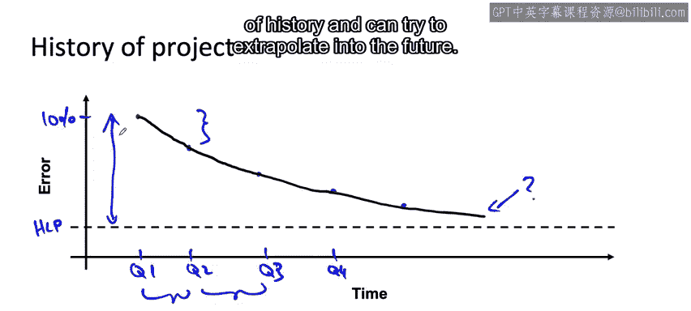

# 吴恩达《机器学习工程师的生产实践（MLOps）Machine Learning Engineering for Production》中英字幕 - P39：38_可行性和价值调查.zh_en - GPT中英字幕课程资源 - BV1pi4y167g5

In the last video you heard about the step of assessing a project for technical feasibility and for value let's take a deeper look at how you can carry out this diligentligence step to figure out if a project really is feasible and also how valuable it really is Let's start with feasibility is this project idea technically feasible before you've started on a machine learning project how do you know if this thing can even be built。

😊，One way to get a quick sense of feasibility is to use an external benchmark。

 such as the research literature or other forms of publications。

Or if a different company or even a competitor has managed to build a certain type of online search system before or recommendation system or inventory management。

But if there's some external benchmark that might help give you a sense that this project may be。

Technically feasible。Because someone else has managed to do something similar。

 either to complement this type of external benchmark or in the absence of this type of external benchmark。

 here are some other ways to assess feasibility and I'm going to build a two by two matrix that looks at different cases depending on whether your problem has unstructured data like speech images or structured data like transaction records。

And on the other axis， I'm going to put new versus existing whereby new。

 I mean you're trying to build a system to do a task for the first time。

 such as if you've never done demand forecasting before and you're thinking of building one。

 whereas existing refers to if you already have some existing，System， maybe a machine learning one。

 maybe not， that is carrying out this task。And you're thinking of scoping out an improvement to an existing system right so new means you're delivering a brand new capability and existing means you're scoping out a project to improve on an existing capability in the upper left hand quadrant。

To see if a project is technically feasible， I find human level performance HLP to be very useful at giving you an initial sense。

Of whether a project is doable， So when evaluating HLP。

 I would give a human the same data as would be fed to a learning algorithm and just ask。

 can a human given the same data perform a task， such as can a human given a picture of a scratch smartphone perform a task of detecting scratches reliably？

And if a human can do it， then that significantlyly increases the hope that can also give the learning algorithm to do it for existing projects。

 I would use HLP as a reference as well， where if。You have a visual defect inspection system and you're hoping to improve it to a certain level of performance if humans can achieve the level you're hoping to get it to。

 then that might give you more hope that it is technically feasible whereas if you're hoping to increase performance well beyond human level performance then that suggests the project might be harder or may not be possible in addition to HLP。

 I often also use the history。Of the project。As a predictor for future progress and we'll say more about both HP and history of project。

In the next few slides。But the previous rate of progress on a project can be a reasonable predictor for the future rate of progress on a project。

 you see more of this later in this video moving over to the right column if you're working on a brand new project with structured data the question I would ask is our predictive。

Features。Available。Do you have reason to think that the data you have， the inputs X。

 are strongly predictive or sufficiently predictive of the target output y in this box on the lower right？

For a structured data problem， if you're trying to improve an existing system。

One thing that will help a lot is if you can identify new predictiveor features。

 so are there features that you aren't yet using whether you can identify that could really help predict why。

And also， by looking at。The history。Of the project。So on this slide， you heard about three concepts。

Human level performance， the question of whether predictive features are available and also the history of a project。

 let's take a deeper look at these three concepts。And let's start with using HLP on unstructured data images。

 so I use HLP to benchmark what might be doable for unstructured data because people are very good on unstructured data tasks and so the key criteria for assessing project feasibility is。

Can a human， given the exact same data as would be given to learning algorithm， perform a task？

Let's look at an example， let's you're building a self driving car and you want an algorithm to classify whether a traffic light is currently red。

 yellow or green。I would take pictures from your selfdriv car and ask a person to look at an image like this and see if a person looking only at the image can tell which lamp is illuminated and in this example it's prettyque green。

But if you find that you also have pictures like this。

 then well I can't tell which lamp is illuminated in this example。

 and this is why it's important for this HLP benchmark to make sure the human is given only the same data as your learning algorithm。

It turns out maybe a human sitting in the car and seeing the traffic light with their own eye could have told you which lamp was illuminated in this example on the right。

But that's because the human eye has superior contrast to most digital cameras。

 but the useful test is not whether the human eye can recognize which light which lamp is illuminated。

 the useful test is if the person was sitting back in the office and they can only see the image from the camera。

 can they still do the task and that gives you a better read on feasibility。

And specifically it helps you make a better guess at whether a learning algorithm。

 which will only have access to this image can also accurately detect which lamp in the traffic light is illuminated。

 making sure that a human sees only the same data as the learning algorithm will see is really important。

 I've seen a lot of projects where for a long time a team was working on a computer vision system say。

😊，And they thought they could do it because a human physically inspecting the cell phone or something could detect the defect。

 but it took a long time to realize that even a human looking only at the image couldn't figure out what was going on then you can figure out much earlier that with the current camera setup it just wasn't feasible and the more efficient thing to do would have been to invest early on in a better camera or better lighting setup or something rather than key working on a machine learning algorithm on a problem that I think just wasn't doable with the imaging setup available at the time Next for structured data problems one of the key criteria to assess for technical feasibility is do we have input features X that seemed to be predictive whatever we're trying to predict Y let's look at a few examples。

😊，In our ecom example， if you have features that show what are the past purchases of a user and you like to predict future purchases。

 that seems plausible to me because most people's previous purchases are predictive of future purchases。

So if you have past purchase data， you do have features that seem predictive of future purchases and this project might be worth a try。

 or if you work with a physical store given data on weather if you want to predict shopping mall foot traffic so how many people will go to the mall well we know that when it rains a lot fewer people leave their holes so weather is predictive of foot traffic and shopping malls and so I would say you do have predictive features worth a try。

 let's look at some more examples given DNA of an individual。

 let's try to predict if this individual will have heart disease。This one I don't know。

The mapping from your DNA to whether or not you get heart disease is a very noisy mapping in biology。

 this is referred to the genotype and phenotype， but the mapping from genotype to phenotype or your genetics to your health condition is a very noisy mapping so I would have mixed feelings about this project because it turns out your genetic sequence is only slightly maybe mildly predictive of whether you get heart disease I'm going to put a question mark there or given social media chatter can you predict demand for a clothing style this is another if you one I think you may be able predict demand for clothing style right now but given social media chatter can you predict what would be the hot fashionable trend six months from now that actually seems very difficult。

So one of the ways I've seen AI projects go poorly is if there's an idea like let's use social media to figure out what people are chatting about in fashion and it will manufacture the clothing and sell it in six months and sometimes the data just is not that predictive and you end up with a learning algorithm that does barely better than random guessing and that's why looking at whether you have features that you believe are predictive is an important step of diligence for assessing technical feasibility of a project One last example that maybe even clearer which is given a history of a particular stock or particular shares price。

 let's try to predict the future price of that stock。

All the evidence I've seen is that this is not doable unless you get some other clever set of features looking at a single shares historical price to predict the future price of that stock is exceedingly difficult and I would say if those are the only features you have those features are not predictive of the future price of that stock based on the evidence I've seen And so even leaving aside the question of how much predicting share prices for trading creates any social value。

 I have some questions about that sometimes I think this project is also just not technically feasible Finally。

 on this diagram。😊，One last criteria I mentioned a couple times is the history of a project。

 Let's take a look at that。 When I've worked on a machine learning application for。

Many months I found that the rate of previous improvement can be maybe a surprisingly good predictor for the rate of future improvement。

 here's a simple model you could use。Let's take speech recognition as an example。

And let's say that this is。Human level performance。

 and I'm going to use human level performance as our estimate for base error or the irreducible level of error that we hope to get to。

 Let's say that when you started the project， you'll say in the first quarter or Q1 of some year。

 the system had。10%。Araates。And over time in subsequent quarters， the error went down。Like so。So Q2。

 Q3， Q4， and so on。It turns out that it's not a terrible model to estimate this curve。

 So if you want to estimate。How well the team could do。In the future。

 one simple model I've used is to estimate the rate of progress as for every fixed period of time。

 say every quarter。The team will reduce the error rate。By some percentage。

Relative to human level performance。So in this case。

 it looks like this gap between the current level of performance and human level of performance is shrinking by maybe 30% every quarter。

 which is why you get this curve that is exponentially decaying toward HLP and by estimating this rate of progress you may project into the future that hopefully in future quarters。

 you continue to reduce the error by 30% relative to HLP and this will give you a sense of what might be reasonable for the future rate of progress on this project。

 and this gives you a sense of what may be feasible for an existing project for which you already have this type of history and can try to extrapolate into the future。

In this video， you saw how to use human level performance。

The question of whether you have predictive features。

And the history of a project in order to assess technical feasibility。Next。

 let's dive more deeply into assessing the value of a project， we'll do that in the next video。

