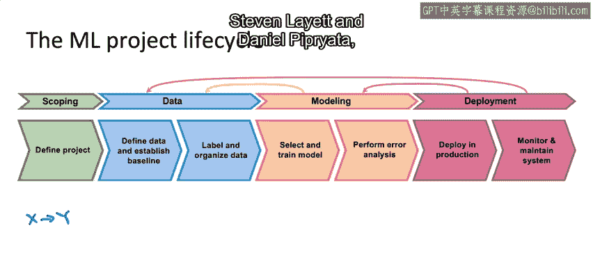

# 吴恩达《机器学习工程师的生产实践（MLOps）Machine Learning Engineering for Production》中英字幕 - P3：2_机器学习项目步骤.zh_en - GPT中英字幕课程资源 - BV1pi4y167g5

When I'm building a machine learning system I found that thinking through the machine learning project lifecycle is an effective way for me to plan out all the steps that I need to work on and when you are work in a machine learning system I think you find too that this framework allows you to plan out all the important things you need to do in order to get a system to work and also to minimize surprises so let's dive in these are the major steps of a machine learning project first is scoping in which you have to define a project just decide what to work on what exactly do you want to apply machine learning to and what is X and what is Y。

😊。

After having chosen the project， you then have to collect data or acquire the data you need。

For your algorithm。This includes defining the data and establishing a baseline and then also labeling and organizing the data there's some best practices for this that are not intuitive that you learn more about later in this week after you have your data you then have to train a model During the model phase you have to select and train a model。

And also perform error analysis， you might know that machine learning is often a highly iterative task。

 so during the process of error analysis you may go back and update the model。

 or you might also go back to the earlier phase and decide you need to collect more data as well。

As part of error analysis before taking a system to deployments。

 I'll often also carry out a final check or maybe a final audit to make sure that the system's performance is good enough and that it's sufficiently reliable for the application Sometimes in Internet things that when you deploy a system you're done I now tell most people when you deploy a system for the first time youre maybe about halfway to the finish line because it's often only after you turn on live traffic that you then learn the second half of the important lessons needed in order to get the system to perform well to carry out the deployment step。

 you have to deploy it in production right the software needed to put into production。

And then also monitor the system， track the data that continues to come in and maintain the system for example。

 if the data distribution changes you may need to update the model and so after the initial deployment maintenance will often mean going back to perform more error analysis and maybe retrain the model or it might mean taking the data you get back now that the system is deployed and is running on live data and feeding that back into your data to then potentially update your data retrain the model and so on until you can put an updated model into deployment。

I found this framework useful for a very large variety of machine learning projects。

 from computer vision to audio data to structured data to many other applications。

 so feel free to take a screenshot of this image and use it with your friends or by yourself to plan out your machine learning projects as well Thanks also to landing AI Dilan Leard and Daniel Biberreta who are instrumental to developing this diagram。

In this video we quickly went through the machine learning Project lifecycle in order to deepen our understanding of this project lifecycle it would be useful to walk through a concrete example。

 so in the next video let's step through what these different steps of machine learning project lifecycle look like in the context of a speech recognition application let's go on the next video。

😊。