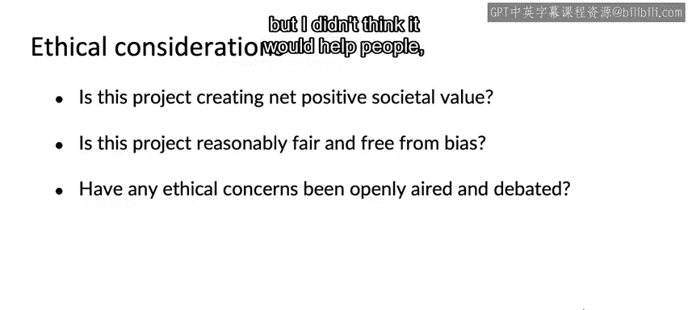

# 吴恩达《机器学习工程师的生产实践（MLOps）Machine Learning Engineering for Production》中英字幕 - P40：39_价值调查.zh_en - GPT中英字幕课程资源 - BV1pi4y167g5

How do you estimate the value of machine learning project This is sometimes not easy to estimate。

 but let me share with you a few best practices Take speech recognition。

 let's say you're working on building a more accurate speech recognition system for the purpose of voice search to let people speak to the smartphone app to do web searches。

It turns out that in most businesses， there will be some metrics that machine learning engineers are used to optimizing。

And some metrics that the owners of the product or the business will want to maximize。

 and there's often a gap between these two building machine learning systems。

 the objective that the learning algorithm may optimize。

Might be something like word level accuracy so if a user says a certain number of words。

 how many of the words do we get right so maybe the learning algorithm actually does gradient intos on log likelihood or some other criteria but many machine learning teams would be comfortable trying to get good word level accuracy。

 but when using this in a business context one other key metric is query level accuracy。

 which is how often do you get all the words in a query right and for some businesses。

Word level accuracy is important， but query level accuracy may be even more important。

And we've now taken one step away from the objective that the learning algorithm is。

Almost directly optimizing。Even after you get the query， you writes。

Which is important for the user experience。What users care even more about is the search result quality。

And the reason the business may want to ensure search result quality is that this gives users a better experience and this increases user engagement。

 So they come back to the search engine more often， and this is important。

 but this is just one step towards actually driving the revenue of the business。

 One gap I've often seen between machine learning teams and business teams is。

The engineering team will usually want to work on this， whereas the business leader。

Me want promises on that。And。In order for a project to move forward。

I usually try to have the technical and the business teams try to agree on metrics that both are comfortable with。

This often takes a little bit of compromise where the machine learning team might stretch a little bit further into their rights。

And the business teams stretch a little bit further to the left。 And the further we go to the right。

 the harder it is for a machine learning team to really give a guarantee。

And I wish more problems could be solved by gradientding descent or by optimizing test set accuracy。

 but that's just not the state of the world today。 a lot of practical problems require we do something more than just optimizing testet accuracy。

 so having the technical team and the business teams both step a little bit outside their comfort zone is often important for reaching compromise to pick some set of metrics that the technical team feels like it could stretch a bit to deliver on and that the business team can stretch a bit to feel comfortable will create sufficient value for the business。

One other practice I found useful is that if you can do even very rough back of the envelope calculations。

To relate word level accuracy to some of the metrics on the right。

 so if word level accuracy improves by 1%， if you have any rough guess for will that improve query level accuracy maybe by 0。

7% or 0。8% and how much will that improve search result quality and user engagement and maybe revenue。

 if you're able to come up with even a very crude back of the envelope calculation。

 sometimes these are also called Fermi estimates you can read about this。On。Wikippedia。

That can also be a way to help bridge the machine learning engineering metrics and the business metrics Now it goes without saying that as part of estimating the value of a project。

 I would encourage you to give thought to any ethical considerations as well such as is this project creating net positive societal value and if not。

 I hope you won't do it？Or is this project reasonably fair and free from bias and have any ethical or values based concerns being openly aired and debated。

 I find that issues of values and ethics is very domain dependent is very different。

In making loans versus healthcare versus recommending products online。

So I to encourage you to look up any ethical frameworks that have been developed for your industry and your application。

 and if you have any concerns， raise it for debate within your team。Ultimately。

 if you don't think the project you're working on will help other people or will help humanity move forward。

 I hope you keep searching for other more meaningful projects to jump into in my work。

 I have faced difficult choices where I really wasn't sure if a particular project was something I should work on。

Because I really didn't know if it would make people netNe better off。

 and I found that having a team debate and discuss it openly often helps us get to a better answer and feel more comfortable with whatever decision we make。

 and I have killed multiple projects on ethical considerations。

When I felt a project was economically sound but I didn't think it would whole people and I just told the team I don't want to do it and I won't do it。

 so I hope this gives you a framework for evaluating the value of a project。

And on the ethics and value piece， I think all of us collectively should only work on projects that create net positive social value that help other people that move humanity forward personally kill projects just on that basis。

 there are multiple projects。That I felt the economic value was completely sound。

 the economic case was completely fine， but I looked at the project and I said。

 I don't think this actually helps people and I've killed projects just on that basis and told my teams let's find something else to work on because I'm not going do that so I hope that you also be able to focus your efforts just on projects that help people and that help move humanity forward。

