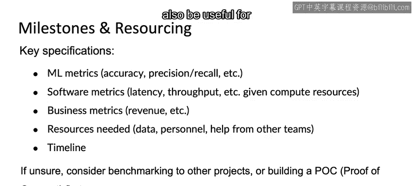

# 吴恩达《机器学习工程师的生产实践（MLOps）Machine Learning Engineering for Production》中英字幕 - P41：40_里程碑和资源分配.zh_en - GPT中英字幕课程资源 - BV1pi4y167g5

Say you've identified a problem， found a worthy solution。

 finished diligence for technical feasibility and value and you think this is worth doing Let's take a look at the last steps of the scoping process of milestones and reouring determining milestones and resouring involves writing out the key specifications for your project this will include machine learning metrics such as accuracy or precision recall for some applications this may also include fairness types of metrics the specification will often also include software metrics regarding the software system such as latency throughput queries per second and so on given the computational resources available and if possible you might also write out estimates of the business metrics you hope to move for the project scoping such as how much incremental revenue if you have a way of estimating that In addition。

 writing out the resources needed。😊，How much data from which teams， personnel。

 any help you need from cross functional teams， what software integrations。

 data labeling support or other support you need from other teams。And finally， the timeline。

On which you hope to achieve certain milestones or deliverables。Now。

 if you're looking at a machine learning project and you find that you're having a very hard time。

Right here on some of these key specifications， then you might also consider carrying out a benchmarking exercise to compare it to other similar projects that others may have worked on before。

Or building a proof of concept first， in order to get a better sense of what accuracy。

 precision or latency through points or other metrics might be feasible and only after you've done that POC proof of concept。

To then use that information to more confidently scope out the milestones and resources needed。

For a larger scale execution of the project you have in mind。So that's it。

 congratulations on making it to the end of this section on scoping。

 I hope that these ideas will help you to pick valuable and meaningful projects to work on and thank you also for sticking with me from deployment through modeling through training all the way back to scoping and I hope this framework of the full cycle of machine learning project will also be useful for all the projects I hope you will build and deploy。

😊。

