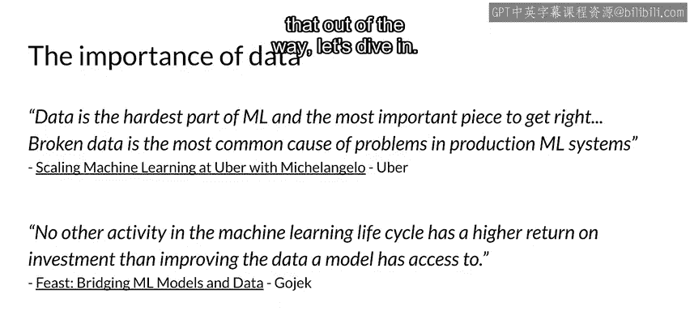
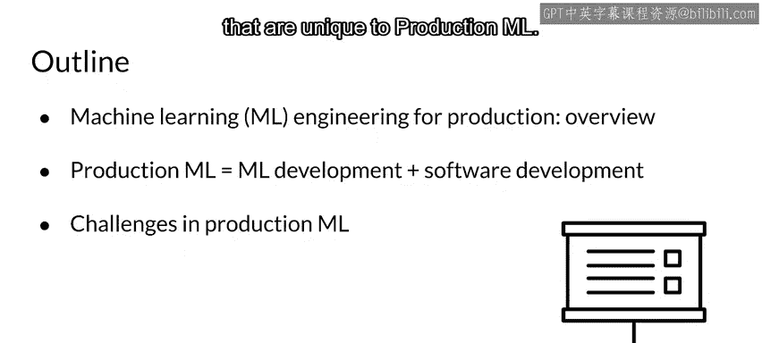
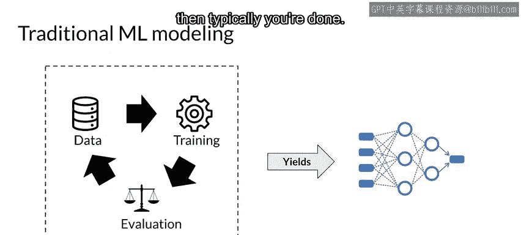
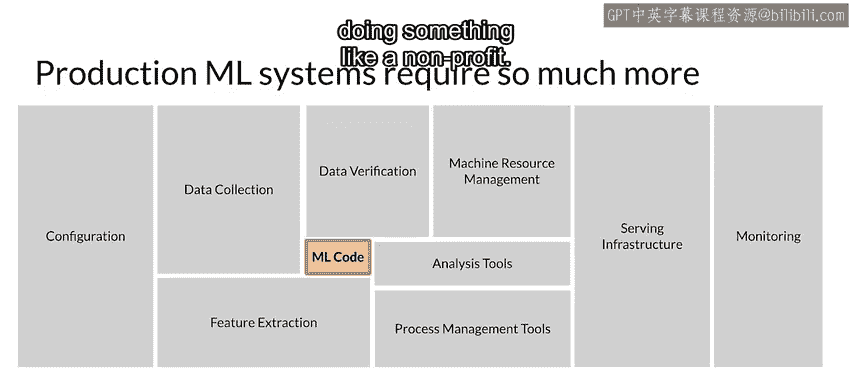
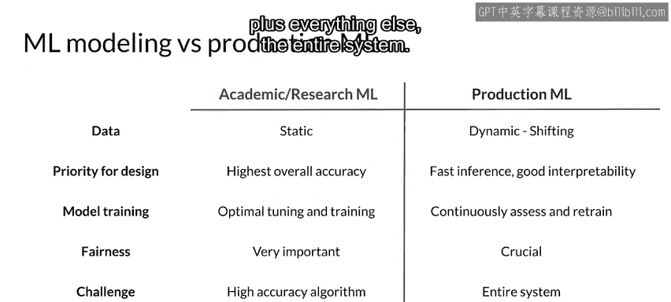
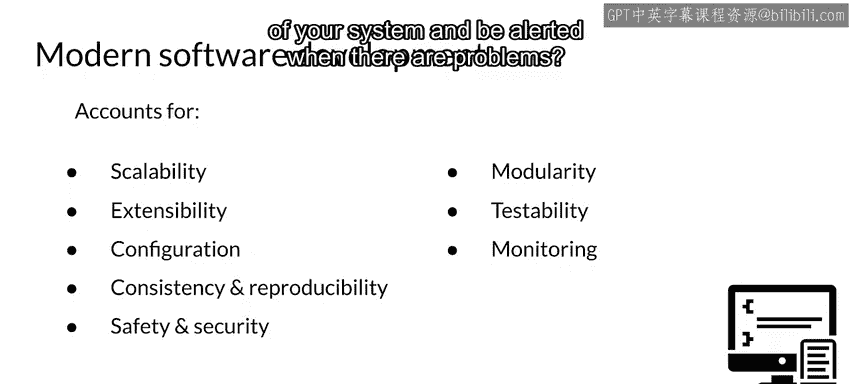
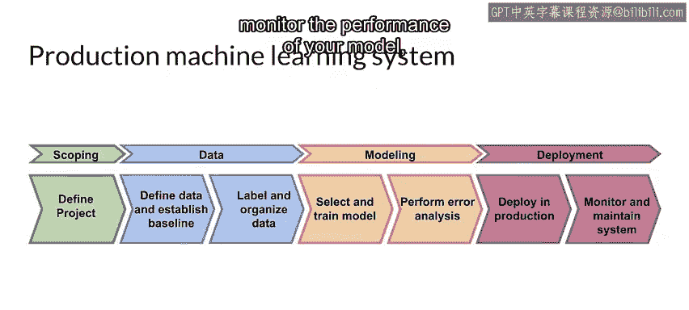
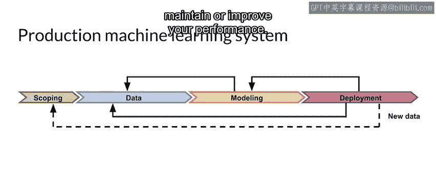
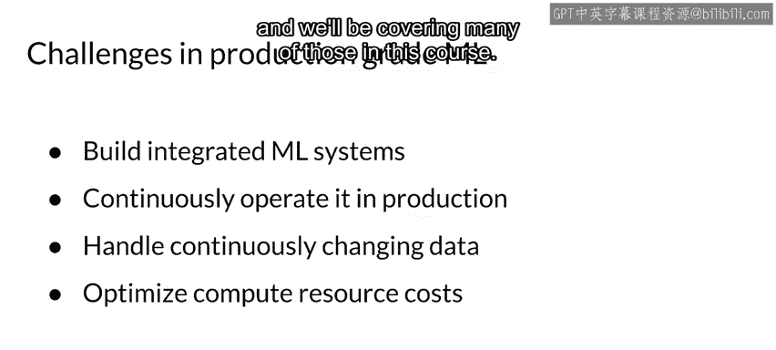

# 吴恩达《机器学习工程师的生产实践（MLOps）Machine Learning Engineering for Production》中英字幕 - P43：2_概述.zh_en - GPT中英字幕课程资源 - BV1pi4y167g5

Hey， hi， and welcome to Collecting， labeling and validating data。

This course is all about data and not just data， but data in a production machine learning setting。

You'll discover that there are quite a few differences between production data and data that you might have been using in。

 say， an academic or research environment。 And that's what this course is all about。

 I'm really excited to get started。 So let's get going。

 We've got some really important stuff to talk about this week。 This week is all about data。

 Collecting our data， labeling it and validating it。😊。

Let's get started before we jump in， I know there may be some of you who are coming from a more academic or research setting who might be thinking data。

 I already know all about data， what am I going to learn here？Well， in production environments。

 you discover some interesting things about the importance of data。

Here two quotes from ML practitioners at businesses where data and ML is mission critical。

 talking about how they view the importance of data。First， from Uber。

Data is the hardest part of ML and the most important piece to get right。

Broken data is the most common cause of problems in production ML systems。And next from Gojak。

No other activity in the machine learning life cycle has a higher return on investment。

Thathan improving the data a model has access to。The truth is that if you go to just about any production ML team and ask them about the importance of data。

You'll get similar answers。So that's why we're talking about data because it's incredibly important to success and the issues for data in production environments are very different from the academic or research environments that you might be familiar with。

ok。Now that we've got that of the way， let's dive in。

So this is our introduction to machine learning for production。

 and we're going to start with an overview。

Let's get started by establishing what machine learning and production is。

And how you can view production ML really as a combination of ML development and modern software development practices。

 we'll also discuss some of the challenges that are unique to production ML。

In an academic or research setting， modeling is really fairly simple。Well， maybe not simple。

 but perhaps less complicated。Anyway。Typically you have some data set。

 often a standard data set that's supplied to you and already cleaned and labeled。

And you're going to use that to train your model and evaluate the results。

The end result is a model that makes good predictions。

 So you'll probably go through a few iterations to fully optimize the model。

But once you're satisfied with the results， then typically you're done。

 Production ML requires a lot more than just a model。

We found that the model is typically about 5% of the code required to put an ML application into production。

Take a look at all the other boxes that are in this diagram and you'll get some idea about what we're going to be talking about Fundamentally we're not just talking about machine learning and modeling。

 we're talking about production ML applications and what it takes to create them， deploy them。

 maintain them and improve them so that you can make them available to your users and your business or your organization if you're doing something like a nonprofit。

Let's compare some of the differences between ML modeling in a research or academic setting and real production ML。

To start with in an academic or research environment， you're typically using a static data set。

For production ML， real world data is used， which is dynamic and usually shifting。

The design priority for academic or research M is usually the highest accuracy over the entire training set。

But the design priority for production M L is fast inference and good interpretability， and。

 of course， accuracy。And cost。Model training for research ML is based on a single optimal result and the tuning and training necessary to achieve it。

Production M O requires continuous monitoring， assessment and retraining。

Interpretability and fairness is very important for any M， L modeling。

 but its absolutely crucial for production， M， L。And finally。

 while the main challenge of academic and research ML is finding inting a high accuracy model。

For production and all， the challenge is that。Plus， everything else， the entire system。

So it would be fair to say that you can look at production machine learning as both machine learning itself。

And the knowledge and skill set required。And modern software development。

It really requires expertise in both areas to be successful because you're not just producing a single result。

 Youre developing a product or service that is often a mission， critical part of your offering。

ML development itself focuses on specific issues related with the data and the quality of predictions。

For example， assuming that you're doing supervised learning。

 then you need to make sure that your labels are accurate。

And you also need to make sure that your training data has examples which cover the same feature space as the request that your model will receive。

You also want to reduce the dimensionality of your feature vector to optimize your system performance while retaining or enhancing the predictive information in your data。

And throughout all of this， you need to consider and measure the fairness of your data and model。

 especially for rare conditions， For example， in domains such as healthcare care。

 where rare but important conditions may be absolutely critical to success。

But on top of all of that。You're putting a piece of software into production。

 That requires a system design that includes all the things that are required for any production software deployment。

 Of course， this deployment has to be focused on M， L and your application。

So is your system scalable， can you scale it both up and down？

Can you extend it cleanly to add new stuff when you need to。Does it have a clear。

 well defined configuration， Is it consistent， Can you reliably reproduce results。

Is it hardened against attacks？Is the design modular following modern software development principles。

Can you test individual units， Can you do N to end testing？

Can you continuously monitor the health and performance of your system。

And be alerted when there are problems。

Have you adopted industry best practices？Using a model in real world applications requires much more than just an understanding of machine learning algorithms。

The first step is scoping， which focuses on defining the project needs and goals and the resources required to achieve them。

Next， you start working on your data。Which defining the features that you're going to use as well as organizing and labeling your data。

That may sometimes include measuring human level performance to set a baseline for comparison。

Then you design and train a model。In this phase， error analysis will help you refine your model to suit your project's needs。

After training your model， you deploy it so that it can be used to serve prediction requests。

You might deploy your model on mobile devices， on a cloud or in IoT devices。

 or even in a web browser。Over time， real world data continuously changes。

 which can result in a degradation of your model performance。

So you need to continuously monitor the performance of your model。

 and if you measure a drop in performance， you need to go back to model retraining and tuning or revise your data。

And during deployment， new data may affect your project design， either positively or negatively。

And rescoping might be necessary。Ultimately， all these steps create your production ML system。

Which needs to run automatically such that you are continuously monitoring your model performance。

 ingesting new data。And retraining as needed。 And then redeploying to maintain or improve your performance。

So the challenges when doing production ML are very different than academic or research ML。

Or in some sense， they are the same， but include a lot more。

You're going to be building an integrated systems specifically focused on ML use cases。

You need to think about operating it continuously in production， and for online use cases。

 that means it has to stay available 24/7。You've got to think about and put systems in place to handle a changing world and changing data。

And of course， like any production system， you need to try to do all of this at the minimum cost while producing the maximum performance。

It might seem daunting。But the good news is that there are well established tools and methodologies for doing all of this。

 and you'll learn a lot about them in this course。

