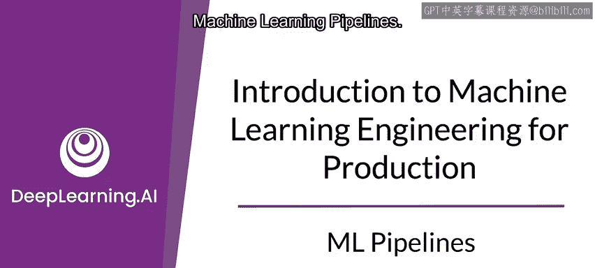
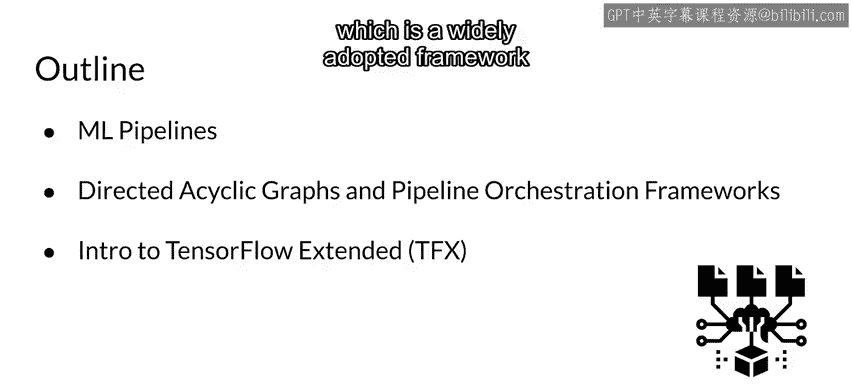
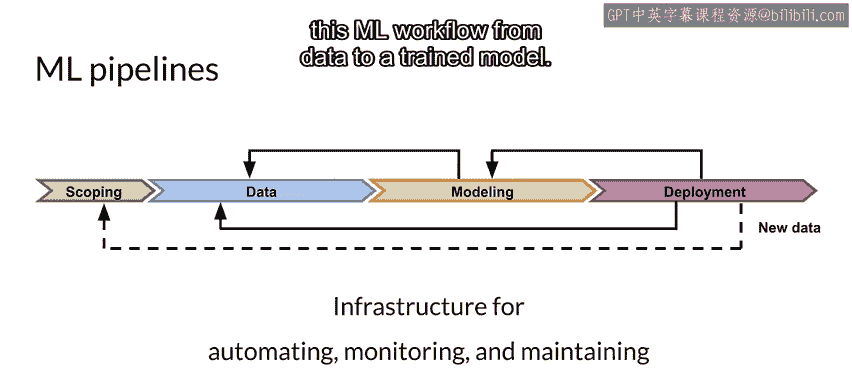
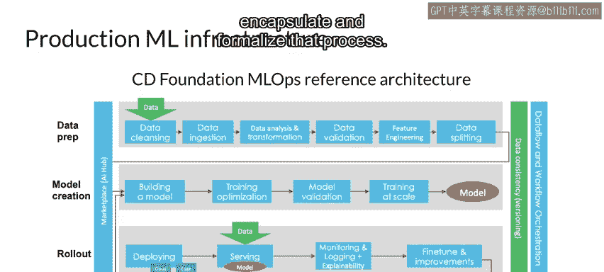
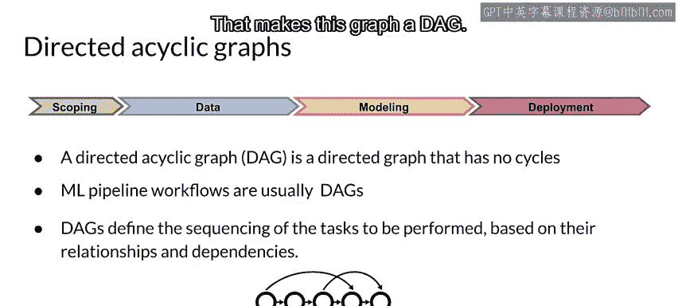
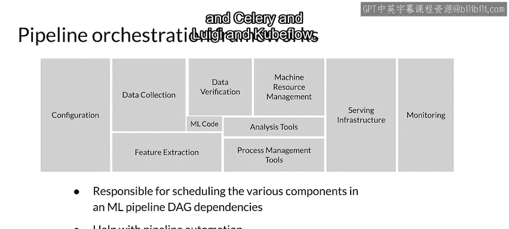
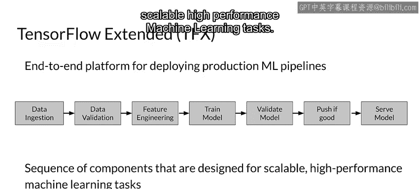
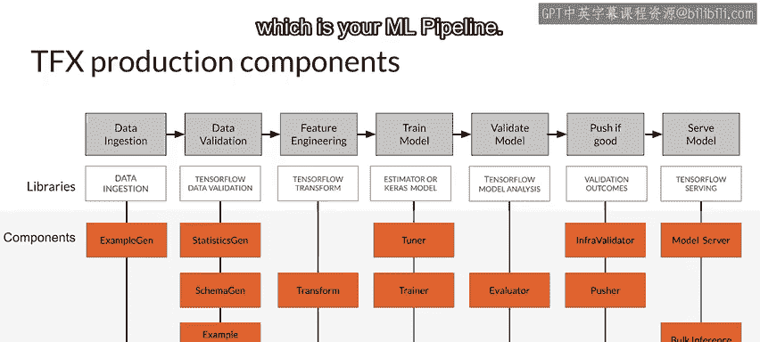
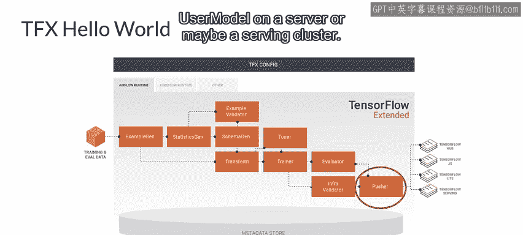
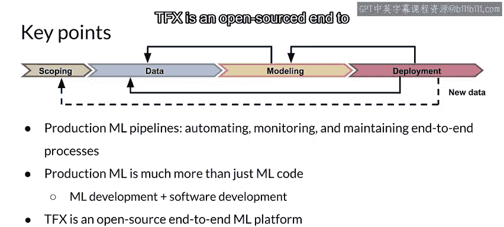

# 吴恩达《机器学习工程师的生产实践（MLOps）Machine Learning Engineering for Production》中英字幕 - P44：3_机器学习流水线.zh_en - GPT中英字幕课程资源 - BV1pi4y167g5

Welcome back， this next session is all about MO pipelines。No， not those kind of pipelines。

Machine learning pipelines。

M L pipelines are the heart of any production M L system。

 and you're going to learn all about them right now in this lesson。

 we'll begin to introduce M L pipelines and the concept of M L ops。

You'll also see how pipeline orchestrators sequence and schedule ML tasks to implement the entire ML training process。

We'll then look at the example of Tensorflowlow extended or TFX。

 which is a widely adopted framework for creating ML pipelines。

 So what do we mean by the phrase ML pipeline Well。

 remember the iterative ML workflow that we talked about previously an ML pipeline is a software architecture to implement exactly that Automating。

 monitoring and maintaining this ML workflow from data to a trained model。

ML pipelines form a key component of M ops architectures。

 This slide shows one version of what an ML pipeline looks like。

 which was put together by an industry group， the C D Foundation。

There are some differences between different pipeline architectures， but in general。

 they look something like this。You'll notice that they basically mirror the ML development process。

 starting with data ingestion and ending with a trained model。That's by design。

 since they need to encapsulate and formalize that process。

MmL pipelines are almost always directed acyclic graphs or dags， although in some advanced cases。

 they can sometimes include cycles。A dag is a collection of all the tasks you want to run。

 sequenced in a way that reflects their relationships and dependencies。Notice that in this graph。

 the edges are directed， and there are no cycles。That makes this graph a dag。

Orchestrs are responsible for scheduling the various components in an ML pipeline。

Based on dependencies defined by a dag。Orchests help with pipeline automation。

 So examples include Argo and airflow and celery and Luigi and cube flow。

TFX is an open source end to end machine learning platform， and it's what we use at Google。

A TFX pipeline is a sequence of scalable components that can handle large volumes of data。

Starting on the left。We ingest data and then we move to data validation and we do some feature engineering。

 we train a model， we validate it。If it's better than what we already have in production。

 we're going to push it to production。 and finally， we're serving predictions。

The sequence of components are designed for scalable high performance machine learning tasks。

In this course， you'll be using TFX to implement real ML L pipelines exactly as you would for production systems。

TFX and production components are built on top of open source libraries such as TensorFlow data validation。

 which you'll also learn about later this week。TensorFlow transform we shall also be working with extensively later in this course and others like TensorFlow model analysis。

Components in the orange here leverage those libraries and form your dag。

As you sequence these components and set up the dependencies between them， you create your dag。

 which is your M L pipeline。

So this is what we refer to as the Hello world of TFX。

We start on the left with our data and we're going to ingest our data with a TFX component called example Gen。

 all of the boxes in orange that you see here are TFX components。In fact。

 these are components that come with TFX when you just do a PIP install。

Next we generate statistics for our data， we want to know the ranges of our features if their numerical features。

 if they're categorical features， we want to know what are the valid categories and so forth。

 what are the types of our features。Example validator is used to look for problems in our data。

 schema Gen is used to generate a schema for our data across our feature vector and transform well do feature engineering。

Tuner and trainer are used to train a model and to tune the hyperparameters for that model。

An evaluator is used to do deep analysis of the performance of our model。

 and we'll talk about what we mean by deep analysis a little bit later。

An infr validator is used to make sure that we can actually run predictions using our model on the infrastructure that we have。

 So， for example， do we have enough memory。If all of that passes and the model actually performs better than what we might already have in production。

Then pushusher pushes the model to production。But what does that mean？Well。

We might be pushing to a repository like TensorFlow hubub and then using our model later for maybe transfer learning or generating embeddings。

 we could be pushing to Tensorflowlow JS if we're going to be using our model in a web browser or a node JS application。

We could push to Tensorflow light and use our model in a mobile application or on an Io device。

 or we could push to Tensorflow serving and use our model on a server， or maybe a serving cluster。

 So the key points here， first of all， production M L pipelines are more than just M L code。

 their M L development and software development and a formalized process for running that sequence of tasks and to end in a maintainable and scalable way。

😊。

And TFX is an open sourced end to end M L platform that we'll be using in this course。

