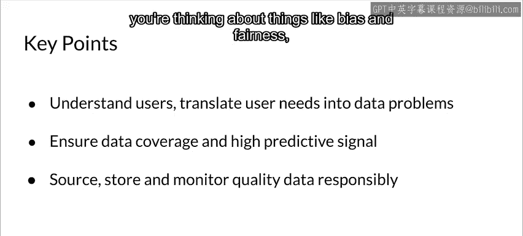

# 吴恩达《机器学习工程师的生产实践（MLOps）Machine Learning Engineering for Production》中英字幕 - P45：4_数据的重要性.zh_en - GPT中英字幕课程资源 - BV1pi4y167g5

Hi and welcome back。Well， to actually do any machine learning， you need to have some data。

Where do you get that data Well in production ML， it turns out you usually have to find ways to collect that data。

And we'll talk all about that right now。Now let's discuss collecting data and a little bit about the importance of data too。

First， let me tell you a story about an application that I was involved in。

We were asked to create a model to predict the amount of time that it would take to get through an airport security checkpoint on different days at different times with different you know lines of different lengths and so forth。

So we needed data。And how are we going to get that data well。

 we had to measure how long it took people to get through security checkpoints。

 how are we going to measure that？Well， what it came up with is we had to actually go to the airport。

 we had to get someone cleared through security because anything you do at an airport has to be approved by the security。

We had one person standing at the beginning of the line to get into a security checkpoint。

 and they would record the time that somebody entered。

And then we had another person standing at the other end， the exit of the checkpoint。

 and actually they were far enough away from each other。 they couldn't even see each other。

And they would record the time that each person left。And in that way。

 we would gradually build up a data set of labeled data that gave us the amount of time that people took to get through an Air security checkpoint。

Well， as you can imagine， it was incredibly painful。

 we had to develop applications just to support being able to do that and it was incredibly expensive。

 we had to pay people， they had to be cleared through security and so forth。

So when we talk about collecting data in the real world。Hopefully。

 you're not going to deal with a situation like that。

 but it will be a real world situation where you need to think about how you're going to get the data you need unless。

 you know， you're very lucky and somebody already has the data for you， which is great。

 And if that's the case， that's wonderful。 So let's start by discussing the importance of data and the importance of data quality。

It's your data and your model is only going to be as good as the quality of your data if there's a lot of noise in your data。

 then you need to try to deal with that if the labels especially are noisy。

 then you have to find ways to try to clear up that signal。

We're going to be using data pipelines almost exclusively because remember we need to automate these processes。

 so we're going to need data collection and then in our pipeline we're going to ingest and prepare our data as sequenced automated tasks。

And we're going to need to monitor data collection。 so remember for most applications。

 you don't just collect data once you are going to collect data throughout the lifetime of that application As we've seen data is the hardest part of ML and the most important piece to get right。

 this is a quote from Uber。Broken data is the most common cause of problems in production animal systems。

 Well， I hope you never have to learn that the hard way。

GoJk has similar feelings about that and really if you go to just about any production machine learning team。

 they'll tell you stories about collecting data and how important it is to get the data right。

In programming language design， a first cloth citizen in a given programming language。

 is an entity which supports all the operations generally available to other entities。And in ML。

 data is a first class citizen。So software 1。0 was all about code。

 it's really just the instructions for the computer。In softwareftware 2。0。

 we need to specify a goal for the behavior of the program。The code is important。

 but not the only thing that we worry about。Optimization is really the driving force here so optimization in a lot of different directions。

 so we want to optimize for performance， obviously what we want to optimize for maintainability and scalability as well。

And for ML。Data and data quality is really critical for success。In some ways。

 you could look at it as you know， data is almost like the software。

 almost like the code in a software 1。0 application data is sort of a similar sort of player in an ML application so the cartoon on the right shows one way to look at this。

You I' let you， I'll let you read that by yourself， but models aren't magic， so it's。

 it's good for you to know that。The data that you have， you could have mountains of data。

 but if it doesn't have predictive content。Then， you know。

 you're just not going to be able to create a predictive model with it。

So there's a couple things here， you want to remove information from your model and features from your model that aren't predictive because they're going to cause problems。

 they're certainly going to take a lot of compute resources that you don't want to be spending on that。

And you need to make sure in a supervised learning case or even unsupervised learning that your training data is really covering the same feature space as as the prediction requests that you'll get when you put your model into production。

 you need to cover that same space so that your model has good information about the regions of that space to make predictions and you know just like anything。

 it's garbage in and garbage out so if your data is garbage if your data quality is low。

Your model and your application will be low quality。

The good news actually for ML is that we can measure that in a lot of software applications。

 you you know might not be it might not be as easy to measure how bad your solution or good your solution is doing。

 but in ML it it's pretty easy to measure that so data collection is an important and critical first step。

To building ML systems and data， you know， you want to avoid problems with downtime。

 you need to make sure that you're trading a model that you can scale。

 that you can serve predictions。And you need to think about， especially for things like time series。

 you have things like seasonality and trends。You need to think about different kinds of errors。

 and we'll talk about all of these， but it's this whole picture that you need to sort of keep in your mind when you're you're developing things that it's going to be an entire process。

 you know， from ingestion through serving and。That all has to be automated and it all has to be testable and maintainable and scalable and so forth。

So you need to understand your users。And you need to make sure that you're translating the user needs into data problems。

 you don't want to just do you know the model that you happen to have if it doesn't meet the needs of the user。

You need to make sure that your data covers the same region of your feature space as the prediction request that you'll get your training data and you want to make sure that you've really maximize a predictive signal in that data。

And you need to worry about the data quality， not just at the beginning。

 but throughout the life of the application。So part of that is making sure that you're sourcing data responsibly and you're thinking about things like bias and fairness。

 which we will talk about later on in this course。

