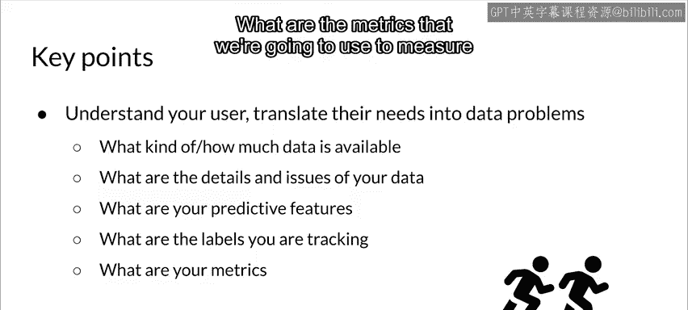

# 吴恩达《机器学习工程师的生产实践（MLOps）Machine Learning Engineering for Production》中英字幕 - P46：5_建议运行的应用示例.zh_en - GPT中英字幕课程资源 - BV1pi4y167g5

So now let's talk about collecting data and look at an example application。

So for this example， we're going to be looking at an application that suggests runs to runners。

And there's different runners with different level of fitness。

The first step is really to try to understand the users as we've discussed。ML systems。

 this system is going to suggest runs based on the user's behavior and by leveraging observed patterns and preferences。

So the goal is to improve the consistency of running and for runners to complete those runs and to really be happy about that。

So some key considerations。First of all， you need to consider data quality and data collection。

 so what kind of data and how much data do you need？And how often do you need new data。

 when do you expect things to change， is that data annotated？

You also need to translate the user needs into data needs， so understand the user is great。

 but at the end of the day we do need features and data。

We need to first understand the user because otherwise we run the risk of collecting a bunch of data that is really just garbage。

But once we understand the user， then we need to translate the user needs into data needs。

And we're going to do that with identifying what the data is， what the features are。

 and what the labels are。So here's an example data set。

 we've got three different examples here for three different kinds of runs and we've got some features。

So the examples here are the Boston Marathon， the Seattle October Fest 5K and the Houston Half Marathon。

The 5 k sounds good to me， and I'm that kind of a runner。So the features， well， the run itself。

 the runner time and the elevation， which is also important。

And then the labels here just going to be how the runner ratess the fun level of those runs。

So it looks like they agree with me， the 5K sounds like it'd be a lot of fun。

So get to know your data， you need to identify the data sources and as you're going to use where you going to get this data and not just the first time。

 but on an ongoing basis。So it's not just training。

 but you need to collect that same data to do inference。When you want to create a prediction。

And you need to think about， you， how often do I need to refresh my trainings at？Along the way。

 when you're working with your data， you need to make sure that there's actually predictive value in your data。

 anyone want try to make sure that you've eliminated you features and data that does not have predictive value。

But there's also some more basic things like， you know， are is the data consistent。

 is it when you're expecting， say a floatat， do you always get a floatat or is it mixed？

And looking for things like outliers， too， or just errors。

 because remember you're dealing with systems。You know you could have a sensor that goes bad and then you've got an error so there could be data issues coming from different measurements and different types and also you know simple things like the difference between an end and a float or how missing values encoded that can all cause problems and in this example data set if the elevation is zero feet does that really mean that we're at sea level or does it mean that that we don't have any elevation data for that record。

And， you know， if the output is coming from other ML models， maybe you're using an ensemble。

If there's errors in those， then you can compound those errors when you try to use it in a downstream model。

You also want to make sure that you're looking for errors and issues early in the process and monitoring the data sources for system issues and outages。

 because remember we're operating this thing you know， could be 24，7 easily， a lot of things are。

 and so you need to expect to have system issues and outages。

So what if the app was offline for a while and it recorded runner time is wrong？

For some number of users， do you have ways to deal with that？So measuring the data effectiveness。

 you need some intuition about the data value， but your intuition can be misleading。

So you really need to make sure that you're looking at which data is really giving you the most information feature selection and feature engineering are really critical to shaping your data to be what you need it to be the feature engineering will help you maximize the predictive signals once you've。

Really identified where those are and feature selection that helps you measure where that predictive information is and really focus in on those features that give you the most value and help your model the most。

So again， user needs， you need to understand the user and the application。And in this case。

 we're looking at running data from an app right and we can get demographic data when the user fills out their profile and we also probably can get some GPS data to give us some local geographic information。

 so at a high level that helps us understand the user and then we need to translate that into features。

 so the runner demographics， we need to express that as you know a feature or probably several features。

 things like the time of day how long it takes them to complete a run， their pace during the run。

 the distance and so forth， the elevation， and if if we're working with an app that has some sensors like a heart rate monitor。

 that's great information to have to really feed into this app。

 probably has some some predictive information， but again we need to test that。

And then what are our labels going to be so you know runner acceptance in this case is a label that we want to focus on and runners that take our suggestions and use them that tells us that the app successfully gave them a run that they wanted to do。

And conversely， if they rejected it。User generated feedback， you need to think about first of all。

 how they're going to give you that feedback in a structured way that you can use to help with training your model。

And then you know， things like user rating in this case of the enjoyment of the recommended runs。

 again， it needs to be in a form that we can use， it can't just be free form unless you're going to do。

 you know， like NLP to try to understand their paragraph of feedback。

 but you know typically you're not going to do that。But anyway。

 the point here is that you need to understand the data and your user and how you're going to apply labels。

So key points， understand your user or your application if there is no user。

 translate their needs into data problems and features。

 well defined features that give you predictive information。

So what kind of data can you get what's available and what are the details and issues for your data。

 things like sensors， how reliable are they Where's the predictive information in your data It may not be where you think it is it sometimes isn't what are the labels we need to make sure that we're you know tuning we're training a model to predict the right things so we need to make sure our labels are the correct ones for our goals。

And so that's going to get to the metrics， right， what are the metrics that we're going to use to measure the performance of our model。

