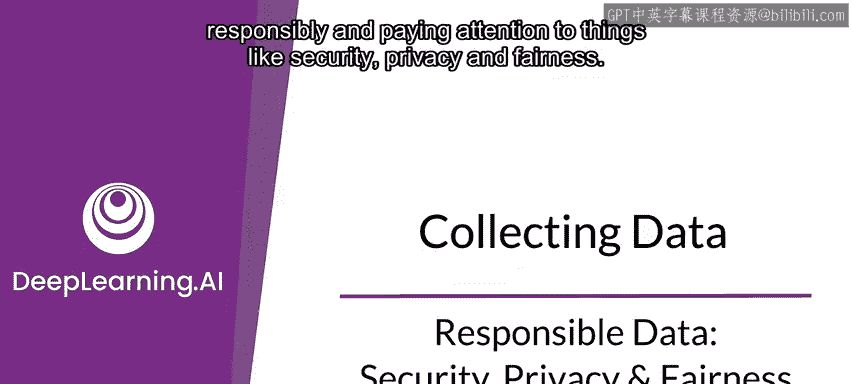
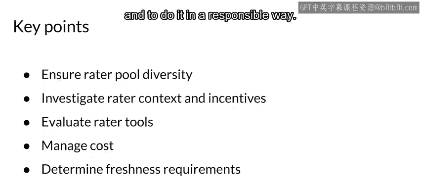

# 吴恩达《机器学习工程师的生产实践（MLOps）Machine Learning Engineering for Production》中英字幕 - P47：6_负责任的数据、安全、隐私和公平.zh_en - GPT中英字幕课程资源 - BV1pi4y167g5

One of the key aspects of collecting data is to make sure that you're collecting it responsibly。

And paying attention to things like security， privacy， and fairness， let's talk about that now。

So we're going to be looking at how to responsibly source data and ensure that our data is secure and that we're managing user privacy correctly。

 we need to know how to check for and ensure fairness。

And we need to design labeling systems that will mitigate bias。So here's an example。

These images here show one standard open source image classifier trained on the open Images data set that does not properly apply wedding related labels to images of wedding traditions from different parts of the world。

On the far left， the classifier's label prediction is recorded as ceremony， wedding。

 bridede man group， womanov dress， so that's pretty correct。The next one is bride ceremony。

 wedding dress and woman again， we know that's correct， at least in the West。

 that's what a bride typically looks like。The next one over is you know good as well so it's ceremony and bride and wedding mang woman dress again gets it right。

 but the one on the end， the one on the right。Well， that's for an African winning ceremony。

 but it's incorrectly labeled as simply person or people。 Well， it is person or people。

 but it's also a ceremony， and there's a bride and a groom and a dress and so forth。

 So this is a classic case。 It's it's a example It's often cited。

Of a problem with bias in the data set。 So in ML system， the data may come from different sources。

And you need to think about those sources as well in your data set it's not just the data that you have。

 but where did you get it from， so you might be building synthetic data。

 you might be doing web scraping， you're often collecting live data。

 especially when you're running inference。You're often almost always really going to be building your own data set。

 although sometimes you can be using an open source data set。

 it just depends on you know what's available and what you need。

But data security and privacy are key。They're always going to be important data security that really refers to the policies and methods and means to secure personal data or what's often referred to as PII personally identifiable information data privacy is about proper usage。

 collection retention， deletion and storage of that data。

So data collection is not just about your model， you need to think about your users and you know。

 treat that data as something that has been given to you to be a steward of you're taking care of that data。

 you need to manage it responsibly。Users really should have control over which data is being collected。

 and it's important to establish mechanisms to prevent your system。

Revealing a user's data inadvertently or even through attacks。

So how you handle your data privacy and data security depends on the nature of your data as well as the operating conditions and regulations and policies。

 things like GDPR very important here。Users privacy is also really key， so you need to protect。

Personally identifiable information or data。Well， there's different ways to do the aggregation really helps with that if you can aggregate the data so that you can't identify individual people within it。

 anonymizing it and giving users control over what data they share also a good way to deal with that。

 you need to consider any laws or regulations regarding user privacy that might be affecting in the places where you're going to be using your model and redaction so in a lot of cases you need to give users a way to remove some of the data which will create a less complete picture but is part of being responsible with your data。

So ML systems can fail users you know， in a lot of different ways and we need to strike a balance between being fair and accurate and transparent and explainable。

Some of the ways that ML systems can fail are through things like representational harm。

So representational harm is where a system will amplify or reflect a negative stereotype about particular groups。

Opportunity denial is when a system makes predictions that have negative real life consequences that could result in lasting impacts。

Disproportionate product failure is where the effectiveness of your model is is really skewed so that the outputs。

Happened more frequently for particular groups of users， you get skewed outputs more frequently。

 since they can think of it as errors more frequently。

Harm by disadvantage is where a system will infer disadvantages disadvantageous associations between different demographic characteristics and the user behaviors around that。

So fairness is important and you should really commit to it from the beginning。

So what does it mean well well being fair means that you're going to identify some groups of people or identify if some groups of people get a different experience than others in a problematic way。

 so for instance， let's assume particular gender or occupation or age fields are part of your data and that you use it to train a model that predicts whether someone would be a reliable new employee。

So it's involved in hiring， you need to really check to make sure that your model does not consistently predict different experiences for some groups in a problematic way by ensuring group fairness。

 so what that means is demographic pary and that things are equalized across different groups。

And you need to make sure the accuracy as well is equal or as close as you can get it。

The data collected and labeled by humans will reflect their biases in many cases and their personal experiences。

 so you have to account for that。Diversifying your user base is a good way to move towards fairness。

 but it's not a guarantee。So ML systems can amplify biases。

 you need to be aware of that and be careful about it。And really。

 what you want to do is deploy fair models。Bass can also arise when you have disproportionate representation of some groups within your data or no representation at all。

So looking at the graphic here， what we're trying to show is that part of the people that are shown here are in your data。

 but there's a whole lot of other people who are not。So those groups might be stereotyped。

 the ones that are not in your data， or they might just be presented in a less positive way。

 or they may just get a bad experience a lot more often。

So to reduce bias for supervised learning you need accurate labels to train your model and serve predictions。

The labels are usually coming from two broad sources， it depends there's other sources as well。

 but most of the time they're going to be coming from automated systems or human Raers and we'll talk about both。

Humans are able to label data in different ways and the more complicated the data is the more you may require an expert to look at that data and we'll talk about that in a bit So humans that label data are referred to as raters so who are rateers well they could be generalists and these are people who you know just pretty average people who are going to be adding labels through a variety of crowdsourcing tools and you know these are cases where it's fairly easy for people to recognize the correct labels so for example。

 if you want a human to recognize the difference between a cat and a dog that's something most people can do by looking at the image but in some cases you really need a subject matter expert so in those cases you're often using specialized tools an example of that is looking at x-rays for diagnosis it's not something that just。

Any can do， you need to make sure that you're working with an expert and that that labeling tends to get pretty expensive。

So a subject matter an expert or domain expert， this is something that you need in certain cases。

You can also use your users， so this sort of feedback that we looked at for our running app。

 this can often be very valuable if you can find a way to work with that in your application and it's going to give you this ongoing stream of labels for your data if you can make that work。

So key points， first of all， always account for fair raters and fair representation in your data set to avoid potential biases。

And take into account who those labelers are and what their incentives are。

 because if you design the incentives incorrectly， you could get a lot of garbage in your data。

The cost is certainly always going to be an important consideration so if you can find a way to do it with a high level of quality but at you know less cost that's great but you need enough data you need to find a way to do that it's one of the challenges of production applications and finally data freshness too you're going to be working with data and depending on how the world changes around the application and the data that you have you're going to need to refresh that data on some regular basis and detect when you need to do that so those are all issues you need to think about to really manage collection of data and to do it in a responsible way。

