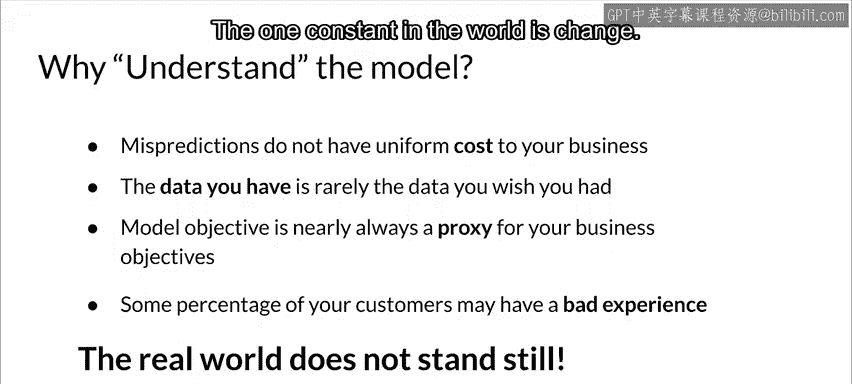

# 吴恩达《机器学习工程师的生产实践（MLOps）Machine Learning Engineering for Production》中英字幕 - P48：7_模型性能退化案例研究.zh_en - GPT中英字幕课程资源 - BV1pi4y167g5

Welcome back。 You know， the only constant in the universe is change。

 That quote is actually attributed to Heaclitus of a thesis in 500 B C。

 And I think it's fairly safe to say that it's still true today day， and it affects production of L。

 So for example， if you had trained a model a few years ago to recognize what a book looks like。

 It might have looked like this。 if you trained a model a day。

 you'd also want to include books that look like this。 Let's find out more now。😊。

To illustrate some of the issues with labeled data in performance settings。

 let's take a look at a case study。

So imagine that you're an online retailer and you're selling shoes and you have a model that predicts clickthrough rates。

 which helps you to decide how much inventory to order。And suddenly。

 the AU and prediction accuracy have dropped not on everything。

 but on a particular part of your inventory， men's dress shoes。Okay。Why？You trained your model。

 you did you know fairly well in your metrics and so forth， Why is it different， What change。

 Why does your model not predict men's dress shoes well now？And perhaps more importantly。

 how do you even know that you have a problem， Your model still running。

 it's still giving predictions， you're still ordering inventory。

How do you know that the orders that you're making and the predictions that your model is giving you are not as good as they used to be？

Unfortunately， if you don't put good practices into place in a production setting。

 you're probably going to find out either when you order way too many shoes or not enough shoes。

And that's not a situation that you want to be in in a business， this is going to cost you money。So。

You need to think about how you're going to detect problems like that early and what the possible causes are so that you can look for those and monitor your system。

And then try to have methods， systems in place to deal with those problems when they happen。

 because they probably will happen at some point。But what kinds of problems， Well。

' there's different kinds， and they tend to fall into two different categories。

There are slow problems， so for example， your data will drift over time as the world changes and you know seasons pass and you have holidays and competitors enter or change what have you。

And then you have fast problems that are really part of your system。

 so you have a sensor that goes bad or you have a software update that gets applied and suddenly you know things are wonky。

So you need to really be monitoring your system well and looking for both of those problems and thinking about remediation in both cases。

For gradual problems， they tend to fall into two groups really。

 but they're interrelated though it's not like there's a hard line between them。Trend in seasonality。

 for example， especially in time series。You will have trends and you will have seasonality in most cases and you could argue about whether that's really a change in data or a change in the world。

 same thing with the distribution of the features again，' it's something that you see in your data。

And the relative importance of features can change too， and as the relative importance changes。

 if you haven't retrained your model， your model accuracy starts to decay。

The world also changes constantly， and in production settings。

 that has to become part of the systems that you design and the processes that you have in place。

Things like， well， if we're working in retail and we're just looking at an example with shoes。

 styles change so you know maybe last year black shoes were really fashionable for men's dress shoes and now it's brown shoes or what have you。

The scope and the processes change so your understanding of those processes and how they happen in the world will affect how your model views the results of those processes。

Competitors change and your business also changes， so you may take on new products。

 you may end of life other products， you may have new competitors。

 you may expand into other geographies or you may move out of geographies。

 prices from suppliers change prices you know on the open market change。

 all of that affect how your model needs to adapt to the world and this is tends to be very domain specific。

 but in general in nearly all domains changes in the world affect your model performance。

So for sudden problems there's things that you're probably familiar with。

 so data collection problems， things like a bad sensor or bad camera。

 the log data suddenly changes and you know you have a different format or you know the logs themselves or maybe rotated differently you can have you know a sensor or a camera that doesn't really change but it moves maybe it gets bumped or maybe someone decided it should be in a different spot I personally have seen that happen where we had cameras that someone decided that they should be moved and didn't tell us about that。

Systems problems so you're going to have software updates all the time and if you know they change something significant that you weren't aware of that can be a real problem network connectivity no no the network never goes down does it well maybe sometimes it does。

Systems too， whole systems can go down， so be aware of that。And bad credentials， you know。

 you assign credentials and often they time out。or if something changes about them。

 all those things can cause a sudden problem that all of a sudden it's a fire drill and you need to deal with it。

So part of this is really trying to understand your model and how it's sensitive to different changes in the world a big issue here is that mis predictiondictions don't have uniform costs to your business。

 some mis predictiondictions will you know have very little effect on your business other mis predictiondictions could have huge effects。

 so understanding that and and really you know as you're monitoring things looking for things that have you know larger impacts is important。

The data you have as you collect data is rarely the data that you wish you had。

So I've personally seen cases where we were using sensor data from Wifi devices。

And it was not great data， there was it was really noisy and， you know， but it was all we had。

 it was all we could have。So we had to work with what we had。

The model objective is almost always a proxy for what you're really trying to get to in many cases。

 sometimes you can design a model and you have the data to design a model for exactly the thing that you're trying to attack。

But often， as in the case of the shoes that we just looked at。

 we were predicting click through rates as a proxy for deciding how much inventory to order。

Some percentage of your customers will have a bad experience。

 you want that percentage to be as small as possible。And as much as possible。

 you want to understand which customers those are going to be so that you can try to design ways to mitigate that and improve the situation for all of your customers。

But the bottom line here that you will deal with constantly is that the real world does not stand still。

 The one constant in the world is change。

