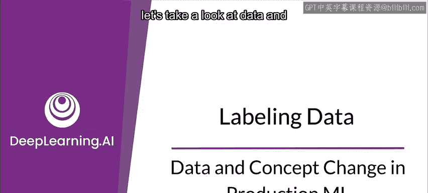
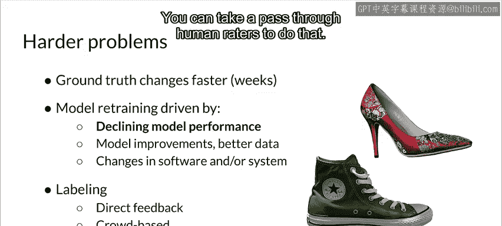
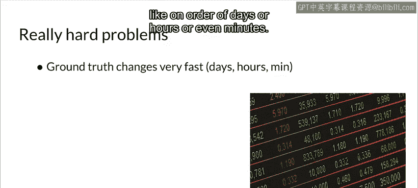
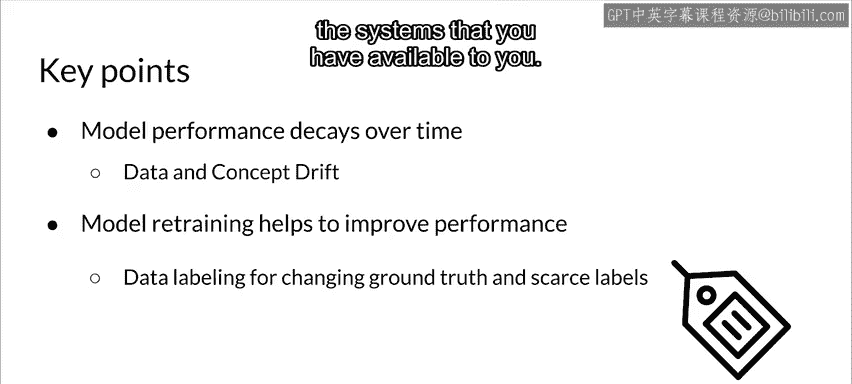

# 吴恩达《机器学习工程师的生产实践（MLOps）Machine Learning Engineering for Production》中英字幕 - P49：8_生产环境中的数据与概念变更.zh_en - GPT中英字幕课程资源 - BV1pi4y167g5

So in our discussion of labeling data， let's take a look at data and concept change in production ML。

So we're going to be talking about detecting problems with deployed models and really that focuses on two things。

Data。Data change and concept change or world change。

And there's different kinds of this we've talked about a little bit of this。

 we'll get into it some more so there are different kinds of changing ground truth and you know there's easy problems。

 there's harder problems and then you get really hard problems and you need different approaches to deal with these so let's look at that。

So detecting problems with deployed models， you can look at the data and the scope of the data and the world in a couple of different ways。

 but fundamentally you need to monitor your models。

And you need to validate the results and the data of your models to find problems。

 so you want to try to find problems early， especially with system problems that happen quickly。

 like a bad sensor， things like that that we've discussed。But。

A fundamental issue is changing ground truth and what that means is that you need to label new data。

Over the life of your application。 And it depends on really the domain that you're working in and the kinds of problems that you're trying to solve。

 as far as what approaches are really feasible for doing that。There are easy problems。

 things like you trying to recognize images of cats and dogs， and in this case。

 the ground truth really changes pretty slowly。So model retraining in those cases is usually driven by model improvements。

 you are better at recognizing cats or dogs or whatever it is that you're doing。

You could have changes in software too， so you could be upgrading things or using a different library。

 that kind of thing or systems。So labeling in this case is fairly simple。

 you're going to work with maybe a curated data set that you're getting from you know some public domain source or a source that your organization has been using for a while。

 or you could look at crowdbased as well so if it tends to be fairly simple。

 things like feedback of course， if you have those available great， use them。

 you know use what you can。Then we get into a little harder problems where the ground truth really changes faster。

 things like styles， we looked at shoes， but there's a lot of things where styles and you the world changes on a matter of maybe weeks。

 that kind of thing。And so model retraining in that case is usually driven by declining model performance。

 which you need to measure if you're going to be aware of。You can also have model improvements。

 you can also have better data， and of course the software and systems you're running on can also change。

But as these things get harder， you get， you know， more things and declining the model performance is one of those。

And so labeling in this case， if you can do direct feedback either from your systems or from your users。

 that's great， crowd based human labeling is another feasible way of doing this since you do have probably weeks to respond。

 so you can take a pass through human Raers to do that。

Really hard problems， though， it becomes well， really hard。 and so in this case。

 ground truth changes very fast， like on an order of days or hours or even minute。

So things like markets really fall into this category they change very quickly and in this case declining model performance is definitely going to be a driver for when you need to retrain your model you can also have things like model improvements and changes and software and so forth。

 but those are tend to be things that you'll be working on kind of offline while you're keeping your application running and it's really model performance where you really need well definedfined processes to deal with those changes。

So labeling in this case becomes very challenging， direct feedback is great if you can do it in your domain。

 if not you need to look at things like weak supervision that we'll talk about。

 but it's really challenging in these kinds of domains and you know they tend to be high value domains。

 things like predicting markets where there's significant incentive to doing these predictions。

So the key points of what we're talking about here， model performance decays over time。

It may decay slowly over time in things like cats and dogs where， you know。

 that doesn't change very quickly or it may change very fast。Things like markets。

So model retraining will help you improve or maintain your performance。

Certainly as your model performance decays， it'll help you do that and data labeling。

 assuming you're doing supervised learning which you know is pretty common。

 data labeling is a key part of that so you really need to think about how you're going to approach that and your particular problem and your particular domain and with the systems that you have available to you。

