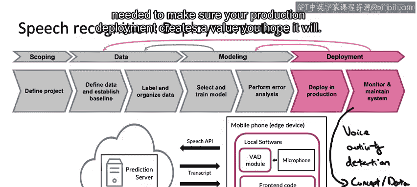

# 吴恩达《机器学习工程师的生产实践（MLOps）Machine Learning Engineering for Production》中英字幕 - P4：3_语音识别案例学习.zh_en - GPT中英字幕课程资源 - BV1pi4y167g5

One of the successes of deep learning has been speech recognition deep learning has made speech recognition much more accurate than you know maybe a decade ago and this is allowing many of us to use speech recognition in our smart speakers on our smartphones for voiceur and in other context you may have heard occasionally about the research work it goes into building better speech models but what else is needed to actually build a valuable production deployment speech recognition system let's use the machine learning project lifecycle to set through a speech recognition example so you can understand all the steps needed to actually build and deploy such a system。

😊。

I've worked on speech recognition systems in a commercial context before and so the first step of that was scoping have to first define a project and just make a decision to work on speech recognition。

 say a voice search as part of defining the project and I'd also encourage you to try to estimate or maybe at least guesstimate the key metrics this will be very problem dependence almost every application will have its own unique set of goals and metrics but in the case of speech recognition some things I cared about where how accurate does the speech system what does the latency。

 how long does the system take to transscribe speech and what is the throughput how many queries per second could we handle。

And then if possible， you might also try to estimate the resources needed， so how much time。

 how much compute， how much budget as well as timeline。

 how long would it take to carry out this project I'll have a lot more to say on scoping in week three of this course so we'll come back to this topic and describe this in greater detail as well。

The next step is the data stage where you have to define the data and establish a baseline and also label and organize the data。

What's hard about this， one of the challenges of practical speech recognition systems is is the data label consistently。

Here's an audio clip of a fairly typical recording you might get if you're working on speech recognition for voice search。

 let me play this audio clip today's weather。And the question is given this audio clip that you just heard。

 today's weather， would you want to transcribe it like that。

 which if you have transcription as labeled the data。

 this would be a perfectly reasonable transcription， or would you want to transcribe it like that。

 which is also a completely reasonable transcription。Or should the transcriptionists say， well。

 there's often a lot of noise in audio， you know， maybe there's a sound of a conkve。

 something fell down and you don't want to transcribe noise。

 so maybe it's just noise and you should transcribe it like that。

It turns out that any of these three ways of transtriiving the audio is just fine。

 I would probably prefer either the first or the second， not the third。

 but what would hurt your learning algorithm's performance is if one third of the transcription is used the first。

 one third a second， and one third， the third way of trans drivingiving。

 because then your data is inconsistent and confusing for the learning algorithm because how is the learning algorithm supposed to guess which one of these conventions。

 a specific transcription is happened to use for an audio group。

So spotting correcting consistencies like that。😊，Maybe just asking everyone to standardize on this first convention。

That can have a significant impact on your learning algorithms performance。

 so we'll come back later in this course to dive into some best practices for how to spot inconsistencies and how to adjust them。

Other examples of data definition questions for an audio clip like today's weather。

 how much silence do you want before and after each clip after a speaker has stopped speaking。

 do you want to include another 100 milliseconds of silence after that or 300 milliseconds？

Or 500 milliseconds， half a second。Or how do you perform volume normalization？

Some speakers speak loudly， some are less loud， and then there's actually a tricky case of if you have a single audio clip with some really loud volume and some really soft volume all within the same audio clip。

So how do you perform volume normalization？Questions like all of these are data definition questions。

 a lot of progress in machine learning， that is a lot of machine learning research was driven by researchers working to improve performance on benchmark data sets。

In that model， researchers might download the data and just work on that fixed data。

 and this mindset has led to tremendous progress in machine learning。

 so no complaints at all about this mindset。But if you are working on a production system then you don't have to keep the dataset set fixed。

 I often edit the training set or even edit the test set if that's what's needed in order to improve the data quality to get a production system to work better so what are practical ways to do this effectively not in an ad hoc but systematic frameworks for making sure you have high quality data。

 you learn more about this later in this course and later in the specialization as well。

After you've collected your data， the next step is modeling in which you have to select and train a model and perform error analysis。

The three key inputs that go into training your machine learning model are the code that is the algorithm or the neural network model architecture that you might choose。

You also have to pick hyperpara and then there's the data and running the code with your hyperparameter on your data gives you the machine learning model。

Theele machine learning model for learning from， say audio clips to text transcripts。

I found that in a lot of research work or academic work。You tend to hold the data fixed。And very。

The code and maybe vary the hyper parameters in order to try to get good performance。In contrast。

 I found that for a lot of。Product teams， if your main goal is to just build and deploy a working。

 valuable machine learning system。I found that it can be even more effective to hold the code fixed and to instead focus on optimizing the data。

And maybe the hyperparameter in order。To get a high performing model， a machine learning system。

Includes both code。And data。And also hyper parameters that theyre maybe a bit easier to optimize than the code or data。

 and I found that rather than taking a model centric view of trying to optimize the code to your fixed data set。

For many problems， you can use an open source implementation of something that you download off GiHub and instead just focus on optimizing the data。

 so during modeling you have to select and train some model architecture。

 maybe some neural network architecture。Eror analysis can then tell you where your model still falls short。

And if you can use that error analysis to tell you how to systematically improve your data。

 maybe improve the code too that's okay， but often if error analysis can tell you how to systematically improve the data。

 that can be very efficient way for you to get to a high accuracy model and part of the trick is you don't want to just feel like you need to collect more data all the time because we could always use more data。

 but rather than just trying to collect more and more and more data。

 which is helpful but can be expensive， if error analysis can help you be more targeted in exactly what data to collect。

 that can help you be much more efficient in building an accurate model finally。

 when you have trained the model and when error analysis seems to suggest it's working well enough。

You're then ready to go into deployment。Tick speech recognition。

 this is how you might deploy a speech system。You have a mobile phone。

 this would be an edge device with software running locally on your phone。

 that software taps into the microphone to record what someone is saying maybe for a voice search and in a typical implementation of speech recognition。

You would use a VAD module。VAD stands for voice Act detectiontection。

And it's usually a run of these simple algorithm， maybe a learning algorithm。😊。

And the job of the VAD allows the smartphone to select out just the audio that contains。

 hopefully someone speaking so that you can send only that audio clip to your prediction server。

 and in this case， maybe the prediction server list in the cloud。

 this will be a common deployment pattern， the prediction server then returns both the transcript so the user so you can see what the system thinks you said。

And it also returns to search results if you're doing voice search and the transcript and search results are then displayed in the front end code running on your mobile phone。

So implementing this type of system would be the work needed to deploy a speech model in production。

Even after it's running， though， you still have to monitor and maintain the system。

So here's something that happened to me once， my team had built a speech recognition system and it was trained mainly on adult voices。

We pushed it to production， ran in production， and we found that over time。

 more and more young individuals， kind of teenagers， you know sometimes even younger。

 seem to be using our speech recognition system and the voices of very young individuals just sound different。

 And so my speech systems performance started to degrade we just were not that good at recognizing speech as spoken by younger voices and so we had to go back and find a way you know collect more data。

 other things in order to fix it。 So one of the key challenges when it comes to deployment is。

Concept drift。Or data drift。Which is what happens when the data distribution changes。

 such as there are more and more young voices being fed to the speech recognition system and knowing how to put in place appropriate monitors to spot such problems and then also how to fix them in a timely way is a key skill needed to make sure your production deployment creates the value you hope it will。

To recap in this video， you saw the full life cycle of a machine learning project using speech recognition as a running example。

 so from scoping to data to modeling to deployment。Next。

 I want to briefly share with you the major concepts and sequencing you learn about in this course。

 so come with me to the next video。