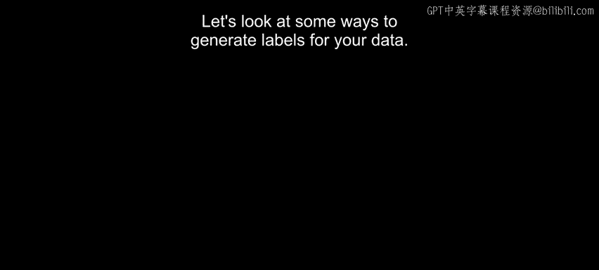
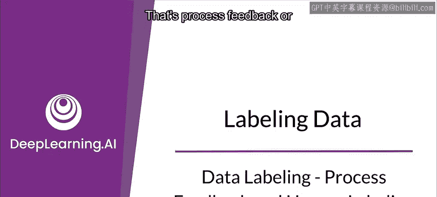
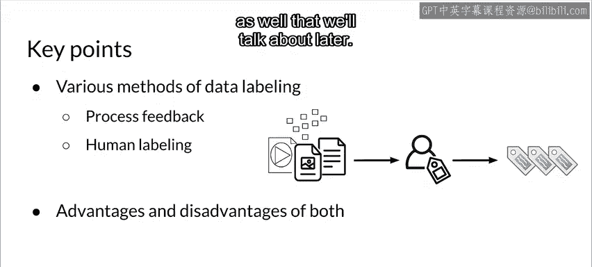

# 吴恩达《机器学习工程师的生产实践（MLOps）Machine Learning Engineering for Production》中英字幕 - P50：9_流程反馈与人工标注.zh_en - GPT中英字幕课程资源 - BV1pi4y167g5

Now let's look at some ways to generate labels for your data。

 and we're going to focus on two different methods， two of the most common methods。

That's process feedback or direct labeling and human labeling。

So there's a variety of methods， process feedback or direct labeling is great and we'll talk about that and human labeling as well as a very common method that's applied to create labels。

But you should also be aware and we'll talk about later some other more advanced methods。

 semiupervised labeling， where we label part of our data。

 active learning where we really try to focus in on the part that is most important。

 and weak supervision which is a programmatic way of creating labels。

 but we won't be talking about that in this module， we'll really focus on the first two。

 which are the most common。Processed feedback or direct labeling and human labeling。 Well。

 you need labels。 if you're going to do supervised learning， you need labels for your data。

 So two simple ways of doing that are process feedback and human labeling。But what does that mean。

 Well， let's look at it some examples。For process feedback。

 a very typical example is clickthrough rates， so actual versus predicted clickthrough， suppose。

Suppose you have recommendations that you're giving to a user。

 did they actually click on the things that you recommended， if they did， you can label it positive。

 if they didn't， you can label it negative。And human labeling。

 you can have humans look at data and apply labels to them。 so for example。

 you can ask cardiologists to look at MRI images and apply labels to them。

So why is labeling important in production amount， well。

 most businesses and organizations have a bunch of data， but if it's not labeled。

 you can't use it for supervised learning。And if you can apply unsupervised techniques and get good results。

 that's great， but in many cases you really need supervised learning to solve the problems that you're trying to solve。

What that means is that in most domains， you're going to need to retrain at some point and it will depend as we've talked about on the domain that you're working in and the type of problem。

 some you will just need to retrain on a very infrequent basis。

And some you might need to retrain several times per day。

So labeling is an ongoing and often critical process in your application and your business。

 but at the end of the day， creating a labeled training data set for supervised learning requires labels so you need to think about how you're going to do that。

Direct labeling， which we'll talk about first or process feedback。

Is a way of continuously creating new training data that you're going to use to retrain your model。

So you're taking the features themselves from the inference requests that your model is getting。

 the predictions that your model is being asked to make and the features that are provided for that。

And then you get labels for those features for those inference requests by monitoring systems and using the feedback from those systems to label that data。

One of the things that you need to solve there is to join the results that you get from monitoring those systems with the original inference requests。

 which could be hours or days apart you might have run batches you on Monday and you're getting feedback on Friday。

 so you need to make sure that you can do those joins to apply those labels。

In some ways you can think about this as similar to reinforcement learning where instead of applying rewards based on action。

 you're applying labels based on a prediction， it's kind of a similar sort of feedback loop。

So the advantage is well， processed feedback or direct labeling is great and if you can do it。

 you know if your system and your domain is set up in a way that you can do that。

 it's often the best answer because you know you have labels。

 you're monitoring constantly getting new training data。

 the signals that you get from your labels are really strong you're getting like for clickthroughs。

 you know if the user clicked or didn't click， it's a very strong signal。Disadvantages， well。

 unfortunately， in many domains， for many kinds of problems， it just isn't possible。Personally。

 I've in the problems I've been asked to solve， I found very few where I've been able to do that。

 so that's that's an issue。The other other big thing is that it tends to be very custom design。

 your systems will be unique， your problem is unique， and you're doing custom design。

 which isnt you know the end of the world but it'd be great if it was a little bit more off the shelf。

So one of the tools that you can apply is log analysis tools because often when you're doing process feedback。

 the data is coming from logs， they're log files， so you're monitoring systems and populating log files。

So one good open source tool for doing that is log staash you can ingest from multiple sources for collecting and parsing and storing logs。

 you can index them in elasticasticse， you can push them to storage it takes inputs from a variety of different sources and databases and so forth。

 great great tool at its open source too Fluent D is another good open source tool as you can use to collect and parse and Flu D comes from the cloud native computing foundation and it connects to a lot of different platforms so again another great tool。

When you're working on the cloud， there's cloud tools that are available as well。

 so if you're working on the Google Cloud， Google Cloud logging is a great tool to be able to log your data either coming from Google Cloud or from AWS。

And Bineplane is used it's great for you know applying onpreise or hybrid cloud systems。

 it's a very powerful service that's available for AWS their version of elasticastic search is available so you can apply that it's not really strictly a log analytics tool but you can apply it for log analytics and for Azure you have Azure Monit so you know regardless of which cloud you're working on there's probably log analytics tooling that you can use to do log analysis So now let's turn to human labeling。

In human labeling， you have people， humans。And we refer to those as raers。

And we ask them to examine data and assign labels to it。 sounds simple。

 sounds like it might be painful， but it's the way that a lot of data is generated and labeled。

So you start with raw data and you give it to people and you ask them to apply labels to it。

And that's the way that you create a training data set that you're going to use to train or retrain your model。

So you started with unlabeled data。And then you need to recruit human Raers， or you can go。

 There' are several services that you can go to where they have pools of human Raers that have already been recruited。

 You need to provide them with instructions， even if it's very simple。

 you need to still tell them what labels they should apply and what to look for to decide which label to apply。

 The data is then divided among different Raers in the pool。

 and often you send the same examples to multiple Raers so that when there's disagreements。

 you're aware of that and you can work to resolve them。

So then you collect the data and any of those conflicts that you have are resolved。

So advantages to human labeling， well， get labels which you know， it's what you're trying to do。

 you're trying to generate labels which you need for supervised learning。

 so that's you know it's a way to do that and it's actually a very common way to do that。

One disadvantage， one issue here is that， you know depending on the data that you have。

 it can be very complex for a human to look at it and decide what the label should be。

 so something like this we might need you know a radiologist to look at this and tell us what the right label should be。

 which can be very expensive。But if you're also talking about situations where you have high dimensional data。

 it's very difficult for humans to look at， say，10 different features and decide what the label is。

So there are some disadvantages to human labeling you can have quality problems where different humans disagree on what the label should be。

 it can be very slow， you're asking people to look at each individual example and it can take a while to do that so in cases where the data is changing quickly it is often just simply not feasible。

And again， it can be very expensive， even if you're using you know generalists to look at very simple data。

 you're still employing people， but in cases where you're asking experts。To look at data。

 then it gets very expensive。 So often what that means is that you end up with small data sets because the cost。

And the time involved results in difficult to get a very large data set。So it can be slow。

 it can be difficult， it can be expensive。If you're doing something like an MRI and you've got a specialist looking at it again。

 a problem。A single rateer can only do a certain number of examples per day。

 so you need to have a fairly large pool compared to the number of examples that you're trying to label。

And that means that recruitment can be slow and expensive。So unfortunately。

 there are several disadvantages。So key points here。

 there's various methods of doing labeling and you really need to think about the problem that you're trying to solve。

 the data that you have and how frequently you need retraining data and how much data you need and the costs involved。

There are advantages and disadvantages to both process feedback in human labeling。

 and there's other techniques as well that we'll talk about later。

