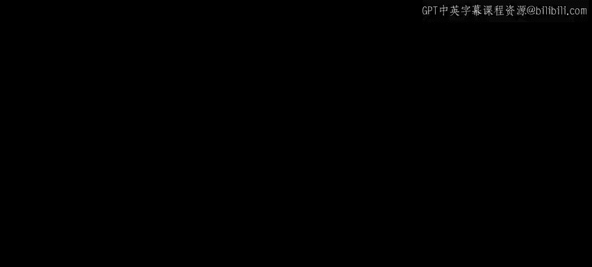
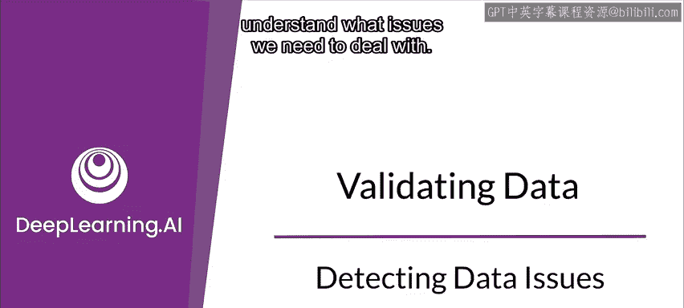
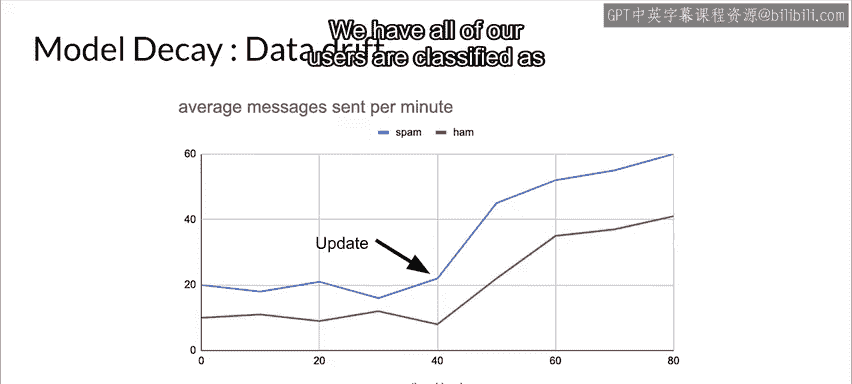
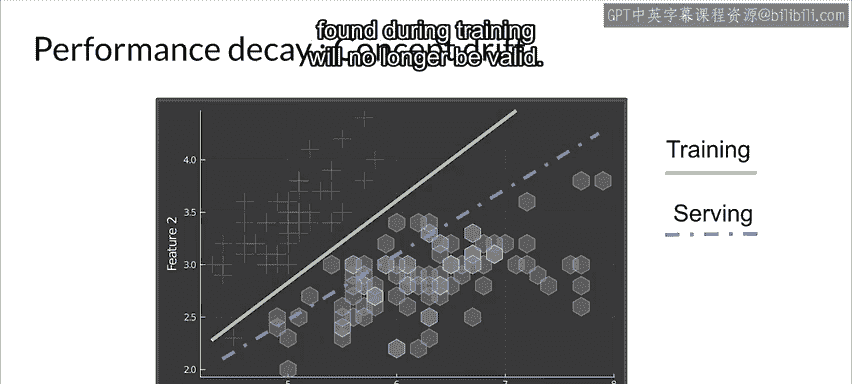
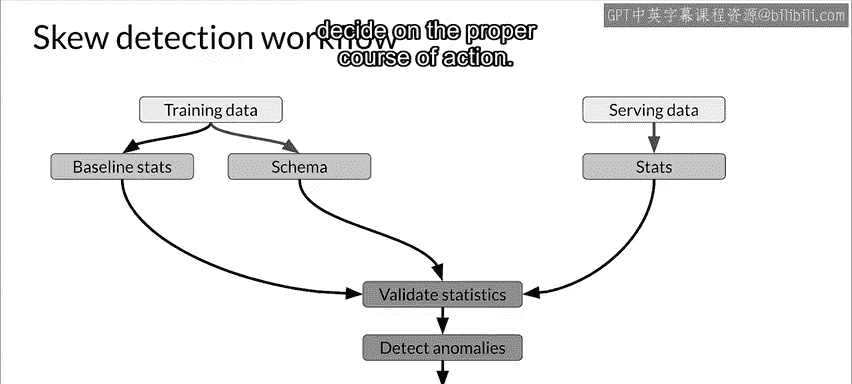

# 吴恩达《机器学习工程师的生产实践（MLOps）Machine Learning Engineering for Production》中英字幕 - P51：10_检测数据问题.zh_en - GPT中英字幕课程资源 - BV1pi4y167g5

Hello and welcome back。You've probably heard the phrase garbage in garbage out。 Well。

 that's very true for production M。 you could have a lot of data， but if your data isn't good， well。

 it's not good for M L either。 but how do you know， how do you know your data is good or isn't good。

Let's find out right now。Now let's look at validating data and detecting data issues and really look at trying to understand what kinds of issues we need to deal with。

We need to detect data issues and we often talk about drift and skew。

 so we're going to be discussing data and concept drift and schema skew and distribution skew and how to go about conceptually detecting data issues。

First of all，'s， let's get some definitions out of the way， Dr and skew。

So drift is changes in data over time， so， for example， data collected once a day， over time。

 maybe a week later， a month later， there are changes the data has drifted。

Skew is the difference between two static versions。

From different sources of conceptually the same data set。

 so for example it could be the difference between your training set。

And the data that you're getting for a prediction request， your serving set。

Those differences are referred to as Skew。So in a typical ML pipeline you will have。

 and this shows batch processing， but it could also be online processing。

 you'll have different sources of data that are conceptually the same and they have the same feature vector。

 but over time they will change。So that means that model performance can either drop quickly due to things like system failure or can decay over time due to changes in the data and things like changes in the world。

We're going to focus on performance decay over time。

That arises due to issues between training and serving data。

And there's really two main reasons for that， there's data drift which are changes in the data between training and serving typically and concept drift。

 which are changes in the world really。So to understand model decay。

 over time an MO model will start to perform poorly in many cases。

And we refer to this as model decay， and that's usually or often caused by drift。

 which is changes in a really， you know conceptual way there is changes in the statistical properties of the features。

So it's sometimes due to things like seasonality or trend or unexpected events or just changes in the world。

 so this example here， we're looking at an app that during training the app was classified or the app classified as a spammer any user who was sending 20 or more messages per minute。

We referred to anybody like that as or we classifiedify anybody like that as a spammer。

But after a system update， which you see is labeled on the chart there。

 both spammers and non spammers start to send more messages。So in this case， the data。

 the world has changed and that causes unwanted misclassification。

 and we have all of our users classified as spammers which they probably won't like。

Concept drift。Is a change in the statistical properties of the labels over time。So at training。

 an ML model learns a mapping between the features and the labels and an a static world that's fine。

 it won't change， but in the real world labels distribution，And the label's meaning will change。

 and the model needs to change as well as the mapping found during training will no longer be valid。

So as you've previously seen， there are many factors that cause changes over time。

 including upstream data changes and seasonality and evolving business processes。

Schema Sw occurs when the training and scheming serving data do not conform to the same schema。

 which you might think could never happen， but actually it can because you're collecting data and things change and suddenly you're getting an integer where youre expecting a float or you're getting a string where you were expecting a category。

 distribution skew is a divergence of training and serving data sets。

So the data shift can be really manifested by covariate and concept and other types of shifts。

 we'll talk about that in a second。Skeew detection involves continuous evaluation of data coming to your server once you change your model。

 so to detect these kinds of changes you need continuous monitoring and evaluation of the data。

Let's take a look at a more rigorous definition of the kinds of drift and skew that we're talking about。

So data set shift occurs when the joint probability of X， our features， and Y。

 our labels is not the same during training and serving。So the data has shifted over time。

Covariate shift。Refers to the change in distribution of the input variables present in training and serving data。

 In other words， it's where the marginal distribution of X。

 Our features is not the same during training and serving。

 but the conditional distribution remains unchanged。Concept shift。

Refers to a change in the relationship between the input and output variables as opposed to the differences in the data distribution or input itself。

In other words， it's when the conditional distribution of Y our labels， given X。

 our features is not the same during training and serving。But the marginal distribution of X。

 our features， remains unchanged。There's a straightforward workflow to detect data Skew。

The first stage is looking at training data and computing baseline statistics and a reference schema。

Then you do basically the same with your serving data。

 you're going to generate the descriptive statistics。And then you compare the two。

 so you compare your serving baseline statistics and instances。

 you check for differences between that and your training data， and you look for SU and drift。

Significant changes become anomalies， and they'll trigger an alert。

 So that alert goes to whoever is monitoring the system that could either be a human or another system to analyze the change and decide on a proper course of action。

 That's going to be the remediation of the way that you're going to fix and react to that problem。

