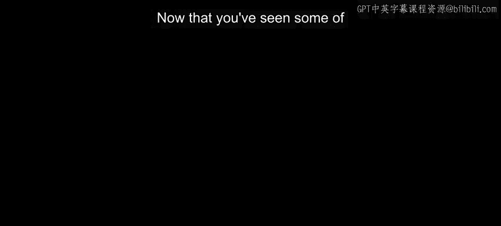
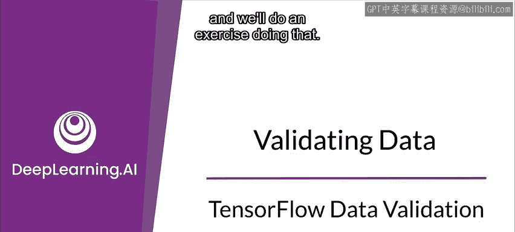
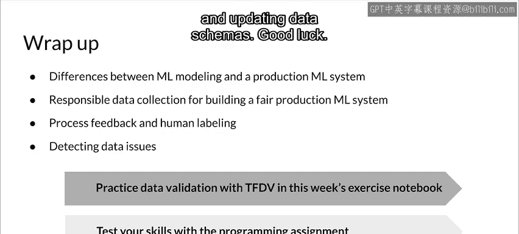

# 吴恩达《机器学习工程师的生产实践（MLOps）Machine Learning Engineering for Production》中英字幕 - P52：11_TensorFlow数据验证.zh_en - GPT中英字幕课程资源 - BV1pi4y167g5

Now that you've seen some of the data issues and detection workflows and got an idea of the importance of production scale data validation。

Let's take a look at TensorF data validation， which is a library from Google。

 it's part of the TFX ecosystem。And it'll allow you to do data validation using Python and we'll do an exercise doing that。

TensorF data validation or TFDV helps developers understand， validate。

 and monitor their ML data at scale。TFTV is used to analyze and validate petabytes of data at Google every day across hundreds or thousands of different applications that are currently in production。

And TFDV helps TFX users maintain the health of their EM pipelines。

TFDV helps generate data statistics and provides browser visualizations。

It also helps infer the schema for your data， but you will need to make sure that that schema makes sense。

It'll do an inference that is sort of best effort。Once it has the statistics and schema。

 it can look for problems or anomalies in your data。And then it will go。

 it will look at the training serving SU by comparing the data in your training and youre serving data sets。

One of the common use cases is continuously checking newly arriving data by validating it against the expectations which you have in the reference schema that you generated from your training data so that a typical setup uses the schema which is maintained over time。

 and then statistics are computed over new data and those statistics are used to validate the data against the original schema。

So remember， we talked about Skew detection and with TFDV。

 you can easily detect three different types of skew。Schema Skew， feature Skew。

 and distribution Skew。So Skew is TFTV performs skew or drift detection on categorical features。

 and a Skew is expressed in terms of an L infinity distance。

 which is also known as a chubby show distance， if you think of a chess board。

 it's the distance metric that is the maximum absolute distance in one dimension of two n dimensional points。

So you can set thresholds so that you'll receive warnings when the drift is higher than what you think is acceptable。

Schema S occurs when the serving and training data don't conform to the same schema。So for example。

 it could be a change in type， an int where you were expecting a float。

 which could be a change in the feature itself。Feature Sw are changes in the feature values between training and serving。

 so it could happen as the system uses different data sources during training and serving or things change or of course things like seasonality and trend as well。

Sometimes that's simply because you have two different code paths。

And you're trying to use you're trying to do the same transformations。

 both when you trained your model and when you're serving your model using two different sets of code or two different code paths and you're getting different results as a consequence there's ways to avoid doing that and we'll talk about that later。

Distribution Skew is changes in the distribution of individual features in the data so a feature that's in training might have a range of0 to 100 when you're training it and then at serving time you're seeing data between5 and 600。

 so that would be a change in the distribution for that feature。

You can also have things like you know， changes in the mean or the median or the standard deviation changes。

 all of those are changes in distribution。Depending on how severe it is。

 it may or may not be a problem。 The question is， does it affect your model performance enough that you need to make changes to try to account for it？

So TFTV provides you with descriptive statistics at scale。

 remember we could be working with petabytes of data。

And it provides some visualizations as well to help you you know monitor and really understand that data。

 so trying to understand the underlying statistics for your data and do comparisons。

 how does your training and evaluation and serving data sets compare just in terms of statistics。

 for example， do they have the same mean。And how can you calculate and fix or detect rather and fix data anomalies？

So we did a lot here just to wrap up， this week you saw differences between ML modeling in academic or research environments and production ML systems。

And we discussed responsible data collection and how to really approach building a fair production ML system。

We learned about process feedback and direct labeling and also human labeling。

And we looked at some of the issues that you can have with data and how to identify and detect those issues。

So now we're going to be practicing data validation with TFDV TensorFlow data validation in this week's exercise notebook。

 you'll be testing your skills with the programming assignment by generating data set statistics and creating and comparing and updating data schemas。

Good luck。